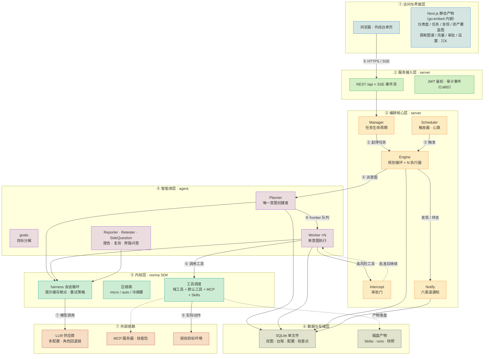
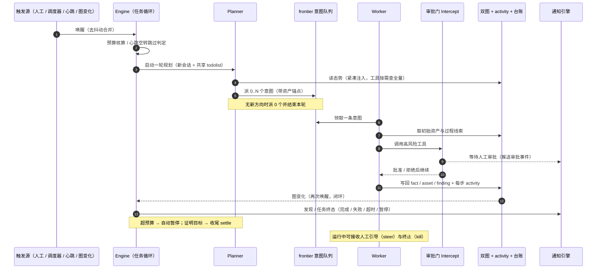
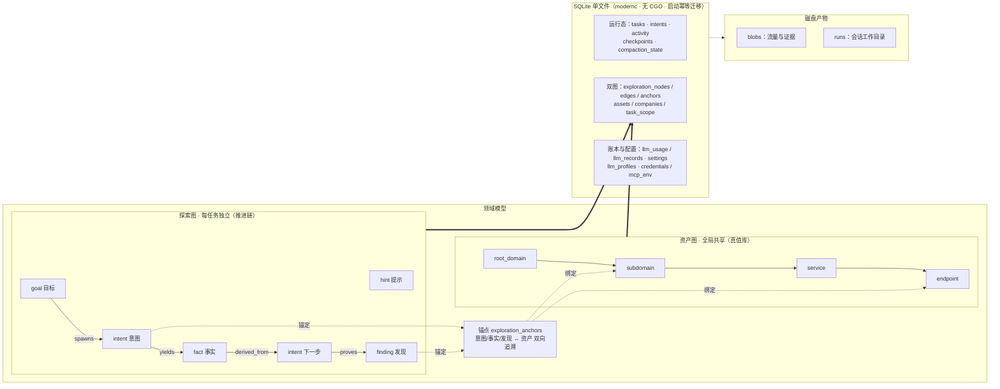
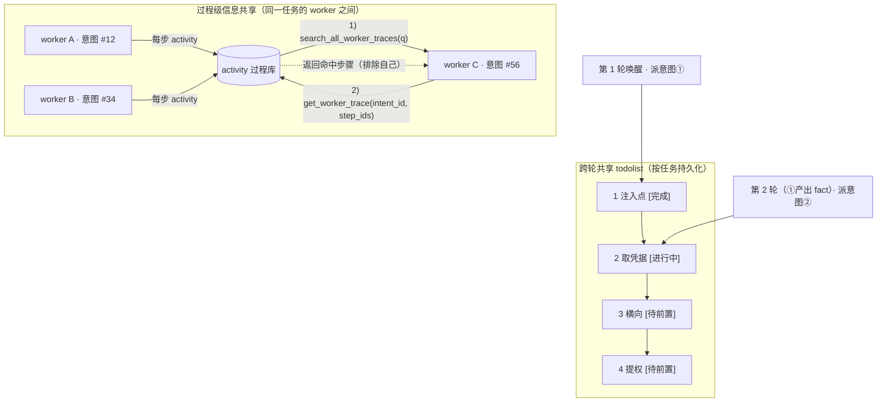
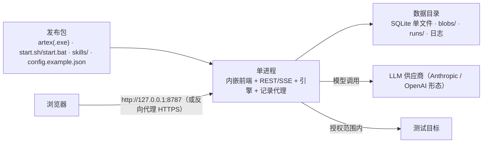

<div align="center">

# ARTEX-HYDRA 简体中文版

**由 LLM 多 Agent 自主执行渗透测试与自适应编排的系统**（Go 后端 + Next.js 前端）

界面、报告、摘要、对话及后端消息**统一使用简体中文**，本仓库不再提供其他语言界面。界面语言属于浏览器本地偏好；报告、摘要、对话与后端消息的输出语言由服务端设置管理，固定为简体中文。历史遗留的其他语言配置一律回退为简体中文。


[](https://github.com/j5tv9nfzhn-hue/ARTEX/actions/workflows/release.yml) [](https://github.com/j5tv9nfzhn-hue/ARTEX/actions/workflows/detections.yml) [](LICENSE)

</div>

---

> ## 🚨 安全与滥用警告：请先阅读
>
> **仅允许在自有或明确授权的环境中，以学习、防御和检测为目的使用。**
>
> ARTEX 可自主组织侦察、工具执行和多阶段测试，滥用可能造成严重损害。
>
> ### 关于本项目的来源与真实事件
>
> - **国内原作者：** ARTEX 由国内开发者 **Autumn-27** 创建并开源（[Autumn-27/ARTEX](https://github.com/Autumn-27/ARTEX)），Agent 能力依赖其 **[Autumn-27/norma](https://github.com/Autumn-27/norma)** SDK。本仓库是该项目的韩语本地化分支 `jiwoochris/artex-ko` 的简体中文分支。
> - **已发生的真实滥用事件：** 2026 年 10 月，韩国多家媒体（经由本项目韩语分支的安全告知记录）报道称，ARTEX 被用于针对韩国境内金融机构的个人信息窃取攻击，涉嫌相关材料已被调查机关获取，相关刑事调查在进行中。该事件是本项目被滥用的公开记录，**本仓库仅转述并保留该记录，不代表对其细节的独立核实**。同一时期亦有面向其他地区金融机构的类似指控报道。保留这段记录的唯一目的，是让防御方理解自主 AI 攻击的真实后果，并据此建立检测与阻断能力。
> - **本仓库的立场：** 本仓库不提供任何攻击方法、目标清单或利用建议，只保留技术说明、防御指南与检测规则。任何以本仓库内容为依据对未授权目标实施扫描、探测或利用的行为，由行为人自行承担全部法律责任。
>
> - **未经授权的使用可能构成犯罪。** 没有所有权或明确书面授权，不得对任何系统扫描、探测或利用漏洞。在中华人民共和国大陆地区，未经授权侵入、非法控制计算机信息系统，可能触犯《刑法》第二百八十五条、第二百八十六条；同时涉及《网络安全法》《数据安全法》《个人信息保护法》。跨境使用还需遵守行为地与数据主体所在地的法律。
> - **不要将他人的真实服务作为实验目标。** 请使用自有、本地隔离的 OWASP Juice Shop、DVWA 等有意设计的测试环境；真实目标必须事先取得书面许可，并约定范围、时间窗口与数据处理方式。
> - **从防御视角阅读。** 本仓库提供[自主 AI 防御与检测指南](docs/defense.md)、指标、规则与加固清单。
>
> 若不同意下方[使用限制与免责声明](#许可证与免责声明)，请勿下载或使用。

ARTEX 最初由国内开发者 Autumn-27 创建并以 AGPL-3.0 开源；`jiwoochris/artex-ko` 是其韩语本地化分支；**本仓库是该韩语分支的简体中文分支**。上游在 2026-10 记录为无法公开访问，链接保留用于来源归属，不保证远端当前可用。

系统将目标分解为意图，执行真实工具，将资产与发现写入图结构。Next.js 静态前端可内嵌到 Go 单二进制，数据存储于 SQLite（单文件，无需数据库服务）。

## 使用范围与法律告知

**仅对自有或获得明确书面授权的目标使用。** 超出授权范围的扫描、探测、利用可能违法。

- 中华人民共和国大陆地区：《刑法》第二百八十五条（非法侵入计算机信息系统罪）、第二百八十六条（破坏计算机信息系统罪）；《网络安全法》第二十一条；《数据安全法》；《个人信息保护法》。非法获取、买卖、提供公民个人信息还可能触犯《刑法》第二百五十三条之一。
- 测试中收集、暴露的个人信息受《个人信息保护法》约束，遵循最小必要原则。即使已获测试许可，也应谨慎处理访问、保存、删除与销毁。
- 跨境测试还需同时满足行为地、数据主体所在地及数据出境的相关合规要求。
- 使用目的应为学习、研究与隔离实验。对真实系统操作前，取得书面许可，并约定目标、方法、时间窗口与数据处置方式。

详见[许可证与免责声明](#许可证与免责声明)。使用本工具即表示已阅读并接受相关条件。

## 分支沿革与简体中文重构

### 分支沿革

```
Autumn-27/ARTEX（国内原作者，中文原创）
        └─ jiwoochris/artex-ko（韩语本地化分支）
                └─ j5tv9nfzhn-hue/ARTEX（本仓库 · 简体中文分支）
```

本仓库 **fork 自韩语分支** `jiwoochris/artex-ko`，并在其基础上完成中文重构：移除全部韩文内容，界面与产物统一为简体中文。

### 重构说明

本分支将项目自有的韩文文案、注释、提示和说明统一为简体中文，而非只替换少量页面或设置默认 locale。

- **中文唯一：** 界面、报告、事实摘要、最终报告、对话、系统消息与后端日志文案均为简体中文；界面不再提供语言选择器，英文与西班牙语词库一并移除。
- **技术语义保留：** 保留内部推理提示词的角色、判断与工具行为；原有中文行为正文不作无关改写。
- **协议不变：** API/JSON 字段、工具名、枚举、SQL、命令、payload、URL、原始日志及用户证据不因翻译改变。
- **语言回退：** 历史遗留的其他语言代码（`ko`/`en`/`es`）与未知值统一回退为简体中文，不再产生韩文或外语产物。
- **防回归：** 源码文本、词库、脚本、文档及静态 UI 通过残留语言检查；格式占位符、错误码与审批解析有回归测试。

详细边界见[贡献指南](CONTRIBUTING.md#本地化原则)，上游同步见[维护手册](MAINTAINING.md)。

## ARTEX 60 秒动态展示

<p align="center">
  <a href="showreel/ARTEX-Showreel-60s.mp4">
    
  </a><br>
  <a href="showreel/ARTEX-Showreel-60s.mp4">查看 / 下载完整 60 秒 MP4</a> ·
  <a href="showreel/README.md">交互播放器、内容简介与制作说明</a>
</p>

这是一支 60 秒、1920 × 1080、60 fps 的无缝循环动态设计短片：一条分析线从纸面铅笔线演化为蓝图几何，再成为黑色全息空间中的光束，串起 ARTEX 的授权安全测试流程。影片含 120 BPM 原创配乐与自动同步音效；交互式播放器、完整分镜和可复现导出步骤见 [`showreel/`](showreel/)。

> **Artex modified open-source reel, full motion graphic + original score included.**
>
> It coded every frame (HyperFrames + GSAP), wrote the background music in Python and synced all sound effects automatically.
>
> The audit panel and visualization art in “Creating” scene is real generated output: Artex exported assessment logs rendered inside DaVinci Resolve on the same day.
>
> Details ⤵️

## 快速开始（三端二进制）

本项目构建并发布 **Linux / macOS / Windows** 三端 Go 单二进制（amd64 与 arm64），不发布 Docker 镜像。

### 方式一：下载发布包

到 [Releases](https://github.com/j5tv9nfzhn-hue/ARTEX/releases) 下载对应平台的 `artex-rea-<版本>-<平台>-<架构>.zip`（`linux` / `darwin` / `windows`），解压后得到：

- `artex-rea` / `artex-rea.exe` —— 程序本体（前端已内嵌）
- `start.bat`（Windows）/ `start.sh`（Linux、macOS）—— 启动脚本（前台启动；Ctrl-C 直接退出。一键更新的重启由 exe 自己负责，见下文「启动与一键更新」）
- `skills/`、`config.example.json`、`README.md`

以下启动示例以 Windows 为例（Linux/macOS 为 `artex-rea` 本体与 `start.sh`）：

```bat
copy config.example.json config.json   & rem 可选：指定数据库文件位置，留空自动创建 artex.db
start.bat                              & rem → http://localhost:8787
```

首次访问 `http://localhost:8787/setup` 初始化管理员密码；设置令牌打印在启动日志中。

### 方式二：源码构建

前置依赖：Go 1.26（以 `go.mod` 为准）、Node.js 22 LTS。

```bat
cd web && npm ci && npm run build:static && cd ..
rm -rf server/webui/dist && mkdir -p server/webui/dist
cp -a web/out/. server/webui/dist/
CGO_ENABLED=0 go build -tags embedui -o artex-rea.exe ./cmd/artex
copy config.example.json config.json
start.bat
```

或直接使用打包脚本（自动完成前端构建、内嵌与 zip 打包）：

```bash
./build.sh --release          # 三端（Linux/macOS/Windows）amd64/arm64，产出 dist/artex-rea-<版本>-<os>-<arch>.zip
```

- `npm ci` 需要 devDependencies，例如 `@tailwindcss/postcss`。若环境为 `NODE_ENV=production`，使用 `npm ci --include=dev`，避免构建时缺包。
- 直接双击 `artex-rea.exe` 也能用：一键更新/回滚的重启由 exe 自己完成。`start.bat` 仍是推荐入口——它把控制台切成 UTF-8、二进制缺失时给出明确提示，并保证 Ctrl-C 直接终止（不弹 `Terminate batch job (Y/N)?`）。
- 数据库文件位置通过 `config.json` 的 `database.path` 或环境变量 `ARTEX_SQLITE_PATH` 配置（留空则在配置文件旁自动创建 `artex.db`），见下节。

## 配置

数据库只有 SQLite：一个数据库文件，无需安装、无需服务。可在 `config.json` 中指定位置，`ARTEX_SQLITE_PATH` 优先：

```json
{
  "database": { "path": "" },
  "language": "zh"
}
```

`database.path` 留空时，首次启动会在 `config.json` 旁自动创建 `artex.db`；完整注释与示例见 [config.example.json](config.example.json)。

LLM 可在环境变量或“LLM 设置”页面配置，相关环境变量包括 `ANTHROPIC_API_KEY`、`OPENAI_API_KEY`、`ARTEX_LLM_PROVIDER`、`ARTEX_LLM_MODEL`、`ARTEX_LLM_BASE_URL`、`ARTEX_LLM_PROXY`。OpenAI 兼容供应商可使用自己的 Base URL。

成本与效率相关的运行设置（新建任务默认 Token 预算 `default_task_token_budget`、模型价目表 `price_table`、LLM 重试策略 `llm_retry_policy`）在「系统配置」页填写，说明与默认值见[成本与上下文](#成本上下文与重试)。

每个任务的 Worker 并发数在系统设置中配置，默认 3。`-addr` 控制 Web/API 地址，`-proxy` 控制流量记录代理，例如 `./start.sh -addr :8787 -proxy :8788`；默认 Web/API 仅绑定 `127.0.0.1:8787`。

输出语言固定为**简体中文**。服务端配置的优先级为 **`ARTEX_LANG` > `config.json.language` > `zh`**，数据库中的运行时输出语言设置在服务启动后优先。控制台日志使用环境/文件默认语言，浏览器界面语言通过本地 cookie/localStorage 保存，两者不是同一个配置，但取值一致。

### 模型选择与输出语言

输出语言依赖 `agent/prompt.go` 的 `langDirective()` 提示约束，而不是对模型回复作字符级硬过滤。命令、代码、工具名与原始证据不应被翻译。

- 选择能力合适的模型，结构化字段、短摘要仍可能受角色和上下文影响而混入英文。可在任务中明确要求用简体中文生成自然语言内容。
- 韩语分支曾在隔离沙箱比较 `claude-opus-4-8`、`gpt-4o` 与 `gpt-4o-mini` 的输出语言表现，记录了不同角色的语言漂移。该历史比较不是当前中文输出的模型端到端验证，不能当作质量保证。
- 推理型模型可能把较小的响应预算用于内部推理，导致最终回复为空。应按模型实际要求设置足够的 `max_tokens`。
- 韩语分支记录 `gpt-4o` 的响应上限为 16,384，而兼容请求可能默认填写 32,768，从而发生 `400 (max_tokens is too large)`。遇到该错误时核对供应商和模型限制，并在 LLM profile 中设置合适上限；不要假设所有兼容模型具有相同限制。

### 首次运行保护（设置令牌与绑定地址）

管理员用户名固定为 `ARTEX-HYDRA`，首次通过 `/setup` 创建密码。

- 无密码时，启动日志打印设置令牌。`/setup` 和 `POST /api/auth/init` 的 `setup_token` 必须匹配，错误尝试限流。令牌不通过公开状态接口返回。
- 无人值守部署可设置 `ARTEX_SETUP_TOKEN` 固定令牌，或用至少八字符的 `ARTEX_ADMIN_PASSWORD` 直接初始化。
- 默认仅监听回环地址。开放到其他设备前先完成初始化，并优先部署 HTTPS；非回环且未初始化时会有启动警告。
- 修改密码会使旧 JWT 会话在数秒内失效。若恢复泄露的管理员账户，还需检查自定义工具、MCP、LLM 与通知配置。
- 忘记管理员密码时，可在本机运行仓库根目录的 `reset-password.sh`：脚本定位 `artex-rea`/`artex-rea.exe`（或回退 `go run ./cmd/artex`）调用 `-reset-password` 重写密码哈希，无需数据库服务与 psql；也可直接运行 `artex-rea -reset-password`。
- CORS 允许列表为 `ARTEX_CORS_ORIGINS`，以逗号分隔；内嵌 UI 同源通常无需填写，开发默认允许 `http://localhost:5173`。

### 反向代理部署（HTTPS / 只开放 443）

Web、API、SSE 共用后端端口。生产环境可只公开 443，将 8787 留在内部；同源 SSE 通常无需设置 `NEXT_PUBLIC_SSE_BASE`。

**必须关闭 SSE 代理缓冲**，否则浏览器连接成功但活动流持续等待。Nginx 示例见[反向代理部署](#反向代理部署https--只开放-443)。

## 系统架构

系统 = **Go 单二进制后端（内嵌 Next.js 静态前端）+ SQLite 单文件 + [norma SDK](https://github.com/Autumn-27/norma) 多智能体内核**。关键设计：**双图数据底座**（探索图 + 资产图，经锚点互连）、**事件驱动闭环**（图变化唤醒 Planner）与**成本与可靠性控制面**（缓存 / 预算 / 通知 / 记账）。以下用六个视角完整展开，可直接按序阅读。

### ① 全景架构：一图纵览（六层 + 外部依赖）



| 层 | 职责 | 代码入口 |
| --- | --- | --- |
| **界面** | 作战台单页 + 7 套主题预设 + ⌘K 命令面板 | `web/src/app/`、`web/src/styles/presets/` |
| **接入** | REST + SSE + JWT；审计事件以 `CallID` 贯穿 | `server/server.go` |
| **编排** | 任务生命周期、规划循环、触发器/心跳、审批门、通知引擎 | `server/manager.go`、`server/engine.go`、`server/scheduler.go` |
| **智能体** | 目标分解、意图规划（唯一创建者）、执行器、报告/复测/旁路问答 | `agent/planner.go`、`agent/worker.go`、`server/orchestration.go` |
| **内核** | 会话循环、提示缓存、上下文压缩、工具调度；MCP 与技能接入 | norma SDK（`agent/assembly.go` 接线） |
| **数据** | 双图、台账、配置、检查点；SQLite 单文件（modernc 纯 Go 驱动，无 CGO） | `db/schema_sqlite.sql`、`db/` |
| **观测与出口** | Token 台账与计价、进度指标、审计指标、六渠道通知 | `llmrec/`、`server/pricing.go`、`metrics/`、`notify/` |

支持子系统作为横切能力接入以上各层：记录型 MITM 流量代理与 DNS/HTTP 富化、证据存储（blobs）、工具审批门（guard / intercept）、通知路由（Markdown · HTML · Telegram · 飞书 · 钉钉 · Webhook）、检查点/回滚，以及内核侧的技能（Skills）、MCP 与记忆/报告能力。

### ② 任务运行闭环：从触发到收尾

引擎是事件驱动的闭环：图一变就唤醒 Planner，Planner 派意图，Worker 领意图执行并写回，写回又触发下一轮——直到目标被证明（`prove_goal`）。预算闸、审批门与收尾通知都挂在这条闭环上。



### ③ 数据底座：双图 + 存储拓扑

“目标是什么”和“测到了什么程度”分别存储，经**锚点**双向追溯。Planner 只读态势、只在有未覆盖方向时派意图；Worker 只领一条意图、把新资产/事实/发现写回两图后结束。



锚点机制同时支撑**资产测试覆盖度**与**资产覆盖图**（范围内资产 + 已测高亮）。

### ④ 协作机制：过程共享 + 跨轮 todolist

两条自主性机制让多 Worker、跨轮次的探索保持连贯：

- **过程级信息共享**：有价值的观察未必写成正式 fact。`search_all_worker_traces(q)` / `list_worker_traces` / `get_worker_trace(intent_id, step_ids)` 让 Worker 能检索同任务其他意图的执行过程（自动排除自己），信息以“执行过程”为粒度流动，边界不变。
- **跨轮共享 todolist**：串行利用链（发现注入点 → 取凭据 → 横向 → 提权）存在前置依赖，不能一次并行派发。todolist 按任务持久化，每轮只对“前置已完成、依赖 fact 已存在”的下一步派意图，并随进展更新状态——事件驱动 + 无状态会话下依然稳定推进、不重复、不错序。



### ⑤ 成本与可靠性控制面

每一层都刻意收敛“重复计费”的可能性：输入侧瘦身、过程侧守门、统一观测与出口。

```mermaid
flowchart LR
  subgraph IN["输入侧瘦身（每轮重复计费部分）"]
    direction TB
    C1["提示缓存断点<br/>system 整段 ephemeral 缓存"]
    C2["工具输出上限 12k 字符<br/>超限落盘 + 指针"]
    C3["注入瘦身<br/>planner ≤16KB · worker ≤12KB<br/>资产 30 条紧凑视图"]
    C4["心跳空转跳过<br/>有在跑意图且无新变动不启轮"]
  end
  subgraph RUN["过程侧守门"]
    direction TB
    R1["意图重试 ≤4 次<br/>指数退避 3→24s · 硬失败 2 次"]
    R2["触发器间隔 ≥60s"]
    R3["任务 Token 预算闸<br/>每轮收尾核算 → 超限自动暂停"]
    R4["上下文压缩<br/>micro / auto / 冷摘要 800tok"]
  end
  subgraph OBSV["观测与出口"]
    direction TB
    O1["Token 台账 + 价格表<br/>按任务 / 模型 / 角色计价"]
    O2["进度指标<br/>首发现耗时 · 产出速率 · 等待审批"]
    O3["通知六渠道<br/>发现 / 任务终态 / 等待审批"]
    O4["审计与指标<br/>AuditEntry.CallID · /api/metrics"]
  end
  IN --> RUN --> OBSV
```



对应落点：提示缓存 `agent/deferred.go`；预算闸 `server/engine.go` + `tasks.token_budget`；计价 `server/pricing.go`（设置 `price_table`）；通知 `notify/`；配置项与完整清单见[成本与上下文](#成本上下文与重试)。

### ⑥ 单二进制部署与交付



发布产物、编译标志与运行时文件落点详见[构建与产物](#构建与产物)。

## 防御与检测资料

- [自主 AI 防御与检测指南](docs/defense.md)：行为差异、可观察指纹、入口加固、WAF/SIEM/认证日志、响应清单及通报渠道。
- [部署用检测规则](detections/README.md)：Sigma 主机/日志规则、关联规则与 Suricata 网络规则。
- [ATT&CK 覆盖率](detections/attack/README.md)：仅来自实际规则标签，不添加推测技术。
- [CSV/MISP 指标](detections/indicators/README.md)：每项都注明来源、对应规则和局限。
- [只读主机 triage](detections/triage/README.md)：无需额外依赖，检查主机、端口、代理与数据库结构等本地线索（数据库检查仍针对上游 PostgreSQL 布局，本分支 SQLite 暂未覆盖）；结果是分类线索，不是攻击归属证明。
- [可复现检测测试](detections/tests/README.md)：规则、层、指标和 triage 自测遵循同一贡献契约。

新增规则请遵循[检测规则与测试贡献契约](CONTRIBUTING.md#检测规则与测试贡献)，不得将泛化行为误称 ARTEX 专属指纹。

## 工程手册

> **2026-10-23 文档收口**：原 `docs/` 下 40 篇报告／方案／诊断／记录已合并进本节，原文只保留在 git 历史里（删除前基线 `bda8829`，可用 `git show bda8829:docs/<文件名>` 取回）。
>
> 唯一保留的独立文档是 [`docs/defense.md`](docs/defense.md)：`detections/tests/check-defense-template.sh` 会把它挂进容器，校验其中的内联 Sigma 模板（check、后端转换矩阵、双语规则主体一致），它是**检测门禁的输入文件**，不是报告，因此不并入本 README。

### 开发与发布约定（长期生效 · 最高优先级）

本节优先级高于 `CONTRIBUTING.md` 与 `MAINTAINING.md` 的通用开发说明；冲突时以本节为准。修改本节应与修改 `release.yml` 同等审慎，并在同一个提交内同步。

约定分两类，不要混用：**第 1～6 条**约束「AI 助手 / MCP 客户端在本机工作副本上作业」的行为；**第 7～9 条**（门禁分层、代理、发布）是仓库级约定，对任何执行 `git push`、打 tag 的人与自动化都成立。人类开发者在其他机器上正常开发，仍按 `CONTRIBUTING.md` 的「开发环境」执行本地构建与测试，不受第 2 条限制。

#### 1. 源码唯一位置

项目源码只存在于工作副本 `C:\Users\Administrator\Desktop\ARTEX-HYDRA`（及其远端 `j5tv9nfzhn-hue/ARTEX`）。所有改动直接落在该目录，不另建副本、不在别处「另起一份工程」。

#### 2. 本机不做任何测试 / 编译 / 构建 / 打包

在本机（含通过 MCP shell 间接调用、含写 `.bat` / `.ps1` / `.cmd` 去跑、含用 `docker run` 跑等价命令）：

**禁止**

```text
go build / go vet / go test / go run / gofmt / golangci-lint
npm ci|install|test|run build|run build:static、npx tsc、npx biome、next build
build.sh、dev.sh、任何打包 / 压缩 / 出 zip 的脚本
```

**允许**

```text
读文件、写文件（源码 / 配置 / 脚本 / 文档）、列目录
git status / diff / log / show / ls-files 等只读查看
git add / commit / push / tag（按第 5、6 条的网络与时机规则）
gh 只读查询（run list / release list / api GET）
```

理由：本机是用户的生产机，跑构建会污染工作树、占用 CPU 与磁盘，且与云端环境不一致；云端 Actions 才是唯一的权威构建环境，本机的「跑一下看看」既慢又不能证明发版可用。

**替代手段**：写完回读文件，静态核对 import / 符号名 / 类型签名 / 调用点参数 / 结构体字段 / i18n 键是否存在。宁可写得保守，也不在用户机器上跑命令兜底。

#### 3. 验证由云端承担

| 工作流 | 职责 |
|---|---|
| `.github/workflows/release.yml` | **唯一的构建流水线**：gate（编译/静态）→ frontend → binaries（6 目标）→ release；`workflow_dispatch` 可干跑不发布 |
| `.github/workflows/detections.yml` | 检测规则与指标回归（`push` 时忽略 `v*` tag） |
| `.github/workflows/verification-helper.yml` | 手动触发，单独模块 |

本机的结论只能是「静态看是对的」，不能是「跑通了」。

#### 4. 用静态自检替代编译

提交前逐项核对：

1. 新用的符号是否真实存在（`grep` 定义处，不凭记忆）。
2. 函数签名 / 返回类型 / 错误处理是否与调用点一致。
3. 结构体字段名、JSON tag 是否与前端类型、golden 文件一致。
4. 新增的 `import` 是否齐全，删除代码后是否留下未使用的 import。
5. 新增界面文案是否同时写进 `web/messages/zh.json`，键名一致。
6. 改了 `capability` 相关能力项时，同步 `mcp_tools.golden.json` 与计数断言。

#### 5. 网络：访问 GitHub 必须走本地代理 7897

裸直连会稳定超时（约 20 秒后 `Failed to connect to github.com:443`），而 `gh api` 走另一条链路可能仍然可用——**不要**因此误判为「仓库坏了」。

```bat
:: git（按次传参，不写全局 config）
git -c http.proxy=http://127.0.0.1:7897 -c https.proxy=http://127.0.0.1:7897 push origin main
git -c http.proxy=http://127.0.0.1:7897 -c https.proxy=http://127.0.0.1:7897 ls-remote origin refs/heads/main

:: gh
set HTTPS_PROXY=http://127.0.0.1:7897&& set HTTP_PROXY=http://127.0.0.1:7897&& gh run list --limit 6
```

故障处理顺序：

1. 先探测：`curl -x http://127.0.0.1:7897 -sS -o /dev/null -w "%{http_code}" https://github.com`，得 `200` 再 push。
2. 单次 20 秒无响应即判不可达；最多重试 2 次（合计 3 次）。
3. 3 次仍失败 → **停止并如实报告**。不裸直连硬刷、不无限重试、不改端口乱试。
4. **禁止**用 `gh api POST /git/refs` 绕过 push：commit 不在远端时必然 `422 Object does not exist`，还会让远端出现悬空引用。

#### 6. 推送 / 打 tag / CI：发起即返回

- 不阻塞等待、不轮询日志、不盯 Actions 进度、不为「确认成功」反复查询。
- 唯一必须串行的动作：**tag 必须在新 commit 已到远端之后创建**。因此允许 `push → ls-remote 校验 → push tag` 一次性完成，校验通过立即结束。
- 失败信息由用户转述，或按需再改源码；不靠本机复现失败。

#### 7. 门禁分层：编译失败必拦，测试失败不拦

这是本项目对 CI 的核心口径。**产物健康**与**代码健康**是两件事，不能互相绑架。

| 类别 | 判定 | 典型内容 | 失败时的行为 |
|---|---|---|---|
| **编译 / 静态检查** | 确定性 | `go build ./...`、`go vet ./...`、`go vet -tags embedui`、`gofmt`、`golangci-lint`、前端 `build:static`（含 TS 类型检查） | **硬门禁：必须拦住，不得出包** |
| **测试** | 概率性 / 环境相关 | `go test ./...`、`node --test`、`detections/tests` | **信号灯：只报告健康度，不得阻塞打包与发版** |
| **发布流程** | 确定性 | 资产缺失、zip 数量不符、sha256 不匹配、上传失败、草稿未转正 | **硬门禁：必须失败并清理，不留半成品** |

三条红线：

1. **「测试不拦」≠「什么都不拦」。** 编译类、类型类的确定性失败必须拦死；不得把这条口径当作放松门禁的理由。
2. **测试红了要显著标注**（PR / Release 说明里写清楚哪几个包红），不得静默放过；更不得为了让测试变绿而删测试或改断言。
3. **发布失败必须原子回退**：`release.yml` 的 `if: failure()` 会删除草稿、保留 tag，下一次可原地重跑。

当前落地方式：

```text
release.yml（唯一的构建流水线）
gate       tag 格式 + go build + go vet + go vet -tags embedui + gofmt + golangci-lint
frontend   npm ci → npm test / biome（信号）→ build:static（硬门禁，含类型检查）
binaries   6 目标交叉编译 + 头校验 + 打包
release    校验 6 个 zip → sha256sum → 建草稿 → 上传 → latest.json → 转正
           if: failure() → 删除草稿，保留 tag
signals    go test / 语言检查 / 文档链接（continue-on-error，只报告不拦）
```

**为什么只有一份构建**：2026-10-21 之前 `ci.yml` 与 `release.yml` 各有一套前端构建与 Go 编译，两处维护、两套缓存 key，还会出现「ci 绿了但 release 挂了」。现在合并为 `release.yml` 一份；`workflow_dispatch` 用于打 tag 前干跑（不发布）。

**为什么测试不进门禁**：测试失败不代表二进制坏掉；把测试挂在发版链路上，会让一次 flaky 测试挡住整个版本。编译与静态检查才是「产物能不能用」的必要条件。

#### 8. 版本与发布

- **每版必须发 GitHub Release**，tag 与 Release 同名（`vX.Y.Z`，或四段 `vX.Y.Z.W`），二者缺一视为该版未发布。
- **第四段用于同一 patch 的重发**：`v2.4.0` 修好后又必须换一个 tag 时用 `v2.4.0.1`，不占 patch 位；跨 patch 的正常迭代仍用 `vX.Y.Z`。四段与三段按数字逐段比较（`2.4.0 < 2.4.0.1 < 2.4.1`），客户端更新检测两种都认。
- 版本被删除后**重发沿用同一版本号**，不递增；前提是新 commit 已经成功推到远端。
- 更新源白名单只有 `j5tv9nfzhn-hue/ARTEX`：`selfupdate` 只接受该仓库的 Release，且保留**白名单 + SHA256 双闸门**。`jiwoochris/*`、`Autumn-27/artex` 已彻底移除，不得再进入检测或下载链路。
- 自动更新（安装）**默认关**；自动检测默认开；两者都要有开关，且状态可持久化。
- **发布说明必须写全量变更**：由 `scripts/gen-release-notes.py` 从 git 历史按类型分组生成，不再使用 `gh release create --generate-notes`（它只汇总 PR 标题，直接提交的改动会全部丢失）。正文上限 8 KB——它会进 `latest.json`，客户端每次检测都要下载。
- 一次 tag 推送只应产生 **1 个**发布 run：只保留一个构建工作流后，一次 tag 推送只会产生 `release.yml` 这一次运行；`detections.yml` 用 `tags-ignore: ["v*"]` 排除 tag。

#### 9. 提交粒度

- 一次语义完整的改动合成**单个提交**，提交信息用中文，写清「改了什么 / 为什么 / 影响面」。
- 不提交构建产物（`dist/`、`server/webui/dist/`、`web/out/`）、不提交本地配置与密钥。
- 提交前默认执行 `git status` 与 `git diff --stat` 复核，确认没有夹带无关文件。

#### 10. 常见误判对照表

| 现象 | 真实原因 | 正确做法 |
|---|---|---|
| `git push` 20 秒后 `Failed to connect to github.com:443` | 没走代理 | 按第 5 条加 `-c http.proxy=...:7897` |
| `git push` 返回 `Empty reply from server` | 代理链路抖动 | 换代理参数重试一次；仍失败则报告 |
| `gh api POST /git/refs` 返回 `422 Object does not exist` | commit 还没推到远端 | 先 push，校验 `ls-remote` 后再建 tag |
| 首页 404 | 构建没带 `-tags embedui` | 那是构建参数问题，不是代码问题（见「构建与产物」） |
| CI 红但 Release 正常出包 | 红的是 `go-test`（测试信号） | 属预期行为，按第 7 条处理 |
| CI `go-build` 红、无 artifact | 编译或静态检查失败 | 硬门禁生效，必须修代码 |

### 架构分层

依赖方向自下而上（`go list -deps` 实测，箭头 = import 方向）：

| 层 | 包 | 职责 | 主要依赖 |
|---|---|---|---|
| 前端 | `web/`、`website/` | Next.js 静态导出 UI；内嵌（`-tags embedui`）或独立 dev | 只经 HTTP JSON API |
| 进程入口 | `cmd/artex` | 生命周期、自举、端口、控制台 UTF-8、数据/前端目录、单次模式（`-reset-password`） | server、config、selfupdate |
| API 与编排 | `server` | HTTP 路由/鉴权/SSE、任务管理器、工具执行（内置/自定义）、内嵌前端服务、价格表与费用聚合（`pricing.go`）、任务级通知 emit（`task_notify.go`）、检查点、环境快照、能力元数据 | agent 及其下全部 |
| 角色编排 | `agent` | goals / planner / worker / mainagent、图积累、审批与捕获、注入瘦身（`prompt_slim.go`）、压缩分层、止损、技能路由、域策略（`domain.go`） | db、guard、intercept、llmrec、evidence、sidequestion、metrics |
| 领域能力 | `traffic`、`evidence`、`guard`、`intercept`、`enrich`、`report`、`detections` | 记录代理、证据快照、命令防护、管控规则、资产补全、报告、检测规则 | 按需组合 → db |
| 平台集成 | `selfupdate`、`mcphttp`、`mcpserver`、`mcpbuiltin`、`llmpool`、`llmrec`、`llmtest`、`integrations` | 自更新、MCP 客户端/服务端、进程内 MCP、模型池（角色私有熔断/备用链）、调用记录、服务商轻量测试 | db、config |
| 存储 | `db` | SQLite 唯一引擎、schema 与补列兼容层、检查点/环境快照/压缩状态/MCP 密钥加密、保留策略与审计 | config、metrics、notify、sidequestion |
| 基础设施 | `config`、`metrics`、`notify`、`sidequestion`、`fsutil`、`stageerr`、`tracelog` | 配置与路径解析、指标、通知（含任务级事件）、旁路提问、原子写、阶段错误、链路日志 | 叶子（基本无项目内依赖） |

硬边界（现行、可验证）：

1. **存储唯一出口是 `db`**：SQLite 是唯一引擎，不存在第二后端；路径、DSN 与 pragma 契约只在 `config/sqlite.go` 的 `SQLiteDSNFor` 定义，测试与工具也必须走它。
2. **路径解析集中 `config`**：`BaseDir()`/`Path()`/`SkillDir()`/`SQLitePath()` 是文件位置的唯一来源；数据目录由 `--data` 注入 `server.NewManager`，其他包不再各自拼装。
3. **前端只经 HTTP API**：组件不直连数据库；内嵌与否由 build tag 决定（`server/webui_embed.go` 与 `server/webui_stub.go` 一进一 stub，忘带 `-tags embedui` 时首页返回中文 404 提示）。
4. **消费者侧接口隔离**：`llmrec.Recorder` 的持久化依赖收敛为 `recordStore` 接口（仅 `InsertLLMUsage`/`InsertLLMRecord` 两个方法），不再持有具体 `*db.DB` 句柄。
5. **常量表代替魔法串**：工具 kind 收敛为 `server/toolkind.go` 的四个常量（`command`/`script`/`http`/`shell`），这些值同时是数据库列值与前端契约，只保留一个定义点。
6. **格式与静态门禁**：`gofmt` 由 CI 门禁把关，静态检查为 `.golangci.yml`（govet，干净基线）＋ golangci-lint（v2.14.0）＋ `.pre-commit-config.yaml` 的 `go` hook。收紧路径：ineffassign、unused、staticcheck、misspell、revive 逐项清零后加入，避免一次性引入噪声把门禁架空。

### 构建与产物

| 场景 | 命令 | 说明 |
|---|---|---|
| 日常开发（后端） | `go run ./cmd/artex` | 不含内嵌前端；前端另起 `cd web && npm run dev`。`dev.sh` 一键起前后端 |
| 日常开发（前端） | `cd web && npm run dev` | `/api` 代理到后端 8787 |
| 正式构建（当前平台） | `./build.sh` | 先构建前端再编译；需 Node.js/npm 与 rsync |
| 正式构建（指定目标） | `./build.sh --target windows/amd64` | 支持 linux、darwin、windows 目标 |
| 发布打包 | `./build.sh --release` | 构建三端默认目标（linux/darwin/windows × amd64/arm64）并产出 zip |

编译标志（`build.sh` 固定）：

```text
CGO_ENABLED=0 GOOS=<os> GOARCH=<arch> \
go build -tags embedui -trimpath \
  -ldflags "-s -w -buildid= -X main.version=<版本>" \
  -o dist/artex-rea-<os>-<arch>/artex-rea        # Windows 目标为 artex-rea.exe
```

- `-tags embedui`：启用 `server/webui_embed.go`，把 `server/webui/dist` 编进二进制。**默认构建走 `server/webui_stub.go`，首页返回 404**——这是「忘了带 tag」最常见症状。
- `-trimpath` 去本地绝对路径保证可复现；`-ldflags "-s -w -buildid="` 去符号去 buildid；`-X main.version=` 默认取 `git describe --tags --always --dirty`（去 `v` 前缀），可用 `ARTEX_BUILD_VERSION` 覆盖。
- UPX 默认关闭（`ARTEX_COMPRESS=off`）；`--upx` 强制（缺 upx 直接失败）；`ARTEX_COMPRESS=auto` 缺 upx 时保留未压缩二进制；macOS 目标自动追加 `--force-macos`。

前端静态导出：

```text
cd web && npm ci && npm run build:static   # 产出 web/out
rsync -a --delete web/out/ server/webui/dist/
```

`build.sh` 自动完成同步；`release.yml` 的 `frontend` job 用 `cp -a` 等价操作。`server/webui/dist/` 是生成目录，不手工维护。

产物清单：

- 单目标：`dist/artex-rea-<os>-<arch>/artex-rea`（Windows 为 `artex-rea.exe`；可用 `ARTEX_OUTPUT`/`ARTEX_OUTPUT_DIR` 改路径）。
- 发布包（`--release` 或 `ARTEX_PACKAGE=1`）：`dist/artex-rea-<版本>-<os>-<arch>.zip`，内含 `artex-rea`/`artex-rea.exe`（内嵌前端、去符号）、`start.bat`/`start.sh`（启动脚本）、`skills/`、`config.example.json`、`README.md`。
- `dist/SHA256SUMS`：对 `dist/*.zip` 的校验和。

运行时文件落点：

- **配置**：`ARTEX_CONFIG` > 当前目录 `config.json` > 可执行文件旁 `config.json`（先存在者优先）。
- **基目录 `config.BaseDir()`**：可执行文件所在目录；`go run` 的临时/缓存二进制会被识别并回退到当前工作目录。
- **SQLite**：`ARTEX_SQLITE_PATH` > 配置 `database.path` > 配置目录 `artex.db`。连接约定见 `config/sqlite.go`（WAL、busy_timeout、`synchronous=NORMAL`、`foreign_keys`、`_texttotime`、`_txlock=immediate`）。
- **数据目录**：`--data`，默认 `BaseDir()/data`；内含 `tasks/<任务ID>/`、`transcripts/`、`.delete-staging/`。
- **技能目录**：`ARTEX_SKILL_DIR` > 配置 `skill_dir` > `BaseDir()/skills`。
- **密钥**：`jwt.key` 与凭据密钥位于可执行文件旁，不在可浏览的 `data/` 内。
- **单次模式（`-reset-password`）**：离线重置管理员密码后退出——不占端口、不跑自更新、不起后台 worker，只打开 SQLite 重写密码哈希（`reset-password.sh` 为其封装）。

启动与一键更新：`start.bat`（Windows）/`start.sh`（Linux、macOS、Docker ENTRYPOINT）是推荐入口。

| 退出码 | Windows `start.bat` | `start.sh` |
|---|---|---|
| 0 | 正常停止（Ctrl-C、页面「停止」），窗口关闭 | 正常停止，脚本结束 |
| 2 | 端口被占用：打印占用端口与处置办法，**不重试**，留住窗口 | 同左（不重试，直接退出） |
| 75（`selfupdate.ExitRestart`，EX_TEMPFAIL） | 已把重启交给新进程/上层，脚本不干预 | 立即重新拉起 |
| 其他 | 异常退出：留住窗口给用户看报错 | 1、2、4…秒退避重启，最多 60 秒 |

重启逻辑在 exe 里：更新或回滚装好后先写 `updates/restart.request` 意图，入口监护循环只在意图存在时把新版本拉起来（5 次/5 分钟封顶），用户按 Ctrl-C 退出的进程不会被复活。`start.bat` 因此**不再自己循环**——「异常就重试」会把一次端口冲突放大成无限重启，也会在 Ctrl-C 时弹出 `Terminate batch job (Y/N)?`。

一键更新链路：旧版进程经 `/api/update/apply` 下载并校验新版本 → 暂存更新包 → 写 `updates/restart.request` 并退出 75 → 入口监护循环把进程拉起 → `selfupdate.Bootstrap` 校验并冒烟测试新二进制 → 换装 → 再退出 75 → 拉起新版。下载、SHA256 校验与版本替换全部在 Go 的 `selfupdate` 包中实现，脚本只负责把程序放到前台。

### 数据模型与保留

SQLite 单文件，62 张表（`db/schema_sqlite.sql`），按域分组：

| 域 | 表 |
|---|---|
| 资产与范围 | `companies` `assets` `company_scope` `asset_intercept_rules` |
| 探索图 | `explorations` `exploration_nodes` `exploration_edges` `exploration_anchors` |
| 任务与编排 | `tasks` `task_categories` `task_templates` `task_relations` `task_asset_links` `task_llm_profiles` `task_scope` `task_constraints` `task_intercept_rules` `task_env_context` `task_archives` `agents` `agent_prompts` `agent_prompt_vars` `agent_llm_fallbacks` `agent_visibility` `agent_skill_visibility` `agent_triggers` `scheduler_state` |
| 工具与 MCP | `tools` `mcp_servers` `mcp_tools_cache` `tool_usage` `skill_usage` |
| 对话与运行 | `conversations` `conversation_activities` `main_sessions` `checkpoints` `compaction_state` `activity` `server_logs` |
| 发现与证据 | `findings` `finding_retests` `traffic_evidence_snapshots` `finding_traffic_bindings` |
| 拦截与审批 | `intercept_rules` `intercept_pending` |
| 软件分析 | `re_samples` `re_task_samples` `re_providers` `re_sessions` `re_evidence` `re_entities` |
| 模型与成本 | `llm_profiles` `llm_profile_health` `credentials` |
| 通知 | `notification_channels` `notification_events` `notification_deliveries` |
| 存储治理 | `retention_plans` `retention_audit` |
| 其他 | `settings` `side_question_sessions` `side_question_requests` |

保留策略：

- 默认 **30 / 14 / 30 天**（原始记录 / 证据 / 归档，按 `retention_plans` 可改），后台自动执行，每次动作写 `retention_audit`。
- 活动流默认 **14 天 + 10 万行**双闸门，先量后定档；删除走 `.delete-staging/` 暂存，避免误删即失。
- 存储页提供「写入管道」观测（只读连接池、写队列、库体积），先量再定默认档，不凭感觉调参。
- 数据保留的界面与后端均为源码交付；**没有**运行迁移、清理或启动服务，验收清单独立列在历史归档中。

### 成本、上下文与重试

- **自动注入瘦身**：planner 每轮态势与 worker 首消息概览收紧条数并加字节硬上限（16 KB / 12 KB）；工具输出进入历史的字符上限 30000 → 12000，超限全文落盘、可按需重读。planner 心跳空转跳过（无触发消息、无边沿变更且仍有在跑意图时不烧整轮）。
- **system prompt 整段缓存**：整段 system（含延迟披露工具块）作为缓存块跨轮复用。
- **上下文压缩**：触发比例按「反解等效窗口」落到 **80%** 黄金比例，不改 SDK；调整与回退见 `agent/provider_compaction_test.go` 的验证矩阵。
- **任务级 Token 预算硬闸**：`default_task_token_budget` 与任务级预算，累计输入+输出达到上限自动暂停并在活动流留痕，恢复后继续累计。
- **模型价目表**：`price_table` 由 `server/pricing.go` 做最长子串匹配与读时计价，费用按会话/角色聚合（`llm_usage`、`TokenByWorker`）。
- **五层重试**（`llm_retry_policy`，每层可配「次数 + 间隔」，留空用默认指数退避，填 `-1` 关闭）：建连重试（SDK）→ 空响应重试（SDK，仅 openai 格式）→ 同 provider 安全窗口重试（尚未交付任何输出前的断流重放）→ 轮询熔断（连续失败冷却跳过）→ 意图重跑（worker 以 `model_error` 收场后整条意图重跑）。前三层可逐模型覆盖，熔断与意图重跑是进程级全局一份。
- **连接测试独立**：`llmtest` 走轻量路径（无 tools / system / stream / 历史 / 压缩 / worker），刻意不带重试参数，避免把可用端点测成超时。

### 工具生态：MCP、外部集成与技能包

**进程内 MCP（纯 Go，不拉子进程）**，命名统一 `mcp__<server>__<tool>`：

| 服务器 | 工具 |
|---|---|
| `artex-recon` | `dns_recon`、`port_probe`、`tls_inspect`、`tech_hints` |
| `artex-webscan` | `http_send`、`http_fuzz`、`dir_probe`、`param_probe`、`jwt_inspect`、`sqli_probe` |
| `artex-binscan` | `file_identify`、`pe_info`、`strings_scan`、`entropy_scan`、`ioc_extract` |

**外部接入**：REA（`rea_*` 预设，如 `rea_open_sample`、`rea_list_strings`）、WPE64（14 工具契约：抓包/改包/重放/规则/落盘）、ScopeSentry（资产同步）、浏览器（L1：系统 Chrome/Edge 走 CDP，零额外磁盘；Camoufox 降为按需档）。外部接入扫描是**只读、固定路径、四态**；一键配置遵循 `plan → diff → apply`；同一时间只允许一种接法在线，避免工具面互相盖住。

**技能包（14 个，`skills/`，`go:embed` 注册）**：`api-recon`、`web-vuln-tactics`、`exploit-kb-patterns`、`expert-triage-pivot`、`reverse-engineering`、`rea-mcp`、`wpe64-mcp`、`mitmproxy-traffic`、`human-verification`、`scopesentry-mcp`、`wasm-cloud-saas-tactics`、`ai-gateway-logic`、`ai-coding-sandbox-tactics`、`camoufox`。由 `skill_router.go` 路由、`tool_contract.go` 做别名、`db` 播种可见性（V2 开关只补新包、不复活用户关闭的旧包）。

### 软件分析引擎契约（REA）

- 契约分层 `unverified / basic / deep`，核心操作集 `status / functions / decompile / xrefs / callgraph`；「工具能调」与「引擎 ready」分开判定。
- **地址纪律**：RVA 用于 functions/decompile/xrefs/callgraph/modules/imports/exports；`file_offset` 只用于 strings；多模块以 `(module, address_kind, address)` 三元组为身份。
- 提供完整导出 bundle、配额与清理（`/api/re/sweep`）；外部引擎经 `REProviderConfig` 通用映射层接入（Ghidra / IDA 为骨架），配套 `reEvaluateCapabilities` 做目录与 schema 门控。

### Harness 与域策略

「按域分策略」已代码化：`agent/domain.go` 的 `ModePolicy` 是唯一真值源。多域升级按阶段推进（Phase 0 起逐域迁移），数据模型只加不删；每阶段有独立回归清单，未完成阶段不做跨域混改。

### 人机验证链路

四条能力（原生分类 / 旧 ALTCHA PoW / 同会话 flow / 端到端工具链）与 IPC v2 契约均为**源码交付，未编译、未运行、未做线上通行或生产验收**：

- 工具与能力：分类、PoW、同会话 flow，预算与去重、证据落盘。
- 契约：IPC v2 明确请求/响应字段与失败语义；操作者可远程按需验收。
- 边界：资源与降级有上限，不承诺任何厂商必然通过；格式检查或研究资料**不等于**测试通过。

### 移动端 App 与局域网连接

适用于手机 App 连接本机 ARTEX 服务（`mobile/`，Expo/React Native）。

App 是胖 HTTP 客户端：登录页填「服务器地址 + 密码」→ 拿 Bearer token → 轮询 `/api/mobile/*`。默认服务只监听 `127.0.0.1:8787`，手机上访问不到，需要显式放开局域网。

| 方式 | 写法 | 适合 |
|---|---|---|
| 命令行开关 | `artex-rea.exe -lan` | 临时开一次 |
| 命令行地址 | `artex-rea.exe -addr :8787` | 想指定端口 |
| 配置文件 | `config.json` 加 `"listen": ":8787"` | 一直开着 |
| 环境变量 | `ARTEX_LISTEN=:8787` | 脚本/容器 |

优先级：`-addr` > `-lan` > `ARTEX_LISTEN` > `config.json` 的 `listen` > 默认 `127.0.0.1:8787`。启动横幅会直接列出手机该填的地址；仍在回环上时明确提示「App 连不上」并给出加 `-lan` 的做法。

防火墙（Windows 管理员）：

```text
netsh advfirewall firewall add rule name="ARTEX-HYDRA" dir=in action=allow protocol=TCP localport=8787
```

Linux：`sudo ufw allow 8787/tcp`；macOS 首次运行会弹系统提示，点允许即可。

安全与排查：

- 只在可信局域网开放；公寓/咖啡厅/公共 Wi-Fi 不要开。要从外网访问用 TLS 反向代理（Nginx/Caddy），不要把 8787 直接映射到公网。
- 管理员密码未设置时，监听非回环地址会打开放警告（`WarnIfExposed`）；登录接口按源 IP 限流（`authLimiter`）。
- 排查顺序：`netstat -ano | findstr :8787` 应出现 `0.0.0.0:8787` 或 `[::]:8787` → 手机浏览器访问 `http://<局域网IP>:8787/api/health` 能出 JSON → 再回 App 登录。
- 已知限制：Android 9+ 默认禁止明文 HTTP（`android:usesCleartextTraffic`），iOS ATS 默认拦非 localhost 的 `http://`（`NSAppTransportSecurity`）。两者属 `mobile/app.json` 原生配置；debug 包通常已放开，release 包可能需要补配置。

手机端的**产品范围（五块功能）、四屏信息架构、设计 token、三通道策略、U/T/M 轮次、Go/gomobile 否决证据与已落地接口清单**见 [`mobile/README.md`](mobile/README.md)。

旁路提问（`/btw`）的实现边界、HTTP 契约、上下文预算与验证记录见 [`sidequestion/README.md`](sidequestion/README.md)。

### 安全设计要点

1. **首次初始化防抢占**：`POST /api/auth/init` 必须提供仅服务端控制台显示的 `setup_token`，错误尝试有速率限制（`ARTEX_SETUP_TOKEN` / `ARTEX_ADMIN_PASSWORD`）。
2. **默认只绑回环**：`-addr` 默认 `127.0.0.1:8787`，非回环 + 无密码会告警。
3. **JWT 密钥由密码哈希派生**：改密即废除全部旧 token（UI / `reset-password.sh` / 直接改库都生效）。
4. **CORS 允许列表**（`ARTEX_CORS_ORIGINS`），服务端最短 8 位密码。
5. **凭证静态加密**：API Key 与 MCP env 密钥落库加密（`credential_crypto.go`、`mcp_env.go`）；响应侧只回 hint。
6. **命令防护与管控**：`guard` 审批钩子 + `intercept` 规则/判定，审计带调用 ID 与并发匹配。
7. **编码**：文本写盘、JSON、数据库与 HTTP 链路全程 UTF-8；风险集中在 Windows 控制台代码页与平台派生出的子进程 stdio，已修复并提供回退开关。前端只有 2 处 `dangerouslySetInnerHTML`，均不接收不受信任输入；后端只输出 JSON，不渲染 HTML。
8. **自更新双闸门**：更新源白名单 `j5tv9nfzhn-hue/ARTEX` + SHA256 校验；自动检测默认开、自动安装默认关。

### 已知未闭环

| 项 | 说明 |
|---|---|
| `reOpen` 会话数硬拒绝 | 当前只是报告阈值，未做硬拒绝 |
| REA / WPE64 真实 MCP 联调 | 工具缓存为离线预置，真实 `tools/list` 刷新未验 |
| 软件分析单引擎验收 | 需按验收门禁清单另行授权执行 |
| 「源码已落地 / 运行验收待完成」条目 | 开发总清单中大量条目处于此态；自动清理默认关闭 |
| 运行期假设 | 五断层收口的一批假设只能由运行期数据判定 |
| 手机端明文策略 | release 包可能仍需补 `usesCleartextTraffic` / ATS 两行配置 |

### 历史文档归档索引

下表是并入本 README 前的 40 篇文档；细节以 git 历史为准（`git show bda8829:docs/<文件名>`）。

| 原文件 | 覆盖内容 | 状态 / 结论 |
|---|---|---|
| `开发与发布约定.md` | 本机不构建、静态自检、代理 7897、推送即返回、门禁分层、版本与提交 | 已全文并入「开发与发布约定」 |
| `架构分层.md` | 后端分层、依赖方向、6 条硬边界、命名清理 | 已并入「架构分层」 |
| `构建与产物.md` | 构建入口、编译标志、产物清单、运行时落点、启动监护 | 已并入「构建与产物」 |
| `项目总结-2026-10-21.md` | 全仓盘点：595 个 Go 文件、62 表、15 个内置工具、14 个技能、38 个环境变量、核心能力链 | 本手册的主要来源 |
| `开发总清单.md` | `计划.md` 198 条的执行表与 9 个批次状态（97–130 反检测维持拒绝） | 历史执行表 |
| `修复台账.md` | 198 条核实结果、27 条确认缺陷、PostgreSQL→SQLite 迁移、待做队列 | 历史台账 |
| `五断层收口-假设与验证-2026-10-21.md` | 批次 2–10 的只读假设→验证闭环、流式链路、存储保底 | 已落地，运行期假设待验 |
| `架构整改方案-2026-10-21.md` | 五断层整改的分批方案与验收口径 | 已落地 |
| `架构框架问题诊断-2026-10-21.md` | 耦合、魔法串、接口边界的问题诊断 | 已收敛为边界约定 |
| `上下文压缩黄金比例-落地说明-2026-10-21.md` | 80% 触发比例、反解等效窗口、验证矩阵 | 已落地（不改 SDK） |
| `成本效率优化-实施记录.md`（批次 E） | 注入瘦身、整段 system 缓存、token 预算、意图重跑收敛 | 已落地 |
| `成本预算-会话级后端整改方案.md` | 会话级成本/预算审计、三原则、档位与未落地项 | 部分落地（P1/P2 未做） |
| `LLM重试设计.md` | 五层重试与熔断的存储结构、边界校验、与故障切换链的协同 | 已落地 |
| `norma-SDK优化补丁清单.md` | 需上游立项的 8 条 SDK 优化（缓存断点、压缩白名单、摘要 provider 等） | 供上游评估 |
| `多模态图片链路-调研与整改.md` | 图片从未抵达模型的根因、视觉桥方案、开关与回滚 | 已落地 |
| `工具调用稳定性-三端差异与修复.md` | 「三端 50%+ vs 本机 4%」的四个叠因与本机 20 类错误处置 | 已修复 |
| `工具并发与多文件补丁-落地说明.md` | 并发四层叠加诊断、业界对照、语义边界与残留窗口 | 已落地 |
| `shell-windows-契约与编码.md` | Windows 执行器契约、cmd/PowerShell 差异与编码失败模式 | 已固化 |
| `utf8-audit.md` | UTF-8 全链路审计：风险集中在控制台代码页与子进程 stdio | 已修复，带回退开关 |
| `xss-audit.md` | 前端 2 处 `dangerouslySetInnerHTML`、Markdown 不透传 HTML、后端不渲染 HTML | 已加固 |
| `finding-traffic-evidence.md` | 漏洞「关联流量」：多选、用途说明、排序、解除绑定与导出归档 | 已落地 |
| `数据保留策略.md` | 保留策略后端、元数据表、人工维护 API | 源码交付，未运行迁移/清理 |
| `数据保留界面-实现与验收清单.md` | 保留策略管理界面与验收项 | 源码交付，未验收 |
| `主项目进度-2026-10-17.md` | 本轮源码维护口径：SDK Result、Skill/KB 契约、止损与证据措辞 | 历史进度 |
| `云端全量编译测试与验收门禁清单-2026-10-18.md` | 云端/隔离沙箱的编译、测试、契约核对顺序 | 操作手册 |
| `人机验证工具-2026-10-18.md` | 原生分类工具与预算、返回契约 | 源码交付，未验收 |
| `人机验证端到端工具链-2026-10-18.md` | 端到端工具链契约与资源边界 | 源码交付，未验收 |
| `人机验证专业工具链-2026-10-18.md` | 第三次增量：专业分类、旧 ALTCHA PoW、同会话 flow | 源码交付，未验收 |
| `人机验证链路加固与验收准备-2026-10-18.md` | 代码审查发现、IPC v2 契约、远程验收步骤 | 源码交付，未验收 |
| `逆向引擎契约-REA落地与WPE64-MCP协同设计.md` | `REProviderConfig` 通用映射层、目录/schema 门控、与 WPE64 协同 | 已落地 |
| `MCP能力扩展-调研与路线图.md` | 渗透/分析双域 MCP 现状实测、差距矩阵、分阶段路线（第一批已落地） | 第一批落地，其余待评估 |
| `MCP外部接入-扫描与一键配置.md` | 两种接法、只读扫描四态、`plan → diff → apply`、同时在线约束 | 已落地 |
| `harness-2.0-升级说明.md` | 修掉三个真缺陷、对标补齐能力、关键取舍 | 已落地 |
| `harness-多域升级路线图.md` | 域驱动目标形态、分阶段迁移、数据模型只加不删 | 长期任务，Phase 0 起 |
| `浏览器选型-轻量-vs-反检测-2026-10-21.md` | 自带引擎 150 MB 起步 vs 系统浏览器；L1 落地为零额外磁盘 | 已选型（系统 Chrome/Edge + CDP） |
| `自更新重构方案-2026-10-21.md` | 自更新链路重构：下载、校验、暂存、换装、回滚 | 已落地 |
| `自动更新流程分析-2026-10-21.md` | 与上一份同尺寸的更新链路分析（含退出码 75 监护语义） | 已落地 |
| `AI自我进化沉淀机制.md` | 任务终态/删除/手动提炼的沉淀触发、写入门控与审阅 API、脱敏 | 已落地 |
| `website-maintenance.md` | 官网从独立目录迁入 `website/`、无构建静态化、Cloudflare 发布边界 | 已并入「独立官网」 |
| `手机端局域网连接-2026-10-22.md` | App 连不上的根因、四种开放方式、防火墙、已知明文限制 | 已全文并入「移动端 App 与局域网连接」 |
| `mobile/docs/移动端总控台-范围与轮次-2026-10-22.md` | 五块功能、数据来源映射、通知分级、四屏 IA、T1–T6 | 已并入 [`mobile/README.md`](mobile/README.md) |
| `mobile/docs/移动端UI独立设计-2026-10-22.md` | 网页给不了的 7 件事、RN+Expo 选型对比、深色驾驶舱 token、四屏 IA、U1–U6 | 已并入 [`mobile/README.md`](mobile/README.md) |
| `mobile/docs/移动端策略-三通道-2026-10-22.md` | 不做双端 App 的决策依据、面板/Bot/远程桌面三通道、M1–M7 | 已并入 [`mobile/README.md`](mobile/README.md) |
| `mobile/docs/Go与移动端适配度调研-2026-10-22.md` | gomobile 类型裁剪、体积、构建与 iOS 后台限制（否决证据） | 已并入 [`mobile/README.md`](mobile/README.md)「Go 与移动端适配度」 |
| `mobile/docs/archive/双端APP-多轮计划-已驳回.md` | 被驳回的旧方案（把 PC 功能搬上手机） | 决策理由已保留，原文见 git 历史 |
| `sidequestion/CONTEXT_BUDGET.md` | 旁路请求预算、滚动摘要、溢出恢复、开源实现核对 | 已并入 [`sidequestion/README.md`](sidequestion/README.md) |
| `sidequestion/VALIDATION.md` | 工程检查矩阵、真实模型对话、第三方审查、复现命令 | 已并入 [`sidequestion/README.md`](sidequestion/README.md) |

## 开发

```bash
./dev.sh  # 后端 :8787、记录代理 :8788、前端 :5173
```

- 后端：`go run ./cmd/artex`，无 `embedui` tag 时不内嵌前端。
- 前端：`cd web && npm run dev`，`/api` 反向代理到后端。
- Mock 预览：`cd web && NEXT_PUBLIC_MOCK=1 npm run dev`，不需要真实后端，不进行真实扫描。
- 回归：`go test ./...`；DB 测试自动使用包内临时 SQLite 库，无需外部数据库；个别上游 PostgreSQL 专属用例显式跳过并注明原因。
- 前端：在 `web` 执行 `npm test`、`npm run check`、`npm run build:static`。
- 语言与文档：`python3 -I scripts/check-language.py --source`、构建后 `--web`、`python3 -I scripts/check-doc-links.py`。

更多开发说明见[贡献指南](CONTRIBUTING.md)。分支变更见 [CHANGELOG.md](CHANGELOG.md)。

## 许可证与免责声明

### 开源许可证与分支声明

项目使用 **GNU Affero General Public License v3.0（AGPL-3.0）**，全文见 [LICENSE](LICENSE)。可使用、修改、分发，但衍生作品须遵循相同许可。若修改后通过网络服务提供给用户，应向这些用户提供对应完整源码。

- **上游原创：** 国内开发者 Autumn-27 的 [Autumn-27/ARTEX](https://github.com/Autumn-27/ARTEX)，以 AGPL-3.0 开源。
- **本仓库的 fork 关系：** 本仓库 fork 自韩语分支 [jiwoochris/artex-ko](https://github.com/jiwoochris/artex-ko)，并在其上完成简体中文重构；**韩语内容已从本仓库移除**。
- **归属：** 本仓库保留上游及韩语分支原作者的署名与 AGPL-3.0 许可，不因移除某一语言版本而改变版权归属。

> 开源许可证本身不限制使用目的。以下使用限制和免责声明是原作者的额外使用告知，不应混同为修改了 AGPL 条款。

### 使用限制

- 用于阅读源码、学习研究及自有隔离环境验证。
- 没有所有权或明确书面授权，不对网站、线上服务或联网系统扫描、探测、利用、攻击。
- 严禁非法侵入、数据盗窃、DoS 及其他破坏或犯罪活动。
- 遵守适用国家/地区的网络安全、数据保护与计算机犯罪法律；在中华人民共和国大陆地区包括《网络安全法》《数据安全法》《个人信息保护法》及《刑法》第二百八十五条、第二百八十六条等。

### 免责声明

软件按“现状（AS IS）”提供，不作明示或默示保证。原作者与贡献者不承担因使用本工具产生的直接或间接损害、数据丢失、系统损坏或法律争议责任。下载、安装、使用表示已阅读并理解相关告知。

**使用行为的全部法律责任与后果由使用者本人承担。**

## 原始项目与来源

- **国内原作者 / 上游原创：** [Autumn-27/ARTEX](https://github.com/Autumn-27/ARTEX)（中文原创，AGPL-3.0）。
- **韩语分支（本仓库的 fork 源）：** [jiwoochris/artex-ko](https://github.com/jiwoochris/artex-ko)。
- **Agent SDK：** [Autumn-27/norma](https://github.com/Autumn-27/norma)。
- 上游中文技术原稿：原 `README.zh.md`（已并入本 README，历史版本见 git）。
- 上游演示：[artex-demo.vercel.app](https://artex-demo.vercel.app/)。

上述远端在 2026-10 被记录为无法公开访问；保留链接用于来源归属与历史对照，不保证当前可访问，也不以此断言永久删除。


## 独立官网源码

对外静态官网统一维护于 [`website/`](website/README.md)，与产品控制台 `web/` 分离。目录说明、无构建的静态化维护与 Cloudflare 发布边界见 [website/README.md](website/README.md)。
