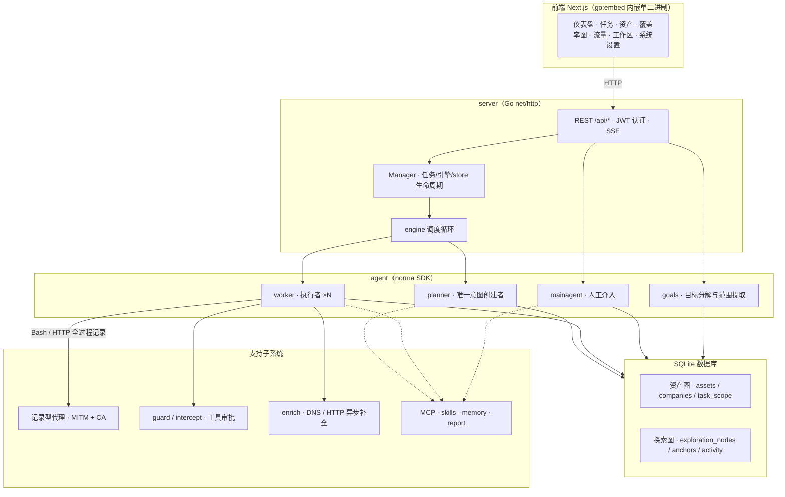
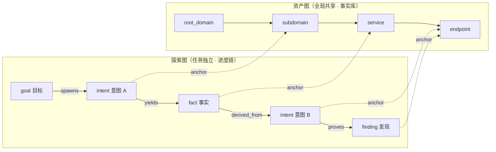
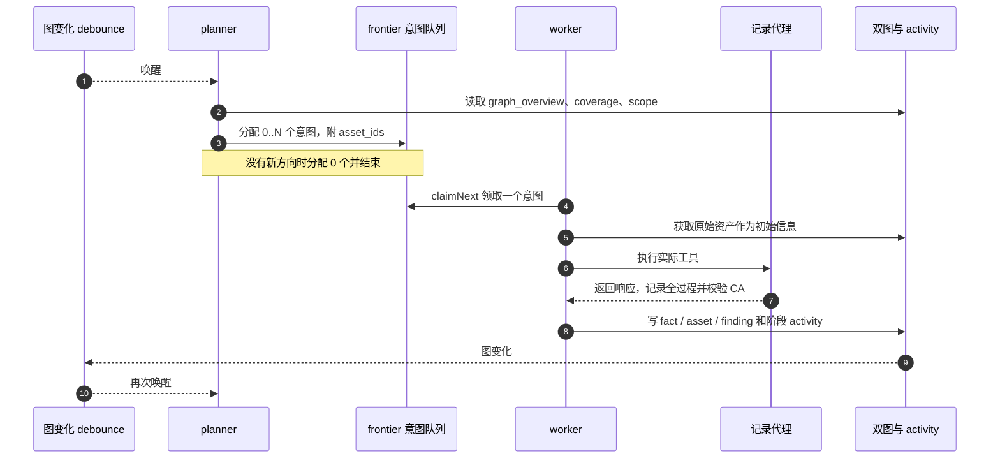
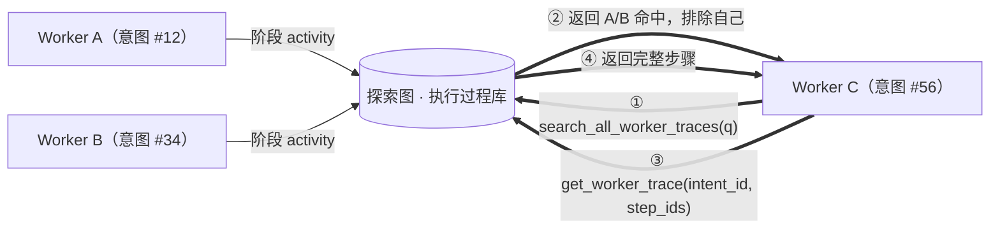
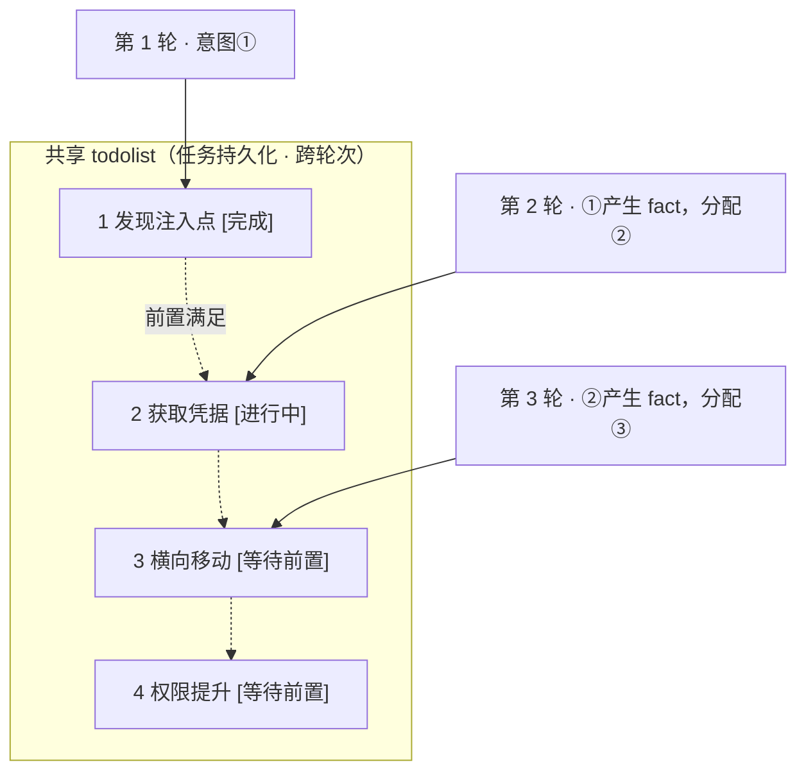

<div align="center">

# ARTEX 简体中文版

**由 LLM 多 Agent 自主执行渗透测试的系统**（Go 后端 + Next.js 前端）

界面、报告、摘要、对话及后端消息**统一使用简体中文**，本仓库不再提供其他语言界面。界面语言属于浏览器本地偏好；报告、摘要、对话与后端消息的输出语言由服务端设置管理，固定为简体中文。历史遗留的其他语言配置一律回退为简体中文。


[](https://github.com/j5tv9nfzhn-hue/ARTEX/actions/workflows/ci.yml) [](https://github.com/j5tv9nfzhn-hue/ARTEX/actions/workflows/detections.yml) [](LICENSE)

</div>

---

> ## 🚨 安全与滥用警告：请先阅读
>
> **仅允许在自有或明确授权的环境中，以学习、防御和检测为目的使用。**
>
> ARTEX 可自主组织侦察、工具执行和多阶段测试，滥用可能造成严重损害。
>
> ### 关于本项目的来源与真实事件
>
> - **国内原作者：** ARTEX 由国内开发者 **Autumn-27** 创建并开源（[Autumn-27/ARTEX](https://github.com/Autumn-27/ARTEX)），Agent 能力依赖其 **[Autumn-27/norma](https://github.com/Autumn-27/norma)** SDK。本仓库是该项目的韩语本地化分支 `jiwoochris/artex-ko` 的简体中文分支。
> - **已发生的真实滥用事件：** 2026 年 10 月，韩国多家媒体（经由本项目韩语分支的安全告知记录）报道称，ARTEX 被用于针对韩国境内金融机构的个人信息窃取攻击，涉嫌相关材料已被调查机关获取，相关刑事调查在进行中。该事件是本项目被滥用的公开记录，**本仓库仅转述并保留该记录，不代表对其细节的独立核实**。同一时期亦有面向其他地区金融机构的类似指控报道。保留这段记录的唯一目的，是让防御方理解自主 AI 攻击的真实后果，并据此建立检测与阻断能力。
> - **本仓库的立场：** 本仓库不提供任何攻击方法、目标清单或利用建议，只保留技术说明、防御指南与检测规则。任何以本仓库内容为依据对未授权目标实施扫描、探测或利用的行为，由行为人自行承担全部法律责任。
>
> - **未经授权的使用可能构成犯罪。** 没有所有权或明确书面授权，不得对任何系统扫描、探测或利用漏洞。在中华人民共和国大陆地区，未经授权侵入、非法控制计算机信息系统，可能触犯《刑法》第二百八十五条、第二百八十六条；同时涉及《网络安全法》《数据安全法》《个人信息保护法》。跨境使用还需遵守行为地与数据主体所在地的法律。
> - **不要将他人的真实服务作为实验目标。** 请使用自有、本地隔离的 OWASP Juice Shop、DVWA 等有意设计的测试环境；真实目标必须事先取得书面许可，并约定范围、时间窗口与数据处理方式。
> - **从防御视角阅读。** 本仓库提供[自主 AI 防御与检测指南](docs/defense.md)、指标、规则与加固清单。
>
> 若不同意下方[使用限制与免责声明](#许可证与免责声明)，请勿下载或使用。

ARTEX 最初由国内开发者 Autumn-27 创建并以 AGPL-3.0 开源；`jiwoochris/artex-ko` 是其韩语本地化分支；**本仓库是该韩语分支的简体中文分支**。上游在 2026-10 记录为无法公开访问，链接保留用于来源归属，不保证远端当前可用。

系统将目标分解为意图，执行真实工具，将资产与发现写入图结构。Next.js 静态前端可内嵌到 Go 单二进制，数据存储于 SQLite（单文件，无需数据库服务）。

## 使用范围与法律告知

**仅对自有或获得明确书面授权的目标使用。** 超出授权范围的扫描、探测、利用可能违法。

- 中华人民共和国大陆地区：《刑法》第二百八十五条（非法侵入计算机信息系统罪）、第二百八十六条（破坏计算机信息系统罪）；《网络安全法》第二十一条；《数据安全法》；《个人信息保护法》。非法获取、买卖、提供公民个人信息还可能触犯《刑法》第二百五十三条之一。
- 测试中收集、暴露的个人信息受《个人信息保护法》约束，遵循最小必要原则。即使已获测试许可，也应谨慎处理访问、保存、删除与销毁。
- 跨境测试还需同时满足行为地、数据主体所在地及数据出境的相关合规要求。
- 使用目的应为学习、研究与隔离实验。对真实系统操作前，取得书面许可，并约定目标、方法、时间窗口与数据处置方式。

详见[许可证与免责声明](#许可证与免责声明)。使用本工具即表示已阅读并接受相关条件。

## 分支沿革与简体中文重构

### 分支沿革

```
Autumn-27/ARTEX（国内原作者，中文原创）
        └─ jiwoochris/artex-ko（韩语本地化分支）
                └─ j5tv9nfzhn-hue/ARTEX（本仓库 · 简体中文分支）
```

本仓库 **fork 自韩语分支** `jiwoochris/artex-ko`，并在其基础上完成中文重构：移除全部韩文内容，界面与产物统一为简体中文。

### 重构说明

本分支将项目自有的韩文文案、注释、提示和说明统一为简体中文，而非只替换少量页面或设置默认 locale。

- **中文唯一：** 界面、报告、事实摘要、最终报告、对话、系统消息与后端日志文案均为简体中文；界面不再提供语言选择器，英文与西班牙语词库一并移除。
- **技术语义保留：** 保留内部推理提示词的角色、判断与工具行为；原有中文行为正文不作无关改写。
- **协议不变：** API/JSON 字段、工具名、枚举、SQL、命令、payload、URL、原始日志及用户证据不因翻译改变。
- **语言回退：** 历史遗留的其他语言代码（`ko`/`en`/`es`）与未知值统一回退为简体中文，不再产生韩文或外语产物。
- **防回归：** 源码文本、词库、脚本、文档及静态 UI 通过残留语言检查；格式占位符、错误码与审批解析有回归测试。

详细边界见[贡献指南](CONTRIBUTING.md#本地化原则)，上游同步见[维护手册](MAINTAINING.md)。

## 截图预览

以下为仓库已有的**中文历史演示截图**，使用虚构的 `acme.com` 等示例数据，不代表本次真实目标扫描或生产验证。当前界面可能比截图增加了计量、审批等功能。

<p align="center">
  <br>
  <sub><b>仪表盘</b>：任务、发现、资产、Token 消耗和活动流。</sub>
</p>

<p align="center">
  <br>
  <sub><b>发现</b>：按严重程度、状态、资产与任务汇总，支持 CSV 导出。模型生成的技术标题可能包含英文。</sub>
</p>

<p align="center">
  <br>
  <sub><b>对话</b>：向运行中的 Agent 提供提示，查看执行过程摘要。</sub>
</p>

更多截图见 [README.zh.md](README.zh.md#截图预览)，来源说明见 [screenshots/README.md](screenshots/README.md)。

## 快速开始（Windows 二进制）

本项目只构建并发布 **Windows** 可执行程序（amd64 与 arm64），不提供 Linux/macOS 二进制，也不发布 Docker 镜像。

### 方式一：下载发布包

到 [Releases](https://github.com/j5tv9nfzhn-hue/ARTEX/releases) 下载 `artex-<版本>-windows-<架构>.zip`，解压后得到：

- `artex.exe` —— 程序本体（前端已内嵌）
- `start.bat` —— 启动监护脚本（页面一键更新依赖它重启进程）
- `skills/`、`config.example.json`、`README.md`

```bat
copy config.example.json config.json   & rem 可选：指定数据库文件位置，留空自动创建 artex.db
start.bat                              & rem → http://localhost:8787
```

首次访问 `http://localhost:8787/setup` 初始化管理员密码；设置令牌打印在启动日志中。

### 方式二：源码构建

前置依赖：Go 1.26（以 `go.mod` 为准）、Node.js 22 LTS。

```bat
cd web && npm ci && npm run build:static && cd ..
rm -rf server/webui/dist && mkdir -p server/webui/dist
cp -a web/out/. server/webui/dist/
CGO_ENABLED=0 go build -tags embedui -o artex.exe ./cmd/artex
copy config.example.json config.json
start.bat
```

或直接使用打包脚本（自动完成前端构建、内嵌与 zip 打包）：

```bash
./build.sh --release          # 产出 dist/artex-<版本>-windows-{amd64,arm64}.zip
```

- `npm ci` 需要 devDependencies，例如 `@tailwindcss/postcss`。若环境为 `NODE_ENV=production`，使用 `npm ci --include=dev`，避免构建时缺包。
- 正式启动使用 `start.bat`，不要直接运行 `artex.exe` —— 监护脚本负责在一键更新或回滚退出后重新拉起进程。
- 数据库文件位置通过 `config.json` 的 `database.path` 或环境变量 `ARTEX_SQLITE_PATH` 配置（留空则在配置文件旁自动创建 `artex.db`），见下节。

## 配置

数据库只有 SQLite：一个数据库文件，无需安装、无需服务。可在 `config.json` 中指定位置，`ARTEX_SQLITE_PATH` 优先：

```json
{
  "database": { "path": "" },
  "language": "zh"
}
```

`database.path` 留空时，首次启动会在 `config.json` 旁自动创建 `artex.db`；完整注释与示例见 [config.example.json](config.example.json)。

LLM 可在环境变量或“LLM 设置”页面配置，相关环境变量包括 `ANTHROPIC_API_KEY`、`OPENAI_API_KEY`、`ARTEX_LLM_PROVIDER`、`ARTEX_LLM_MODEL`、`ARTEX_LLM_BASE_URL`、`ARTEX_LLM_PROXY`。OpenAI 兼容供应商可使用自己的 Base URL。

成本与效率相关的运行设置（新建任务默认 Token 预算 `default_task_token_budget`、模型价目表 `price_table`、LLM 重试策略 `llm_retry_policy`）在「系统配置」页填写，说明与默认值见[成本效率优化实施记录](docs/成本效率优化-实施记录.md)。

每个任务的 Worker 并发数在系统设置中配置，默认 3。`-addr` 控制 Web/API 地址，`-proxy` 控制流量记录代理，例如 `./start.sh -addr :8787 -proxy :8788`；默认 Web/API 仅绑定 `127.0.0.1:8787`。

输出语言固定为**简体中文**。服务端配置的优先级为 **`ARTEX_LANG` > `config.json.language` > `zh`**，数据库中的运行时输出语言设置在服务启动后优先。控制台日志使用环境/文件默认语言，浏览器界面语言通过本地 cookie/localStorage 保存，两者不是同一个配置，但取值一致。

### 模型选择与输出语言

输出语言依赖 `agent/prompt.go` 的 `langDirective()` 提示约束，而不是对模型回复作字符级硬过滤。命令、代码、工具名与原始证据不应被翻译。

- 选择能力合适的模型，结构化字段、短摘要仍可能受角色和上下文影响而混入英文。可在任务中明确要求用简体中文生成自然语言内容。
- 韩语分支曾在隔离沙箱比较 `claude-opus-4-8`、`gpt-4o` 与 `gpt-4o-mini` 的输出语言表现，记录了不同角色的语言漂移。该历史比较不是当前中文输出的模型端到端验证，不能当作质量保证。
- 推理型模型可能把较小的响应预算用于内部推理，导致最终回复为空。应按模型实际要求设置足够的 `max_tokens`。
- 韩语分支记录 `gpt-4o` 的响应上限为 16,384，而兼容请求可能默认填写 32,768，从而发生 `400 (max_tokens is too large)`。遇到该错误时核对供应商和模型限制，并在 LLM profile 中设置合适上限；不要假设所有兼容模型具有相同限制。

### 首次运行保护（设置令牌与绑定地址）

管理员用户名固定为 `ARTEX`，首次通过 `/setup` 创建密码。

- 无密码时，启动日志打印设置令牌。`/setup` 和 `POST /api/auth/init` 的 `setup_token` 必须匹配，错误尝试限流。令牌不通过公开状态接口返回。
- 无人值守部署可设置 `ARTEX_SETUP_TOKEN` 固定令牌，或用至少八字符的 `ARTEX_ADMIN_PASSWORD` 直接初始化。
- 默认仅监听回环地址。开放到其他设备前先完成初始化，并优先部署 HTTPS；非回环且未初始化时会有启动警告。
- 修改密码会使旧 JWT 会话在数秒内失效。若恢复泄露的管理员账户，还需检查自定义工具、MCP、LLM 与通知配置。
- 忘记管理员密码时，可在本机运行仓库根目录的 `reset-password.sh`：脚本定位 `artex`/`artex.exe`（或回退 `go run ./cmd/artex`）调用 `-reset-password` 重写密码哈希，无需数据库服务与 psql；也可直接运行 `artex -reset-password`。
- CORS 允许列表为 `ARTEX_CORS_ORIGINS`，以逗号分隔；内嵌 UI 同源通常无需填写，开发默认允许 `http://localhost:5173`。

### 反向代理部署（HTTPS / 只开放 443）

Web、API、SSE 共用后端端口。生产环境可只公开 443，将 8787 留在内部；同源 SSE 通常无需设置 `NEXT_PUBLIC_SSE_BASE`。

**必须关闭 SSE 代理缓冲**，否则浏览器连接成功但活动流持续等待。Nginx 示例见 [README.zh.md](README.zh.md#反向代理部署https--只开放-443)。

## 系统架构

Go 单后端、Next.js 静态前端、SQLite（单文件）与 [norma SDK](https://github.com/Autumn-27/norma) 构成核心系统。原分支曾记录 SDK 上游无法公开访问，构建前应确认依赖可获取。关键设计是**双图结构、过程级信息共享、Planner 跨轮次 todolist**。

### 总体分层



- **前端：** 静态产物通过 `go:embed` 内嵌，展示任务、资产、探索链、覆盖率和人工对话。
- **server：** `net/http` 路由、JWT、SSE，Manager 管理任务、引擎与 DB store。
- **engine：** 每任务一个 `plannerLoop` 与 N 个 Worker goroutine，管理意图分配、超时、暂停和 drain。
- **agent：** goals、planner、worker、mainagent 各司其职，ToolSet 将双图暴露为 LLM 工具。
- **db：** modernc SQLite 驱动（纯 Go、无 CGO），内嵌 `db/schema_sqlite.sql` 每次启动幂等迁移（含列增量与索引）。
- **支持系统：** 流量代理、审批、补全、MCP、Skill、记忆和报告。

### 双图结构：探索图与资产图

“目标是什么”和“已测试到哪里”分别存储，通过锚点关联。

- **资产图（全局共享）：** `root_domain / subdomain / ip / service / app / endpoint` 属于公司；父子关系和去重键由程序计算，Agent 只提交原始信息。
- **探索图（每任务独立）：** `goal / intent / fact / finding / hint` 由 `spawns / derived_from / yields / proves` 连接，记录推理与进度。
- **锚点：** `exploration_anchors(node_id, asset_id)` 将意图、事实和发现绑定到实际资产，支持双向追溯。



Planner 读取探索态势、判断目标，仅在有未覆盖方向时创建意图。Worker 每次只承接**一个意图**，调用工具，把新资产、事实和发现写回双图后结束。

### 引擎与意图生命周期（探索闭环）

图改变唤醒 Planner，Planner 产生意图，Worker 执行并写回，写回再次触发下一轮，直到 `prove_goal` 证明目标。



### Worker 之间的过程级信息共享

有价值的观察可能只存在于某个 Worker 的执行步骤，而未形成正式 fact。其他 Worker 可检索并复用这些观察，避免重复工作：

- `search_all_worker_traces(q)` 检索同任务其他意图的过程，自动排除自己，结果包含 `intent_id`。
- `list_worker_traces` 查看已有过程，`get_worker_trace(intent_id, step_ids=[…])` 获取指定步骤完整内容。



共享的是过程信息，不改变 Worker 仅执行自己意图的边界。

### Planner 跨轮次共享 todolist，维护有序链路

多阶段链路存在前置依赖，不能一次全部并行分配。Planner 每次唤醒是新会话，但任务级 todolist 持久保留，只给“前置已完成且依赖 fact 已存在”的下一步分配意图，并更新完成状态。



这一机制在事件驱动、无状态会话环境中保持顺序、减少重复，仅应在明确授权范围内使用。

## 防御与检测资料

- [自主 AI 防御与检测指南](docs/defense.md)：行为差异、可观察指纹、入口加固、WAF/SIEM/认证日志、响应清单及通报渠道。
- [部署用检测规则](detections/README.md)：Sigma 主机/日志规则、关联规则与 Suricata 网络规则。
- [ATT&CK 覆盖率](detections/attack/README.md)：仅来自实际规则标签，不添加推测技术。
- [CSV/MISP 指标](detections/indicators/README.md)：每项都注明来源、对应规则和局限。
- [只读主机 triage](detections/triage/README.md)：无需额外依赖，检查主机、端口、代理与数据库结构等本地线索（数据库检查仍针对上游 PostgreSQL 布局，本分支 SQLite 暂未覆盖）；结果是分类线索，不是攻击归属证明。
- [可复现检测测试](detections/tests/README.md)：规则、层、指标和 triage 自测遵循同一贡献契约。

新增规则请遵循[检测规则与测试贡献契约](CONTRIBUTING.md#检测规则与测试贡献)，不得将泛化行为误称 ARTEX 专属指纹。

## 项目文档

- [开发总清单](docs/开发总清单.md)：`计划.md` 198 条（除 97–130 反检测外）的全面落实执行表与批次状态。
- [修复台账](docs/修复台账.md)：198 条的核实结果、PostgreSQL → SQLite 迁移记录与本轮落地条目。
- [成本效率优化实施记录](docs/成本效率优化-实施记录.md)：省 token、产出可见、操作顺手的改动、配置项与落点。
- [norma SDK 优化补丁清单](docs/norma-SDK优化补丁清单.md)：需在 SDK 上游立项的 6 项优化建议。
- [架构分层](docs/架构分层.md)：后端分层现状、边界约定与本轮新增模块的层级归属。
- [构建与产物](docs/构建与产物.md)：构建入口、编译标志、发布包内容与运行时文件落点。
- [UTF-8 全链路审计](docs/utf8-audit.md)：编码风险点（控制台代码页、子进程 stdio）与修复、回退开关。
- [XSS 全链路审计](docs/xss-audit.md)：前端注入面、后端凭据掩码与 `Cache-Control` 加固记录。
- [漏洞多流量证据](docs/finding-traffic-evidence.md)：关联流量的工具、API、存储、导出与归档设计。

## 开发

```bash
./dev.sh  # 后端 :8787、记录代理 :8788、前端 :5173
```

- 后端：`go run ./cmd/artex`，无 `embedui` tag 时不内嵌前端。
- 前端：`cd web && npm run dev`，`/api` 反向代理到后端。
- Mock 预览：`cd web && NEXT_PUBLIC_MOCK=1 npm run dev`，不需要真实后端，不进行真实扫描。
- 回归：`go test ./...`；DB 测试自动使用包内临时 SQLite 库，无需外部数据库；个别上游 PostgreSQL 专属用例显式跳过并注明原因。
- 前端：在 `web` 执行 `npm test`、`npm run check`、`npm run build:static`。
- 语言与文档：`python3 -I scripts/check-language.py --source`、构建后 `--web`、`python3 -I scripts/check-doc-links.py`。

更多开发说明见 [README.zh.md](README.zh.md#开发)及[贡献指南](CONTRIBUTING.md)。分支变更见 [CHANGELOG.md](CHANGELOG.md)。

## 许可证与免责声明

### 开源许可证与分支声明

项目使用 **GNU Affero General Public License v3.0（AGPL-3.0）**，全文见 [LICENSE](LICENSE)。可使用、修改、分发，但衍生作品须遵循相同许可。若修改后通过网络服务提供给用户，应向这些用户提供对应完整源码。

- **上游原创：** 国内开发者 Autumn-27 的 [Autumn-27/ARTEX](https://github.com/Autumn-27/ARTEX)，以 AGPL-3.0 开源。
- **本仓库的 fork 关系：** 本仓库 fork 自韩语分支 [jiwoochris/artex-ko](https://github.com/jiwoochris/artex-ko)，并在其上完成简体中文重构；**韩语内容已从本仓库移除**。
- **归属：** 本仓库保留上游及韩语分支原作者的署名与 AGPL-3.0 许可，不因移除某一语言版本而改变版权归属。

> 开源许可证本身不限制使用目的。以下使用限制和免责声明是原作者的额外使用告知，不应混同为修改了 AGPL 条款。

### 使用限制

- 用于阅读源码、学习研究及自有隔离环境验证。
- 没有所有权或明确书面授权，不对网站、线上服务或联网系统扫描、探测、利用、攻击。
- 严禁非法侵入、数据盗窃、DoS 及其他破坏或犯罪活动。
- 遵守适用国家/地区的网络安全、数据保护与计算机犯罪法律；在中华人民共和国大陆地区包括《网络安全法》《数据安全法》《个人信息保护法》及《刑法》第二百八十五条、第二百八十六条等。

### 免责声明

软件按“现状（AS IS）”提供，不作明示或默示保证。原作者与贡献者不承担因使用本工具产生的直接或间接损害、数据丢失、系统损坏或法律争议责任。下载、安装、使用表示已阅读并理解相关告知。

**使用行为的全部法律责任与后果由使用者本人承担。**

## 原始项目与来源

- **国内原作者 / 上游原创：** [Autumn-27/ARTEX](https://github.com/Autumn-27/ARTEX)（中文原创，AGPL-3.0）。
- **韩语分支（本仓库的 fork 源）：** [jiwoochris/artex-ko](https://github.com/jiwoochris/artex-ko)。
- **Agent SDK：** [Autumn-27/norma](https://github.com/Autumn-27/norma)。
- 上游中文技术原稿：[README.zh.md](README.zh.md)。
- 上游演示：[artex-demo.vercel.app](https://artex-demo.vercel.app/)。

上述远端在 2026-10 被记录为无法公开访问；保留链接用于来源归属与历史对照，不保证当前可访问，也不以此断言永久删除。
