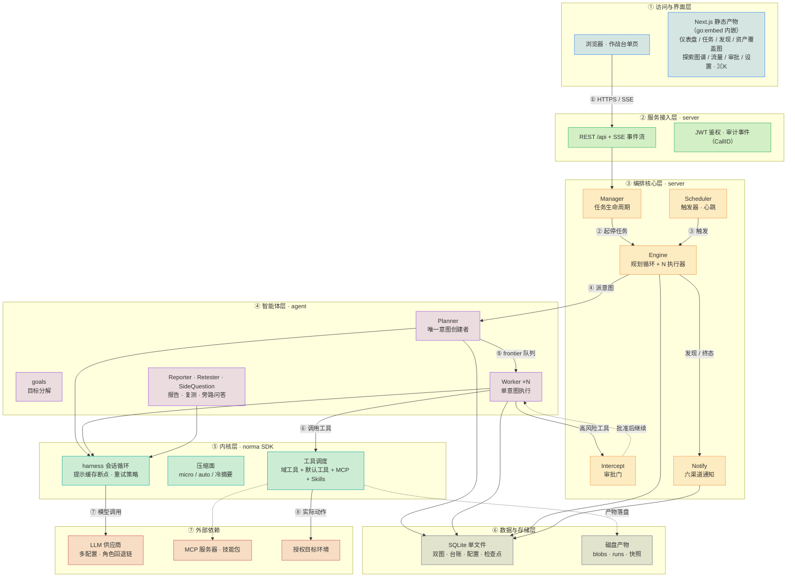
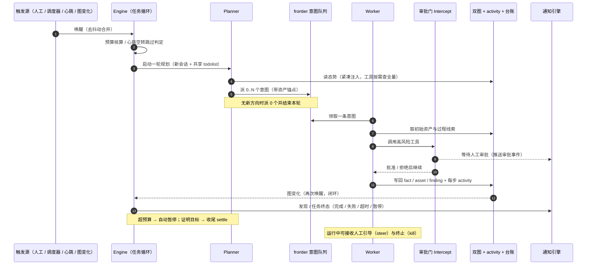
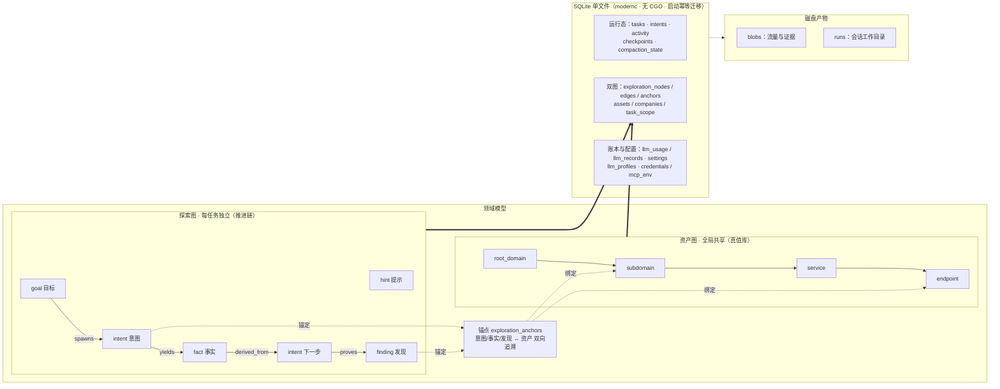
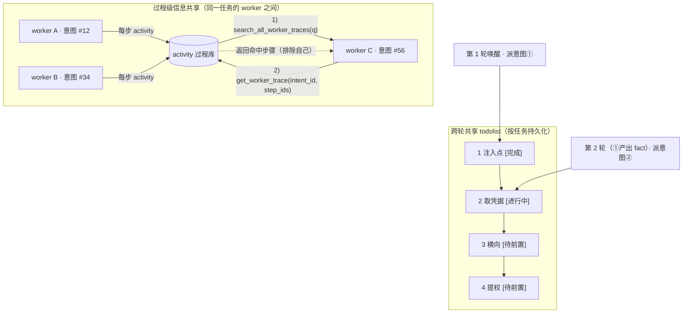
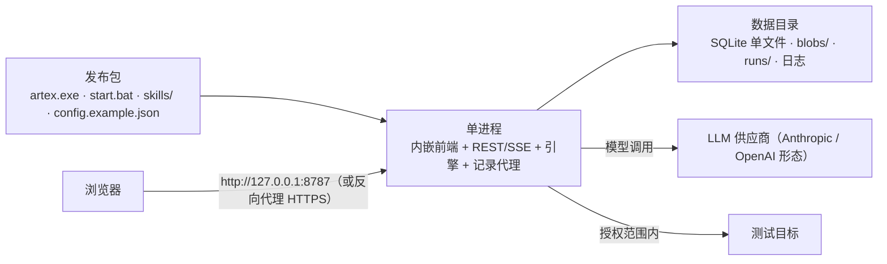

<div align="center">

# ARTEX-REA

AI 自主渗透测试与逆向工程系统（Go 后端 + Next.js 前端）


🌐 **在线 Demo**： [https://artex-demo.vercel.app/](https://artex-demo.vercel.app/)

</div>

---

> ⚠️ **安全与合规提示**：本分支基于 [Autumn-27/ARTEX](https://github.com/Autumn-27/ARTEX)，当前默认简体中文。仅可在自有或明确授权的环境中进行学习、研究和防御验证。原分支保留了 2026 年 10 月韩国金融机构事件的媒体报道警告，本次语言重构不代表独立核实。完整授权限制、法律告知和免责声明见 [README.md](README.md#使用范围与法律告知) 与 [README.md](README.md)。

> ℹ️ **本文件的定位**：本文是上游项目的简体中文技术原稿。下方「安装 / 更新升级」章节描述上游产物（install.sh、Docker 镜像、多平台发布包等），本分支只发布自构建的三端（Linux/macOS/Windows）Go 单二进制，请以 [README.md](README.md) 的说明为准；存储已由 PostgreSQL 迁移为 SQLite 单文件，相关描述按此理解。

---

## 审批记录详情

全局「审批记录」、任务内「拦截审批」及对话中的审批卡片均支持展开查看详情。展示结构参考
[AegisHook 的审批详情组件](https://github.com/RuoJi6/AegisHook/blob/main/web/src/components/CallDetail.vue)，沿用 ARTEX 的组件和主题：


## 资产同步（ScopeSentry）

支持从 [ScopeSentry](https://github.com/Autumn-27/ScopeSentry) 直接同步资产数据，免去重复收集：

- 在「**资产同步**」页填 ScopeSentry 的地址与 API Key，接入数据源；
- 按**项目**或**任务**维度选择要同步的目标与资产类型（域名 / 子域 / IP / 端口 / 站点 / 端点…）；
- 一键导入并按公司资产范围归并，直接进入 ARTEX 的资产图供 agent 探索使用。

---

## 安装

> 依赖数据库 **SQLite**（一个文件，无需安装、无需服务）；探索需配置 **LLM**（`ANTHROPIC_API_KEY` 或 `OPENAI_API_KEY`，也可在 UI 里配）。

### 方式一：一键安装脚本（推荐）

```bash
git clone https://github.com/Autumn-27/ARTEX.git
cd ARTEX
./install.sh
```

脚本会：检测 / 自动安装 Docker → 让你选 **① 全部 Docker** 或 **② 本地编译运行**：

- **① 全部 Docker**：填一个 Postgres 密码（可回车随机）→ 自动写 `.env` → `docker compose up -d`。
- **② 本地运行**：选数据库（连已有 / 用 Docker 起一个）→ 生成 `config.json` → `go` 编译内嵌单二进制 → 启动。

装好后打开 **http://localhost:8787**（首次进入 `/setup` 设置管理员密码；`/setup` 需要输入启动日志中打印的设置令牌，见下方「首次运行保护」）。

### 方式二：Docker Compose（手动）

```bash
git clone https://github.com/Autumn-27/ARTEX.git
cd ARTEX
cp .env.example .env          # 按注释填写（LLM 密钥、ARTEX_SQLITE_PATH 等）
docker compose up -d          # 拉取 autumn27/artex 镜像
# → http://localhost:8787
```

镜像已含常用工具（ripgrep/curl/vim/npm/nmap…）；`./skills` 与 `./data` 以绑定挂载持久化。

远程 MCP 可在系统设置中选择 `http`（Streamable HTTP）或 `sse`（旧版 SSE）。
旧版 SSE 服务通常使用 `GET /sse` 建立事件流，再通过服务返回的
`/message?sessionId=...` 接收 JSON-RPC 请求；配置时将 URL 填为 `/sse`，请求头按
`Authorization=Bearer <token>` 填写。

### 方式三：下载预编译二进制（Releases）

到 [Releases](https://github.com/Autumn-27/ARTEX/releases) 下载对应平台的 zip，解压后得到 `artex-rea` + `start.sh`（Windows 为 `start.bat`）+ `skills/` + `config.example.json`：

```bash
cp config.example.json config.json   # 填好 database 连接
./start.sh                           # → http://localhost:8787
```

> 请用 `start.sh` / `start.bat` 启动，而不是直接跑 `./artex-rea`。它是个守护脚本：程序退出后按退出码决定是否重新拉起，**页面上的[一键更新](#方式一页面一键更新推荐)靠它完成换装**。直接运行 `./artex-rea` 时更新完就不会被拉起了。
> 后台常驻：`nohup ./start.sh >artex-rea.log 2>&1 &`。

### 方式四：从源码编译单二进制

```bash
# 1) 前端静态导出
cd web && npm ci && npm run build:static && cd ..
# 2) 拷进内嵌目录
cp -r web/out server/webui/dist
# 3) 编译（-tags embedui 才内嵌前端）
CGO_ENABLED=0 go build -tags embedui -o artex-rea ./cmd/artex
./start.sh
```

### 方式五：构建 Release 压缩包

`build.sh` 会先构建并嵌入前端，再使用 Go linker 去除调试信息，并将发布文件压缩为 zip。Release 模式默认构建三端（Linux/macOS/Windows）amd64/arm64 目标并产出 zip（三端打包能力已按 Git 历史恢复；GitHub Release 工作流随 `v*` tag 发布三端包）：

```bash
./build.sh --release
# 产物：dist/artex-rea-<版本>-<os>-<arch>.zip（linux/darwin/windows × amd64/arm64）
```

UPX 自解压二进制可能与部分内核、虚拟化环境或安全策略不兼容，因此默认不启用。可用 `ARTEX_TARGETS` 自定义目标；确认目标运行环境兼容时，可显式传入 `--upx` 进一步缩小二进制：

```bash
ARTEX_TARGETS=linux/amd64,windows/amd64 ./build.sh --release
./build.sh --target windows/amd64 --upx
```

---

## 更新升级

> 升级只换程序、不动数据：SQLite 数据库文件（默认 `config.json` 旁自动创建的 `artex.db`，Docker 由 `ARTEX_SQLITE_PATH` 指向持久化卷）、`./data`（jwt.key 等）、`./skills` 都会保留。**数据库迁移无需手动执行**——`artex` 每次启动会幂等重跑 `db/schema_sqlite.sql`（含列增量与索引创建），即“重启即迁移”。升级前仍建议先备份 `./data`、`./skills` 与数据库文件。

### 方式一：页面一键更新（推荐）

在 **系统配置** 页（侧边栏「系统配置」→ `/system/settings`）的**版本与更新**卡片里，可以直接检查并安装新版本，无需登录服务器。

点「更新」后：下载当前平台的发布包 → 比对 Release 的 `SHA256SUMS` → 用 `-h` 冒烟测试新二进制 → 暂存为 `artex.new` → 程序退出，由 `start.sh` / `start.bat` 重新拉起并完成换装。页面会自动等到新版本上线后刷新。

- **失败不会留下坏程序**：校验或冒烟不通过就丢弃暂存件、继续跑当前版本；换装后的新版若连续 3 次启动失败，会自动回滚到 `artex.old`（失败的那个留作 `artex.failed` 供排查）。
- **随时可回退**：上一版本保留为 `artex.old`，卡片上有「回滚到上一版本」。注意数据库结构不会回退。
- **更新会中断正在运行的任务**——更新即重启，请在空闲时进行。
- **开发构建不给更新**：版本号是 `dev` 或 `git describe` 带后缀时禁用，避免正式版覆盖掉本地调试的二进制。
- **Docker 下只换程序、不换镜像**：镜像里的 playwright / nmap 等工具链不会跟着升级，且 `docker compose up -d` 重建容器后会退回镜像自带的版本。要连镜像一起升级仍请用 `docker compose pull artex && docker compose up -d artex`。
- 访问 GitHub 需要代理时，在同一页面配置**全局代理**即可，更新链路会走它。更新只从 GitHub 域名下载并强制 HTTPS。

### 方式二：一键更新脚本

```bash
cd ARTEX
./update.sh
```

脚本先可选 `git pull` 拉取最新代码，再让你选 **① Docker 更新** 或 **② 本地编译更新**（与 `install.sh` 对应）：

- **① Docker**：可指定目标镜像 tag（回车沿用 `.env` 的 `ARTEX_TAG`，缺省 `latest`）→ `docker compose pull` → `docker compose up -d`（换新镜像重启即自动迁移）。
- **② 本地**：重建前端静态产物 → 重新编译 `./artex`（完成后重启进程生效）。

### 方式三：Docker Compose（手动）

```bash
cd ARTEX
git pull                       # 更新 compose / 脚本（可选）
# 指定版本：在 .env 设 ARTEX_TAG=v0.2.0；不设则用 latest
docker compose pull artex
docker compose up -d artex     # 换新镜像重启 → 自动迁移 schema
docker image prune -f          # 清理旧镜像（可选）
```

### 方式四：预编译二进制（Releases）

到 [Releases](https://github.com/Autumn-27/ARTEX/releases) 下载新版本 zip，停掉旧进程后覆盖 `artex` 与 `skills/`（保留你的 `config.json` 与 `data/`），重启即可：

```bash
cp -r <解压目录>/skills ./ && cp <解压目录>/artex ./
./start.sh
```

### 方式五：从源码编译

```bash
git pull
cd web && npm ci && npm run build:static && cd ..
cp -r web/out server/webui/dist
CGO_ENABLED=0 go build -tags embedui -o artex ./cmd/artex
# 重启 ./start.sh
```

---

## 配置

**数据库**（`config.json`，或用环境变量 `ARTEX_SQLITE_PATH` 覆盖）：

```json
{
  "database": { "path": "" }
}
```

`database.path` 留空时，首次启动会在 `config.json` 旁自动创建 `artex.db`；完整注释与示例见 [config.example.json](config.example.json)。

**LLM**：`export ANTHROPIC_API_KEY=sk-...`（或 `OPENAI_API_KEY`），也可在 UI 的「LLM 配置」页填写。
可选：`ARTEX_LLM_PROVIDER` / `ARTEX_LLM_MODEL` / `ARTEX_LLM_BASE_URL` / `ARTEX_LLM_PROXY`。

**并发**：每个任务的 work agent 数在「系统设置」里配置（默认 3）。

**成本与效率**：新建任务默认 Token 预算 `default_task_token_budget`、模型价目表 `price_table`、LLM 重试策略 `llm_retry_policy` 在「系统配置」页填写；说明与默认值见[成本效率优化实施记录](docs/成本效率优化-实施记录.md)。

**常用参数**：`./start.sh -addr :8787 -proxy :8788`（`-addr` 前端+API，`-proxy` 流量录制代理）。启动脚本会把参数原样透传给 `artex`。本分支中 `-addr` 默认值为 `127.0.0.1:8787`（仅本机），需要从其他机器访问时请显式指定如 `:8787`。

### 首次运行保护（设置令牌与绑定地址，本分支新增）

- **设置令牌**：尚未设置密码时，启动日志会打印一行 `[auth] … 设置令牌: …`（设置令牌；Docker 用 `docker compose logs artex` 查看）。`/setup` 与 `POST /api/auth/init`（`setup_token` 字段）必须带上该值才能创建密码，错误尝试会被限速。无人值守部署可用 `ARTEX_SETUP_TOKEN` 固定令牌，或用 `ARTEX_ADMIN_PASSWORD` 直接设置密码（至少 8 位）。
- **默认只绑定 127.0.0.1**：`-addr` 默认值与 `docker-compose.yml` 的端口发布都只开在本机回环地址。需要从其他机器访问时改为 `-addr :8787` 或在 `.env` 中设置 `ARTEX_BIND=0.0.0.0`，但请先完成初始设置，并优先使用下方的反向代理方案。
- **修改密码会使所有旧会话失效**：令牌签名密钥与密码哈希绑定，无论通过界面、`reset-password.sh` 还是直接改库，旧令牌都会在几秒内失效。忘记密码时可在本机运行仓库根目录的 `reset-password.sh`（内部调用 `artex -reset-password`，无需数据库客户端）。
- **CORS**：`/api` 仅允许 `ARTEX_CORS_ORIGINS`（逗号分隔）中列出的来源跨域调用；内置 UI 同源，通常留空。

### 反向代理部署（HTTPS / 只开放 443）

前端和 API/SSE 都由同一个后端端口（默认 `:8787`）提供，实时活动流默认走**同源**地址，因此**无需配置 `NEXT_PUBLIC_SSE_BASE`**，公网只开放 443、把 8787 留在内网即可。

SSE 是长连接 + 持续推送，反代**必须关闭缓冲**，否则浏览器能连上却收不到事件（表现为活动流一直转圈）。Nginx 示例：

```nginx
server {
    listen 443 ssl;
    server_name your.domain.com;
    # ssl_certificate / ssl_certificate_key ...

    location / {
        proxy_pass http://127.0.0.1:8787;
        proxy_set_header Host $host;
        proxy_set_header X-Forwarded-Proto $scheme;

        # SSE 关键项：关缓冲、长超时、HTTP/1.1
        proxy_buffering off;
        proxy_cache off;
        proxy_read_timeout 3600s;
        proxy_http_version 1.1;
        proxy_set_header Connection "";
    }
}
```

> 仅当 SSE 需要走与页面不同的来源（如独立子域）时，才在**构建期**设置 `NEXT_PUBLIC_SSE_BASE`（该变量在 `next build` 时固化进静态包，容器运行时再设无效）。

---


## 开发

### 手动漏洞复测

任务详情的「复测」页签可分页选择本任务的漏洞、查看历次结论和证据，并手动发起复测。启动后保留当前页签，显示转圈图标和「复测中」；确认修复后同步更新漏洞状态。

在漏洞列表每行操作区点击「复测」，或在漏洞详情的「漏洞复测」区域点击「发起复测」，填写可选的修复版本、测试条件或限制，系统会创建独立的复测 Agent 会话，启动后保留当前页面。列表的平铺、按任务分组和资产视图均支持该入口；复测运行时显示转圈图标和「复测中」，需要查看时点击进入对应会话，结束后恢复「复测」。复测无需重新启动原扫描任务，结论分为「仍可复现」「已修复」「无法确认」，每次的结论、证据和会话链接保存在漏洞详情中。

新版后端首次启动会预置可编辑的「漏洞复测」（`retester`）Agent，可在 Agent 管理中配置提示词、LLM、运行预算和工具。默认使用其绑定的 LLM，未绑定则使用全局激活配置。复测会话成功完成且结论为「已修复」时，系统自动将漏洞处置状态改为「已修复」；执行中、失败、停止或其他结论保留原状态。原始证据和报告始终保留。也可在状态下拉菜单中手动选择「已修复」。同一漏洞正在复测时复用已有会话，停止、失败或服务重启后可重新发起。

本版历史记录通过漏洞详情和会话查看，暂未纳入漏洞报告导出或任务归档包，也未自动关联流量包。演示模式只生成明确标注的模拟记录，不请求真实目标。

### 本地运行与测试

```bash
./dev.sh    # 后端(:8787) + 流量代理(:8788) + 前端 next dev(:5173) → http://localhost:5173
```

- 后端：`go run ./cmd/artex`（不带 `-tags embedui` 则不内嵌前端）
- 前端：`cd web && npm run dev`（`/api` 反代到后端，带热更新）
- 测试：`go test ./...`
- Mock 预览（无后端）：`cd web && NEXT_PUBLIC_MOCK=1 npm run dev`

---

## 系统技术架构

系统 = **Go 单二进制后端（内嵌 Next.js 静态前端）+ SQLite 单文件 + [`norma`](https://github.com/Autumn-27/norma) SDK 多智能体内核**（`agentcore` / `tool` / `permission` / `harness` / `memory` / `transcript`）。关键设计：**双图数据底座**（探索图 + 资产图，经锚点互连）、**事件驱动闭环**（图变化唤醒 Planner）与**成本与可靠性控制面**（缓存 / 预算 / 通知 / 记账）。以下用六个视角完整展开，可直接按序阅读。

### ① 全景架构：一图纵览（六层 + 外部依赖）



| 层 | 职责 | 代码入口 |
| --- | --- | --- |
| **界面** | 作战台单页 + 7 套主题预设 + ⌘K 命令面板 | `web/src/app/`、`web/src/styles/presets/` |
| **接入** | REST + SSE + JWT；审计事件以 `CallID` 贯穿 | `server/server.go` |
| **编排** | 任务生命周期、规划循环、触发器/心跳、审批门、通知引擎 | `server/manager.go`、`server/engine.go`、`server/scheduler.go` |
| **智能体** | 目标分解、意图规划（唯一创建者）、执行器、报告/复测/旁路问答 | `agent/planner.go`、`agent/worker.go`、`server/orchestration.go` |
| **内核** | 会话循环、提示缓存、上下文压缩、工具调度；MCP 与技能接入 | norma SDK（`agent/assembly.go` 接线） |
| **数据** | 双图、台账、配置、检查点；SQLite 单文件（modernc 纯 Go 驱动，无 CGO） | `db/schema_sqlite.sql`、`db/` |
| **观测与出口** | Token 台账与计价、进度指标、审计指标、六渠道通知 | `llmrec/`、`server/pricing.go`、`metrics/`、`notify/` |

支持子系统作为横切能力接入以上各层：记录型 MITM 流量代理与 DNS/HTTP 富化、证据存储（blobs）、工具审批门（guard / intercept）、通知路由（Markdown · HTML · Telegram · 飞书 · 钉钉 · Webhook）、检查点/回滚，以及内核侧的技能（Skills）、MCP 与记忆/报告能力。

### ② 任务运行闭环：从触发到收尾

引擎是**事件驱动**的闭环：图一变就唤醒 Planner，Planner 派意图，Worker 领意图执行并写回，写回又触发下一轮——直到目标被证明（`prove_goal`）。预算闸、审批门与收尾通知都挂在这条闭环上。



### ③ 数据底座：双图 + 存储拓扑

“目标是什么”和“测到了什么程度”分别存储，经**锚点**双向追溯。Planner 只读态势、只在有未覆盖方向时派意图；Worker 只领一条意图、把新资产/事实/发现写回两图后结束。



锚点机制同时支撑**资产测试覆盖度**与**资产覆盖图**（范围内资产 + 已测高亮）。

### ④ 协作机制：过程共享 + 跨轮 todolist

两条自主性机制让多 Worker、跨轮次的探索保持连贯：

- **过程级信息共享**：有价值的观察未必写成正式 fact。`search_all_worker_traces(q)` / `list_worker_traces` / `get_worker_trace(intent_id, step_ids)` 让 Worker 能检索同任务其他意图的执行过程（自动排除自己），信息以“执行过程”为粒度流动，边界不变。
- **跨轮共享 todolist**：串行利用链（发现注入点 → 取凭据 → 横向 → 提权）存在前置依赖，不能一次并行派发。todolist 按任务持久化，每轮只对“前置已完成、依赖 fact 已存在”的下一步派意图，并随进展更新状态——事件驱动 + 无状态会话下依然稳定推进、不重复、不错序。



### ⑤ 成本与可靠性控制面

每一层都刻意收敛“重复计费”的可能性：输入侧瘦身、过程侧守门、统一观测与出口。

```mermaid
flowchart LR
  subgraph IN["输入侧瘦身（每轮重复计费部分）"]
    direction TB
    C1["提示缓存断点<br/>system 整段 ephemeral 缓存"]
    C2["工具输出上限 12k 字符<br/>超限落盘 + 指针"]
    C3["注入瘦身<br/>planner ≤16KB · worker ≤12KB<br/>资产 30 条紧凑视图"]
    C4["心跳空转跳过<br/>有在跑意图且无新变动不启轮"]
  end
  subgraph RUN["过程侧守门"]
    direction TB
    R1["意图重试 ≤4 次<br/>指数退避 3→24s · 硬失败 2 次"]
    R2["触发器间隔 ≥60s"]
    R3["任务 Token 预算闸<br/>每轮收尾核算 → 超限自动暂停"]
    R4["上下文压缩<br/>用户窗口 80% 触发<br/>micro / auto / 冷摘要 800tok"]
  end
  subgraph OBSV["观测与出口"]
    direction TB
    O1["Token 台账 + 价格表<br/>按任务 / 模型 / 角色计价"]
    O2["进度指标<br/>首发现耗时 · 产出速率 · 等待审批"]
    O3["通知六渠道<br/>发现 / 任务终态 / 等待审批"]
    O4["审计与指标<br/>AuditEntry.CallID · /api/metrics"]
  end
  IN --> RUN --> OBSV
```



对应落点：提示缓存 `agent/deferred.go`；预算闸 `server/engine.go` + `tasks.token_budget`；计价 `server/pricing.go`（设置 `price_table`）；通知 `notify/`；配置项与完整清单见[成本效率优化实施记录](docs/成本效率优化-实施记录.md)。

### ⑥ 单二进制部署与交付



发布产物、编译标志与运行时文件落点详见[构建与产物](docs/构建与产物.md)。

---

## 参考

- 分支维护账本：[开发总清单](docs/开发总清单.md)、[修复台账](docs/修复台账.md)、[成本效率优化实施记录](docs/成本效率优化-实施记录.md)
- 架构与构建：[架构分层](docs/架构分层.md)、[构建与产物](docs/构建与产物.md)
- 审计与设计：[UTF-8 审计](docs/utf8-audit.md)、[XSS 审计](docs/xss-audit.md)、[漏洞多流量证据](docs/finding-traffic-evidence.md)
- https://github.com/oritera/Cairn


## 许可与免责声明

### 开源协议

本项目采用 **GNU Affero General Public License v3.0（AGPL-3.0）** 授权，完整条款见仓库根目录的 [LICENSE](LICENSE) 文件。

这意味着任何人都可以自由使用、修改和分发本项目，但**衍生作品必须同样以 AGPL-3.0 开源**；特别地，**若你修改本项目并通过网络（如部署为在线服务）向用户提供，也必须向这些用户公开对应的完整源码**。

> ⚠️ **重要提示**：开源协议本身不限制软件的使用用途。以下的「使用限制」与「免责声明」是作者对使用者的额外约定与郑重声明，请务必遵守。

**ARTEX 仅供个人学习、代码研究与本地技术验证使用，不得用于对任何线上系统或网站发起实际测试。**

### 允许使用范围

- 仅可用于**阅读、学习与研究本项目源码**，以及在**本地隔离环境**中进行技术原理验证；
- 适用于个人学习、学术研究、代码审阅等非攻击性用途。

### 禁止事项

- **严禁使用本工具对任何网站、线上服务或联网系统发起扫描、探测、利用或攻击**（无论是否获得授权、是否为自有资产）；
- 严禁将本工具用于任何实际的渗透测试、攻防对抗或生产环境；
- 严禁将本工具用于非法入侵、数据窃取、勒索、拒绝服务或任何破坏性、犯罪性活动；
- 严禁利用本工具从事违反所在国家/地区法律法规的行为。

### 合规责任

使用者须自行遵守所在国家/地区关于网络安全、数据保护与计算机犯罪的全部法律法规（在中国大陆包括但不限于《网络安全法》《数据安全法》《个人信息保护法》及相关司法解释）。**因使用本工具产生的一切法律责任与后果，均由使用者自行承担。**

### 免责声明

本项目按“现状（AS IS）”提供，不附带任何明示或默示的担保。作者及贡献者不对使用本工具（无论使用方式是否得当）所导致的任何直接或间接损失、数据丢失、系统损坏或法律纠纷承担责任。**下载、安装或使用本项目，即表示你已阅读、理解并同意上述全部条款。**
