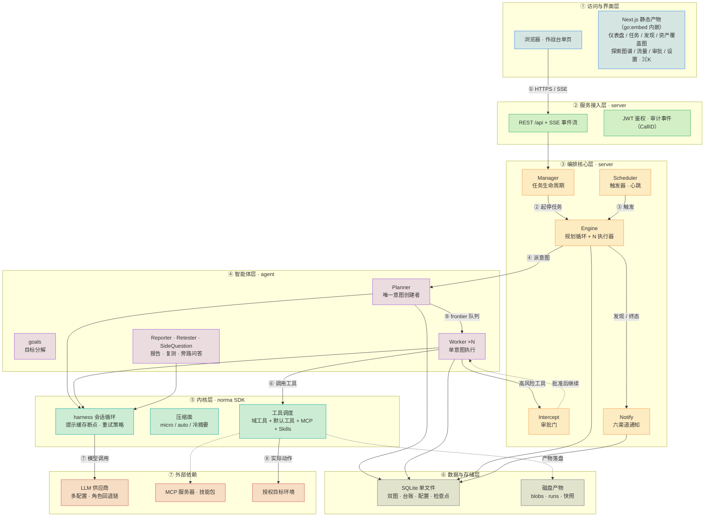
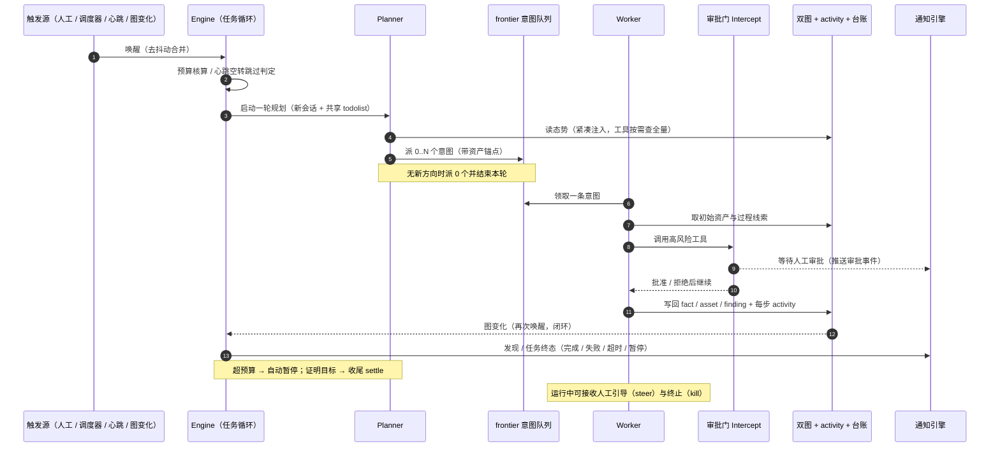
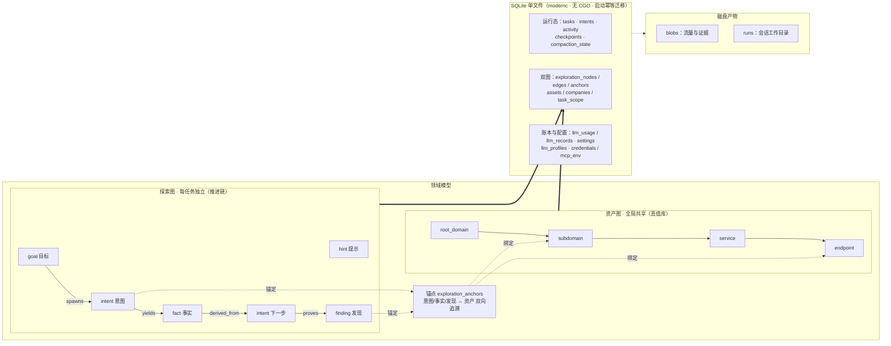
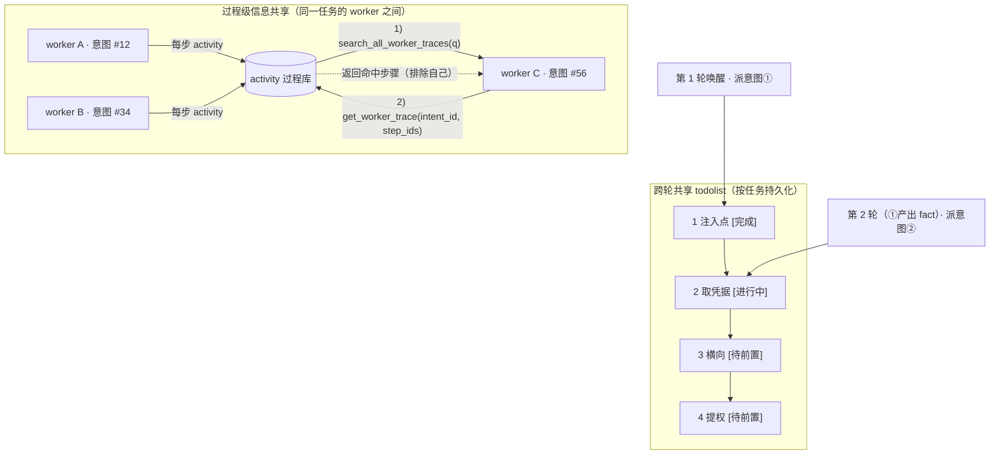
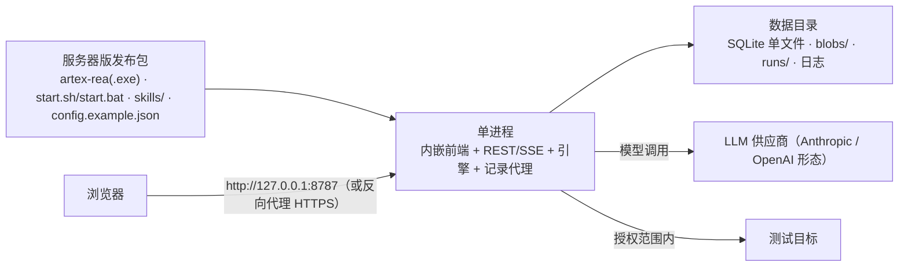

# 系统架构

> 系统 = **Go 后端（内嵌 Next.js 静态前端）+ SQLite 单文件 + [norma SDK](https://github.com/Autumn-27/norma) 多智能体内核**。
> 访问形态只有一种：**浏览器**。


系统 = **Go 后端（内嵌 Next.js 静态前端）+ SQLite 单文件 + [norma SDK](https://github.com/Autumn-27/norma) 多智能体内核**。访问形态只有一种：**浏览器**（`http://127.0.0.1:8787`）。关键设计：**双图数据底座**（探索图 + 资产图，经锚点互连）、**事件驱动闭环**（图变化唤醒协调器）与**成本与可靠性控制面**（缓存 / 预算 / 通知 / 记账）。以下用六个视角完整展开，可直接按序阅读。

#### ① 全景架构：一图纵览（六层 + 外部依赖）



| 层 | 职责 | 代码入口 |
| --- | --- | --- |
| **界面** | 作战台单页 + 7 套主题预设 + ⌘K 命令面板 | `web/src/app/`、`web/src/styles/presets/` |
| **接入** | REST + SSE + JWT；审计事件以 `CallID` 贯穿 | `server/server.go` |
| **编排** | 任务生命周期、规划循环、触发器/心跳、审批门、通知引擎 | `server/manager.go`、`server/engine.go`、`server/scheduler.go` |
| **智能体** | 目标分解、意图规划（唯一创建者）、执行器、报告/复测/旁路问答 | `agent/planner.go`、`agent/worker.go`、`server/orchestration.go` |
| **内核** | 会话循环、提示缓存、上下文压缩、工具调度；MCP 与技能接入 | norma SDK（`agent/assembly.go` 接线） |
| **数据** | 双图、台账、配置、检查点；SQLite 单文件（modernc 纯 Go 驱动，无 CGO） | `db/schema_sqlite.sql`、`db/` |
| **观测与出口** | Token 台账与计价、进度指标、审计指标、六渠道通知 | `llmrec/`、`server/pricing.go`、`metrics/`、`notify/` |

支持子系统作为横切能力接入以上各层：记录型 MITM 流量代理与 DNS/HTTP 富化、证据存储（blobs）、工具审批门（guard / intercept）、通知路由（Markdown · HTML · Telegram · 飞书 · 钉钉 · Webhook）、检查点/回滚，以及内核侧的技能（Skills）、MCP 与记忆/报告能力。

#### ② 任务运行闭环：从触发到收尾

引擎是事件驱动的闭环：图一变就唤醒 Planner，Planner 派意图，Worker 领意图执行并写回，写回又触发下一轮——直到目标被证明（`prove_goal`）。预算闸、审批门与收尾通知都挂在这条闭环上。



#### ③ 数据底座：双图 + 存储拓扑

“目标是什么”和“测到了什么程度”分别存储，经**锚点**双向追溯。Planner 只读态势、只在有未覆盖方向时派意图；Worker 只领一条意图、把新资产/事实/发现写回两图后结束。



锚点机制同时支撑**资产测试覆盖度**与**资产覆盖图**（范围内资产 + 已测高亮）。

#### ④ 协作机制：过程共享 + 跨轮 todolist

两条自主性机制让多 Worker、跨轮次的探索保持连贯：

- **过程级信息共享**：有价值的观察未必写成正式 fact。`search_all_worker_traces(q)` / `list_worker_traces` / `get_worker_trace(intent_id, step_ids)` 让 Worker 能检索同任务其他意图的执行过程（自动排除自己），信息以“执行过程”为粒度流动，边界不变。
- **跨轮共享 todolist**：串行利用链（发现注入点 → 取凭据 → 横向 → 提权）存在前置依赖，不能一次并行派发。todolist 按任务持久化，每轮只对“前置已完成、依赖 fact 已存在”的下一步派意图，并随进展更新状态——事件驱动 + 无状态会话下依然稳定推进、不重复、不错序。



#### ⑤ 成本与可靠性控制面

每一层都刻意收敛“重复计费”的可能性：输入侧瘦身、过程侧守门、统一观测与出口。

```mermaid
flowchart LR
  subgraph IN["输入侧瘦身（每轮重复计费部分）"]
    direction TB
    C1["提示缓存断点<br/>system 整段 ephemeral 缓存"]
    C2["工具输出上限 12k 字符<br/>超限落盘 + 指针"]
    C3["注入瘦身<br/>planner ≤16KB · worker ≤12KB<br/>资产 30 条紧凑视图"]
    C4["心跳空转跳过<br/>有在跑意图且无新变动不启轮"]
  end
  subgraph RUN["过程侧守门"]
    direction TB
    R1["意图重试 ≤4 次<br/>指数退避 3→24s · 硬失败 2 次"]
    R2["触发器间隔 ≥60s"]
    R3["任务 Token 预算闸<br/>每轮收尾核算 → 超限自动暂停"]
    R4["上下文压缩<br/>micro / auto / 冷摘要 800tok"]
  end
  subgraph OBSV["观测与出口"]
    direction TB
    O1["Token 台账 + 价格表<br/>按任务 / 模型 / 角色计价"]
    O2["进度指标<br/>首发现耗时 · 产出速率 · 等待审批"]
    O3["通知六渠道<br/>发现 / 任务终态 / 等待审批"]
    O4["审计与指标<br/>AuditEntry.CallID · /api/metrics"]
  end
  IN --> RUN --> OBSV
```



对应落点：提示缓存 `agent/deferred.go`；预算闸 `server/engine.go` + `tasks.token_budget`；计价 `server/pricing.go`（设置 `price_table`）；通知 `notify/`；配置项与完整清单见[成本与上下文](#成本上下文与重试)。

#### ⑥ 单二进制部署与交付



只有一种部署形态：「下载 → 启动脚本 → 浏览器」。发行包解开后是「入口 + 核心 + skills」的布局，启动脚本拉起后端，界面在浏览器里打开；没有原生窗口形态，也不需要额外安装客户端。更新协议与 SHA256 闸门对所有平台一致。

发布产物、编译标志与运行时文件落点详见[构建与产物](05-开发与贡献.md#构建与产物)。

#### 架构分层

依赖方向自下而上（`go list -deps` 实测，箭头 = import 方向）：

| 层 | 包 | 职责 | 主要依赖 |
|---|---|---|---|
| 前端 | `web/`、`website/` | Next.js 静态导出 UI；内嵌（`-tags embedui`）或独立 dev | 只经 HTTP JSON API |
| 进程入口 | `cmd/artex` | 生命周期、自举、端口、控制台 UTF-8、数据/前端目录、单次模式（`-reset-password`） | server、config、selfupdate |
| API 与编排 | `server` | HTTP 路由/鉴权/SSE、任务管理器、工具执行（内置/自定义）、内嵌前端服务、价格表与费用聚合（`pricing.go`）、任务级通知 emit（`task_notify.go`）、检查点、环境快照、能力元数据 | agent 及其下全部 |
| 角色编排 | `agent` | goals / planner / worker / mainagent、图积累、审批与捕获、注入瘦身（`prompt_slim.go`）、压缩分层、止损、技能路由、域策略（`domain.go`） | db、guard、intercept、llmrec、evidence、sidequestion、metrics |
| 领域能力 | `traffic`、`evidence`、`guard`、`intercept`、`enrich`、`report`、`detections` | 记录代理、证据快照、命令防护、管控规则、资产补全、报告、检测规则 | 按需组合 → db |
| 平台集成 | `selfupdate`、`mcphttp`、`mcpserver`、`mcpbuiltin`、`llmpool`、`llmrec`、`llmtest`、`integrations` | 自更新、MCP 客户端/服务端、进程内 MCP、模型池（角色私有熔断/备用链）、调用记录、服务商轻量测试 | db、config |
| 存储 | `db` | SQLite 唯一引擎、schema 与补列兼容层、检查点/环境快照/压缩状态/MCP 密钥加密、保留策略与审计 | config、metrics、notify、sidequestion |
| 基础设施 | `config`、`metrics`、`notify`、`sidequestion`、`fsutil`、`stageerr`、`tracelog` | 配置与路径解析、指标、通知（含任务级事件）、旁路提问、原子写、阶段错误、链路日志 | 叶子（基本无项目内依赖） |

硬边界（现行、可验证）：

1. **存储唯一出口是 `db`**：SQLite 是唯一引擎，不存在第二后端；路径、DSN 与 pragma 契约只在 `config/sqlite.go` 的 `SQLiteDSNFor` 定义，测试与工具也必须走它。
2. **路径解析集中 `config`**：`BaseDir()`/`Path()`/`SkillDir()`/`SQLitePath()` 是文件位置的唯一来源；数据目录由 `--data` 注入 `server.NewManager`，其他包不再各自拼装。
3. **前端只经 HTTP API**：组件不直连数据库；内嵌与否由 build tag 决定（`server/webui_embed.go` 与 `server/webui_stub.go` 一进一 stub，忘带 `-tags embedui` 时首页返回中文 404 提示）。
4. **消费者侧接口隔离**：`llmrec.Recorder` 的持久化依赖收敛为 `recordStore` 接口（仅 `InsertLLMUsage`/`InsertLLMRecord` 两个方法），不再持有具体 `*db.DB` 句柄。
5. **常量表代替魔法串**：工具 kind 收敛为 `server/toolkind.go` 的四个常量（`command`/`script`/`http`/`shell`），这些值同时是数据库列值与前端契约，只保留一个定义点。
6. **格式与静态门禁**：`gofmt` 由 CI 门禁把关，静态检查为 `.golangci.yml`（govet，干净基线）＋ golangci-lint（v2.14.0）＋ `.pre-commit-config.yaml` 的 `go` hook。收紧路径：ineffassign、unused、staticcheck、misspell、revive 逐项清零后加入，避免一次性引入噪声把门禁架空。

#### 数据模型与保留

SQLite 单文件，62 张表（`db/schema_sqlite.sql`），按域分组：

| 域 | 表 |
|---|---|
| 资产与范围 | `companies` `assets` `company_scope` `asset_intercept_rules` |
| 探索图 | `explorations` `exploration_nodes` `exploration_edges` `exploration_anchors` |
| 任务与编排 | `tasks` `task_categories` `task_templates` `task_relations` `task_asset_links` `task_llm_profiles` `task_scope` `task_constraints` `task_intercept_rules` `task_env_context` `task_archives` `agents` `agent_prompts` `agent_prompt_vars` `agent_llm_fallbacks` `agent_visibility` `agent_skill_visibility` `agent_triggers` `scheduler_state` |
| 工具与 MCP | `tools` `mcp_servers` `mcp_tools_cache` `tool_usage` `skill_usage` |
| 对话与运行 | `conversations` `conversation_activities` `main_sessions` `checkpoints` `compaction_state` `activity` `server_logs` |
| 发现与证据 | `findings` `finding_retests` `traffic_evidence_snapshots` `finding_traffic_bindings` |
| 拦截与审批 | `intercept_rules` `intercept_pending` |
| 软件分析 | `re_samples` `re_task_samples` `re_providers` `re_sessions` `re_evidence` `re_entities` |
| 模型与成本 | `llm_profiles` `llm_profile_health` `credentials` |
| 通知 | `notification_channels` `notification_events` `notification_deliveries` |
| 存储治理 | `retention_plans` `retention_audit` |
| 其他 | `settings` `side_question_sessions` `side_question_requests` |

保留策略：

- 默认 **30 / 14 / 30 天**（原始记录 / 证据 / 归档，按 `retention_plans` 可改），后台自动执行，每次动作写 `retention_audit`。
- 活动流默认 **14 天 + 10 万行**双闸门，先量后定档；删除走 `.delete-staging/` 暂存，避免误删即失。
- 存储页提供「写入管道」观测（只读连接池、写队列、库体积），先量再定默认档，不凭感觉调参。
- 数据保留的界面与后端均为源码交付；**没有**运行迁移、清理或启动服务，验收清单独立列在历史归档中。

#### 成本、上下文与重试

- **自动注入瘦身**：planner 每轮态势与 worker 首消息概览收紧条数并加字节硬上限（16 KB / 12 KB）；工具输出进入历史的字符上限 30000 → 12000，超限全文落盘、可按需重读。planner 心跳空转跳过（无触发消息、无边沿变更且仍有在跑意图时不烧整轮）。
- **system prompt 整段缓存**：整段 system（含延迟披露工具块）作为缓存块跨轮复用。
- **上下文压缩**：触发比例按「反解等效窗口」落到 **80%** 黄金比例，不改 SDK；调整与回退见 `agent/provider_compaction_test.go` 的验证矩阵。
- **任务级 Token 预算硬闸**：`default_task_token_budget` 与任务级预算，累计输入+输出达到上限自动暂停并在活动流留痕，恢复后继续累计。
- **模型价目表**：`price_table` 由 `server/pricing.go` 做最长子串匹配与读时计价，费用按会话/角色聚合（`llm_usage`、`TokenByWorker`）。
- **五层重试**（`llm_retry_policy`，每层可配「次数 + 间隔」，留空用默认指数退避，填 `-1` 关闭）：建连重试（SDK）→ 空响应重试（SDK，仅 openai 格式）→ 同 provider 安全窗口重试（尚未交付任何输出前的断流重放）→ 轮询熔断（连续失败冷却跳过）→ 意图重跑（worker 以 `model_error` 收场后整条意图重跑）。前三层可逐模型覆盖，熔断与意图重跑是进程级全局一份。
- **连接测试独立**：`llmtest` 走轻量路径（无 tools / system / stream / 历史 / 压缩 / worker），刻意不带重试参数，避免把可用端点测成超时。

#### 工具生态：MCP、外部集成与技能包

**进程内 MCP（纯 Go，不拉子进程）**，命名统一 `mcp__<server>__<tool>`：

| 服务器 | 工具 |
|---|---|
| `artex-recon` | `dns_recon`、`port_probe`、`tls_inspect`、`tech_hints` |
| `artex-webscan` | `http_send`、`http_fuzz`、`dir_probe`、`param_probe`、`jwt_inspect`、`sqli_probe` |
| `artex-binscan` | `file_identify`、`pe_info`、`strings_scan`、`entropy_scan`、`ioc_extract` |

**外部接入**：REA（`rea_*` 预设，如 `rea_open_sample`、`rea_list_strings`）、WPE64（14 工具契约：抓包/改包/重放/规则/落盘）、ScopeSentry（资产同步）、浏览器（L1：系统 Chrome/Edge 走 CDP，零额外磁盘）。外部接入扫描是**只读、固定路径、四态**；一键配置遵循 `plan → diff → apply`；同一时间只允许一种接法在线，避免工具面互相盖住。

**技能包（830 个，`skills/`，`go:embed` 全量注册）**：818 个来自上游开源仓库 `mukul975/Anthropic-Cybersecurity-Skills`（Apache-2.0，固定提交 `54a7988`，整包拷贝、不手写改写，含 `references/`、`scripts/`、`assets/`），另 12 个为 ARTEX 任务复盘自动沉淀的技能包（`case-web-*`、`ai-coding-sandbox-tactics`、`wasm-cloud-saas-tactics`）。来源与许可见 `skills/NOTICE.md`；由 `skill_router.go` 路由、`db` 按内置目录动态播种可见性。

#### 软件分析引擎契约（REA）

- 契约分层 `unverified / basic / deep`，核心操作集 `status / functions / decompile / xrefs / callgraph`；「工具能调」与「引擎 ready」分开判定。
- **地址纪律**：RVA 用于 functions/decompile/xrefs/callgraph/modules/imports/exports；`file_offset` 只用于 strings；多模块以 `(module, address_kind, address)` 三元组为身份。
- 提供完整导出 bundle、配额与清理（`/api/re/sweep`）；外部引擎经 `REProviderConfig` 通用映射层接入（Ghidra / IDA 为骨架），配套 `reEvaluateCapabilities` 做目录与 schema 门控。

#### Harness 与域策略

「按域分策略」已代码化：`agent/domain.go` 的 `ModePolicy` 是唯一真值源。多域升级按阶段推进（Phase 0 起逐域迁移），数据模型只加不删；每阶段有独立回归清单，未完成阶段不做跨域混改。

#### 人机验证链路

四条能力（原生分类 / 旧 ALTCHA PoW / 同会话 flow / 端到端工具链）与 IPC v2 契约均为**源码交付，未编译、未运行、未做线上通行或生产验收**：

- 工具与能力：分类、PoW、同会话 flow，预算与去重、证据落盘。
- 契约：IPC v2 明确请求/响应字段与失败语义；操作者可远程按需验收。
- 边界：资源与降级有上限，不承诺任何厂商必然通过；格式检查或研究资料**不等于**测试通过。

#### 局域网浏览器访问

同一网络下的手机、平板或另一台电脑，用浏览器打开即可——完整控制台就是这台机器上的同一个界面，登录用这台机器的账号密码，不需要安装任何客户端。默认服务只监听 `127.0.0.1:8787`，别的设备访问不到，需要显式放开局域网。页面在「系统 → 局域网连接」，可一键开放/收回；开放前必须先设登录密码（见[人机验证链路](#人机验证链路)与下文的安全设计要点）。

| 方式 | 写法 | 适合 |
|---|---|---|
| 页面按钮 | 系统 → 局域网连接 → 「在局域网开放并重启」 | 推荐，不用记命令 |
| 命令行开关 | `artex-rea.exe -lan` | 临时开一次 |
| 命令行地址 | `artex-rea.exe -addr :8787` | 想指定端口 |
| 配置文件 | `config.json` 加 `"listen": ":8787"` | 一直开着 |
| 环境变量 | `ARTEX_LISTEN=:8787` | 脚本/容器 |

优先级：`-addr` > `-lan` > `ARTEX_LISTEN` > `config.json` 的 `listen` > 默认 `127.0.0.1:8787`。启动横幅会直接列出可访问的地址；仍在回环上时明确提示「别的设备连不上」并给出加 `-lan` 的做法。

防火墙（Windows 管理员）：

```text
netsh advfirewall firewall add rule name="ARTEX-HYDRA" dir=in action=allow protocol=TCP localport=8787
```

Linux：`sudo ufw allow 8787/tcp`；macOS 首次运行会弹系统提示，点允许即可。页面在无法自动放行时会把同一条命令摆出来供复制。

安全与排查：

- 只在可信局域网开放；公寓/咖啡厅/公共 Wi-Fi 不要开。要从外网访问用 TLS 反向代理（Nginx/Caddy），不要把 8787 直接映射到公网。
- 管理员密码未设置时，监听非回环地址会打开放警告（`WarnIfExposed`）；登录接口按源 IP 限流（`authLimiter`）。没有设置密码时「在局域网开放」这一步会直接被拒绝（409）并提示先去「系统设置 → 登录密码」设一次，不会出现「端口开着、谁都能进」的中间态。**本机免登录不扩散**：回环地址上的免登录只对 `127.0.0.1` 生效，一旦监听范围放开到局域网，就必须先设密码——这一步由服务端强制，不是界面提示。
- 排查顺序：`netstat -ano | findstr :8787` 应出现 `0.0.0.0:8787` 或 `[::]:8787` → 另一台设备浏览器访问 `http://<局域网IP>:8787/api/health` 能出 JSON → 再回网页端登录。

#### 安全设计要点

1. **首次初始化防抢占**：`POST /api/auth/init` 必须提供仅服务端控制台显示的 `setup_token`，错误尝试有速率限制（`ARTEX_SETUP_TOKEN` / `ARTEX_ADMIN_PASSWORD`）。
2. **默认只绑回环**：`-addr` 默认 `127.0.0.1:8787`，非回环 + 无密码会告警。
3. **JWT 密钥由密码哈希派生**：改密即废除全部旧 token（UI / `reset-password.sh` / 直接改库都生效）。
4. **CORS 允许列表**（`ARTEX_CORS_ORIGINS`），服务端最短 8 位密码。
5. **凭证静态加密**：API Key 与 MCP env 密钥落库加密（`credential_crypto.go`、`mcp_env.go`）；响应侧只回 hint。
6. **命令防护与管控**：`guard` 审批钩子 + `intercept` 规则/判定，审计带调用 ID 与并发匹配。
7. **编码**：文本写盘、JSON、数据库与 HTTP 链路全程 UTF-8；风险集中在 Windows 控制台代码页与平台派生出的子进程 stdio，已修复并提供回退开关。前端只有 2 处 `dangerouslySetInnerHTML`，均不接收不受信任输入；后端只输出 JSON，不渲染 HTML。
8. **自更新双闸门**：更新源白名单 `j5tv9nfzhn-hue/ARTEX-HYDRA` + SHA256 校验；自动检测默认开、自动安装默认关。

#### 已知未闭环

| 项 | 说明 |
|---|---|
| `reOpen` 会话数硬拒绝 | 当前只是报告阈值，未做硬拒绝 |
| REA / WPE64 真实 MCP 联调 | 工具缓存为离线预置，真实 `tools/list` 刷新未验 |
| 软件分析单引擎验收 | 需按验收门禁清单另行授权执行 |
| 「源码已落地 / 运行验收待完成」条目 | 开发总清单中大量条目处于此态；自动清理默认关闭 |
| 运行期假设 | 五断层收口的一批假设只能由运行期数据判定 |
| 页面一键更新的重启链路 | 需本机首跑冒烟（下载 → 退出 → 启动脚本拉起新版本）；CI 只校验产物的文件头与清单一致性，不覆盖进程重启 |
