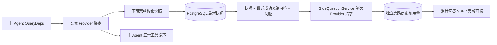

# 子模块

> 仓库内的独立模块。除 SDK 与 DSH 插件外，其余均不参与主二进制构建。

# ARTEX Go SDK（artexsdk）

ARTEX REST 的官方 Go 客户端，覆盖两个面：**协议信封面** `/api/protocol/*`
（Thread/Turn/Item/Approval/Tree/Hooks，统一信封）与**平台原生面**
（`/api/publish`、`/api/options`、`/api/export/*`、`/api/openapi.json`，原生 JSON）。只依赖标准库，
与服务端 `server/protocol_api.go` 的统一信封对齐：

```json
{"protocol":"v1","resource":"threads","action":"list","id":"","data":{...}}
```

### 安装

```bash
go get github.com/Autumn-27/artex/sdk/artexsdk
```

### 快速上手

```go
client, err := artexsdk.New("http://127.0.0.1:8080", artexsdk.WithAPIKey("…"))
if err != nil { … }

// 线程
threads, cursor, err := client.ListThreads(ctx, 0, 50)
_, err = client.CreateThread(ctx, map[string]any{"title": "新任务"})
_, err = client.ControlThread(ctx, "task-1", map[string]any{"action": "start"})

// 轮次 / 消息 / 工作控制
_, err = client.CreateTurn(ctx, "task-1", map[string]any{"kind": "chat", "text": "你好"})
_, err = client.Steer(ctx, "task-1", map[string]any{"text": "改做 B"})
_, err = client.WorkControl(ctx, "task-1", 3, map[string]any{"action": "pause"})
_, err = client.Kill(ctx, "task-1") // 紧急停止走 Engine.KillWork，唯一停止入口

// 会话树 / 发布流与导出
_, err = client.GetThreadTree(ctx, "task-1")
_, err = client.Hooks(ctx)
rc, err := client.PublishStream(ctx)        // SSE，调用方关闭 body
err = client.Stream(ctx, "/api/publish/stream", func(line []byte) bool { …; return true })

// Options：唯一显式下发面（其它端点均为透传/读取，无隐式下发）
prof, err := client.GetModelProfile(ctx)
_, err = client.SetModelProfile(ctx, "deep")
```

### 设计约定

- **显式下发**：只有 Options 系列方法会修改运行时配置；非 Options 方法绝不隐式下发。
- **广播类指令显式化**：如 `Kill` 必须单独调用，不做批量/隐式触发。
- **透传优先**：对上游既有 DTO 原样透传的方法参数用 `any`，响应以 `Envelope.Data`
  （`json.RawMessage`）保留，调用方按需二次解码。
- **错误**：HTTP ≥400 返回 `*APIError`（含状态码与 `error` 文本）。

### 测试

```bash
go test ./sdk/... -count=1
```

测试全部基于 `httptest`，无外部依赖、无网络。

---

# artex-dsh · DSH 原生插件

ARTEX-HYDRA 的 [DSH（DeepSeek Harness）](https://github.com/deepseek-ai/dsh) 原生插件。
它把 ARTEX 的样本分诊、资产图与验证能力直接挂成 DSH 的工具，不用绕
`mcp__artex__*` 这层命名。

### 为什么不用官方 MCP 桥

`@deepseek-ai/dsh-mcp-client` 只桥 **Tools**（Resources / Prompts 官方标注 deferred），
而且工具名会变成 `mcp__artex__pe_info`。这个插件：

- 工具名是干净的 `artex_binscan` / `artex_recon` / `artex_task`；
- 把 ARTEX 的多步工序收成一个动作（`artex_binscan(kind=pe)` → `pe_info`），少一轮往返；
- 档位没开时给的是「去 系统 → MCP 打开 L2」这种能照做的话，而不是 `unknown tool`；
- 挂一段常驻提示（`ctx.systemPrompt`）和一个 `/artex` 斜杠命令（不支持的环境会自动跳过）。

### 安装

```bash
## 1. 先在 ARTEX 控制台 系统 → MCP → 对外接入：打开开关，复制 token
export ARTEX_MCP_TOKEN="artex_mcp_……"      # Windows: setx ARTEX_MCP_TOKEN "…"

## 2. 安装插件（本地目录或已发布的包名）
dsh plugin --profile web add ./artex-dsh

## 3. 确认配置里出现了 artex 行
dsh --profile web --dump-config | grep -A4 artex

## 4. 重启
dsh web
```

`cordis.patch.yml` 默认接 `http://127.0.0.1:8787/mcp`；改端点就改这里的 `config.url`，
或用环境变量 `ARTEX_MCP_URL`。

### 工具一览

| 工具 | 作用 | 依赖档位 |
|---|---|---|
| `artex_binscan` | 样本静态分诊：identify / pe / strings / entropy / ioc | L0 |
| `artex_assets` | 查资产图，避免重复扫描 | L1 |
| `artex_findings` | 查历史漏洞与证据 | L1 |
| `artex_tasks` | 列任务 | L1 |
| `artex_kb` | 战术知识库：打法卡片 / 业务不变量 / 历史结论 | L1 |
| `artex_recon` | DNS / 端口 / TLS / 技术栈验证 | L2 |
| `artex_web` | 原始请求 / FUZZ / 目录 / 参数 / JWT / SQLi 判定 | L2 |
| `artex_task` | 把攻坚委派成 ARTEX 后台任务 | L3 |
| `artex_task_status` | 查任务进度 | L3 |
| `artex_task_pause` / `artex_task_resume` | 暂停 / 恢复任务 | L3 |

默认只有 L0+L1；L2、L3 要在 ARTEX 控制台里显式打开。

### 注意

- 插件本身不做鉴权，也不缓存 token：每次调用都带 `Authorization: Bearer`。
- 没提供「取消任务」：取消等于删任务，请到 ARTEX 控制台操作；这里只有暂停/恢复。
- 本插件按 DSH 2026-08 文档的 Cordis 插件形态编写（`name` / `inject=['tools']` /
  `apply(ctx, config)` + `ctx.tools.register(defineTool(...))`）。若你的 DSH 版本
  API 有变，`dsh --profile web --dump-config` 与 `dsh plugin list` 是最快的验证点。

---

# verification-http · 可选 TLS 校验辅助程序

这是独立Go模块的源码，不是已安装二进制，也不是主ARTEX默认编译依赖。

### 作用

固定`github.com/imroc/req/v3 v3.59.0`的Chrome/Firefox TLS与HTTP预设，通过一对stdin/stdout管道提供单会话RoundTrip。不是浏览器、JS引擎或通用验证码求解器；不保证现代站点或当前浏览器版本通行。

主模块不导入req/uTLS/QUIC。没有显式`fingerprint_profile`时仍走原有HTTP链，存在helper文件也不会默认启动。

### 操作者按需构建与安装（本次未执行）

从本目录执行；仅操作者明确选择才下载Go依赖并构建：

```powershell
## Windows，Go 1.26.3或兼容的新版本；示例不是网页指令
cd integrations/verification-http
go build -mod=readonly -trimpath -o artex-verification-http.exe .
## 移到可信的绝对路径，并在启动ARTEX进程前配置
$env:ARTEX_VERIFICATION_HTTP_HELPER='C:\operator-tools\artex-verification-http.exe'
```

Linux/macOS：

```sh
cd integrations/verification-http
go build -mod=readonly -trimpath -o artex-verification-http .
export ARTEX_VERIFICATION_HTTP_HELPER=/operator-tools/artex-verification-http
```

也可放在ARTEX可执行文件旁或受信PATH。不要使用用户可随意写入的目录，不从网页、AI工具参数或URL自动取程序路径。不要在未获授权时执行上述命令。

通过手动远程CI工作流`Verification helper (opt-in)`检查独立模块；主模块`go test ./...`不会遍历嵌套模块。源码阶段未执行go build/test/vet/mod tidy，也未触发该CI。

### IPC v2（与旧helper不兼容）

本阶段将父级与helper同时更新为v2。旧v1二进制必须由操作者按需重新构建；不自动降级或下载安装。Provider仍为req/v3@v3.59.0，但传输协议版本另行校验。

一行一个JSON，128KiB帧上限。先交换一次hello/ready，再允许最多6个HTTP request/response。握手2秒、请求最多5秒，并受整链deadline夹逼。

- hello：version=2、kind=hello、request_id=0、规范化origin，以及profile/http_version/proxy/ca_pem；不携带URL、method、headers或body。ready仅确认本地协议与配置，不能代表TLS指纹或目标通行验收。
- request：kind=request、request_id按1..6递增，url/method/headers/body及固定会话配置。response必须带相同request_id、kind=response、version/provider。
- profile=chrome|firefox，http_version=auto|1.1|2；TLS默认验证系统根，显式CA有界导入，不提供InsecureSkipVerify。proxy为空则不继承代理环境。
- 每个HTTP URL在子进程内再次校验与握手origin相同；profile、协议、proxy和CA不得中途改变。不允许Host、framing/hop-by-hop和Proxy-Authorization等直接Header覆盖。
- 父级检查状态码、HTTP版本、Header名/值/重复大小写、正文上限、实际请求Header及非空认证/会话Header保留情况。不把helper原始错误或凭据回显，仅返回白名单代码。
- 请求取消、超时、短写、坏帧、超大帧、错序响应或契约不符后，关闭管道、取消进程、禁用当前会话；不重放、不启动替代helper，不让迟到帧污染下一请求。

helper不自动跟随跳转、不持久化Cookie、不写响应文件。父级管理同源、内存jar、提交去重、业务确认及证据。它是操作者可信本地代码，不是恶意可执行文件沙箱，不能暴露成网络服务。

### 资源和取消

- 父级限制最多2个helper进程，每链最多6次客户端RoundTrip、总期限15秒。
- 请求body24KiB、headers8KiB、CA16KiB；response body32KiB+1溢出字节、headers32KiB、stdio帧128KiB。
- 父进程传入GOMAXPROCS=1，GOMEMLIMIT=64MiB。后者是Go软内存目标，非RSS/堆硬限制；TLS、连接、runtime和库可使占用超过该数值。
- 单请求取消或结束时关闭stdin/stdout、取消子进程、Wait回收，进程槽只释放一次。stdout只用于协议，stderr在父级丢弃；不把调试输出返回给模型。
- 没有浏览器、V8、WASM、模型、图片音频解码、媒体缓存或后台daemon。只在操作者构建本模块时引入额外的TLS/HTTP依赖树。

### 依赖与许可

go.mod/go.sum锁定req与其上游显式依赖图，校验条目来自固定版本上游go.sum及Go checksum数据库lookup。此次未下载模块zip、未运行模块解析或验证，最终依赖图/校验仍须由远程CI或操作者验收。

保留`THIRD_PARTY_REQ_LICENSE.txt`，req为MIT；发布二进制前应检查全部间接依赖的许可并生成完整第三方notice/SBOM（uTLS、QUIC、压缩等并非此单份文件全部覆盖）。本次只交付源码，不声称完成二进制供应链或许可验收。

指纹helper的低资源安全覆盖：发送Accept-Encoding=identity，关闭req自动压缩解码；服务端仍返回压缩体时明确失败。不启用Brotli/Zstandard解码窗口或媒体解码，因此并非浏览器全部Header/执行环境的逐字复制。

### 本阶段验收准备（未执行）

手动CI可选择linux、windows或both（最多并行1个），可显式勾选root_ipc_tests以编译agent并执行IPC子进程fixture；默认false，不默认增加主项目编译成本。新增本地httptest的CA信任/拒绝、强制H2、明确代理与不继承环境、无握手/跨源拒绝测试。测试不访问第三方目标；CI下载Go依赖仍需要网络。

本次开发未执行go build/test/vet、未启动ARTEX/helper、未触发CI。公开API与生命周期仍须以远程CI/操作者运行结果验收。

---

# showreel · 60 秒展示片

> **Artex modified open-source reel, full motion graphic + original score included.**
>
> It coded every frame (HyperFrames + GSAP), wrote the background music in
> Python and synced all sound effects automatically.
>
> The audit panel and visualization art in "Creating" scene is real generated
> output: Artex exported assessment logs rendered inside DaVinci Resolve on the
> same day.
>
> Details ⤵️

### 已导出成片

仓库内附带完整 60 秒 MP4 成片：**1920 × 1080、60 fps、H.264 + AAC、120 BPM 原创配乐**。

[](../showreel/ARTEX-Showreel-60s.mp4)

- [下载 / 查看 ARTEX-Showreel-60s.mp4](../showreel/ARTEX-Showreel-60s.mp4)
- [交互式播放器与逐帧源码](../showreel/index.html)

可用下方命令重新生成视频；需要系统已安装带 `libx264` 的 FFmpeg。渲染器会逐帧流式送入编码器，不会落地 3600 张 PNG。

### Run it

```bash
## any static server from this directory — then open the page
python3 -m http.server 8000
## → http://localhost:8000
```

Player controls: `SPACE` play/pause · `←/→` step one frame · `R` restart ·
scrub bar to seek. Query params for deterministic stills: `?t=12.5`,
`?frame=750` (frame index @ 60 fps), `?paused=1`.

### The film

One single analytical line evolves three times and never leaves the screen for
the whole 60 seconds:

| Stage | Ink | Look |
| --- | --- | --- |
| PAPER | graphite `#16161A`, accent blue `#1B3ED2` | cream `#EDE6D5` paper, 60 px grid (13 % / 26 % every 5th), sine-distorted double pencil strokes (phase boils at 8 Hz), diagonal hand hatching, multiply grain masked out from strokes |
| BLUEPRINT | white, accent cyan `#45F0DD` | solid blue `#1B3ED2`, identical grid in white, clean 3–4 px lines, thin dashed hidden edges, fine neat hatching |
| HOLOGRAM | cyan `#45F0DD` + white core (30 % width) | black `#07080A`, grid in cyan, fills from 8 px pitch scan lines whose thickness is the lighting. **No blur, no glow** — light is line density |

Rule obeyed throughout: *the accent color of the current stage becomes the
primary color of the next* — blue pencil on paper → cyan lines on blueprint →
white highlights on hologram.

**Type** — Geist only. Headlines 900 with hatching clipped to letterforms and a
doubled outline; labels 600–800 at 24–28 px with 0.14–0.3 em tracking.

**Camera** — locked front orthographic, top-down drafting table. Objects move;
the camera never does. Static objects respect the 150 px / 90 px safe border
(moving geometry may cross it).

**Timing** — 120 BPM · 120 beats · 30 bars × 2 s. An event lands on every beat
and starts 0.05 s before its marker. Movement easing is the critically damped
spring `1 − (1 + w·t)·e^(−w·t)` with `w ∈ [12, 40]` — nothing ever overshoots.
Wipes, floods and exits use exponential ease-in/out.

**Transitions** — Paper → Blueprint: hard-edged shape flood. Blueprint →
Hologram and Hologram → Paper: a single horizontal scan line. No cuts, no
crossfades, no dissolves, no banned effects. **First frame ≡ final frame** —
the 3600-frame loop is seamless in both directions.

**Permanent HUD** — `FIG. [BAR] — [BAR NAME]` top left (30 names: SCAN, ASSET,
MAP, PORT, TRACE, CURVE, MORPH, NODE, GRAPH, TILE, SOLID, GEAR, PANEL, DATA,
RULE, CHECK, TOOL, REQUEST, RESPONSE, PRIORITY, LOG, LIGHT, WAVE, GLOBE,
PIPELINE, AUDIT, VERIFY, BOUNDARY, LOOP, END) and `BEAT [n] / 120` bottom right.

**Mascot** — the creative-director box character (76 × 54 body, 24 × 16 arm
stubs, 11 × 33 legs, 8 × 14 eyes, ~250 px overall with its drafting pencil,
right arm raised 58°) runs at 6 steps/s leaning 7° into its motion. Paper:
graphite outline + sparse blue hatching. Hologram: cyan outline + scan-line
fill + solid white eyes.

### Storyboard (30 bars)

| Bar | Stage | Beat |
| --- | --- | --- |
| 1 | PAPER | HOOK — ARTEX headline, mascot exits, rail presses letters flat, splits, dimension line |
| 2 | PAPER | SCAN — ASSET DISCOVERY → SCAN → ENDPOINT → PORT MAP between rails |
| 3 | PAPER | CURVE — pen-tool handles, 8-copy leaf fan, travelling sine waves |
| 4 | PAPER | MORPH — circle → triangle (120° spin) → square → hexagon + hatching |
| 5 | PAPER | NODE — honeycomb graph, solid fill, hexagon flood-out |
| 6 | BLUEPRINT | 3D NODE — corner-view cubes merge, perspective turn |
| 7 | BLUEPRINT | GEAR — 16T/10T/12T meshing gears, stepped 45° eighths |
| 8 | BLUEPRINT | PANEL — cube net unfolds into the ARTEX assessment UI |
| 9 | BLUEPRINT | DATA — graph line, live playhead, cursor click, warp to audit circle |
| 10 | BLUEPRINT | RULE — SCOPE / PERMISSION / WHITELIST tree, pruned, compressed |
| 11 | BLUEPRINT | TOOL — HTTP · DNS · SCANNER, packets, risk numbers |
| 12 | BLUEPRINT | LOG — priority sort, typed audit log, terminal flow |
| 13 | HOLOGRAM | VERIFY — cyan node graph, REACHED · CONFIRMED · LOGGED, mascot |
| 14 | HOLOGRAM | GLOBE — wireframe globe, ripples, waveform |
| 15 | HOLOGRAM | PIPELINE — COLLECT → ANALYZE → PLAN → EXECUTE → AUDIT |
| 16–20 | PAPER | CHECK · TOOL · REQUEST · RESPONSE · PRIORITY |
| 21–24 | BLUEPRINT | LOG · LIGHT · WAVE · GLOBE |
| 25–28 | HOLOGRAM | PIPELINE · AUDIT · VERIFY · BOUNDARY |
| 29–30 | PAPER | LOOP · END — the line returns to the headline rail, landing exactly on frame 0 |

### Code map

```
js/hyperframes.js   deterministic frame engine — clock, spring/exp easing, noise
js/geometry.js      polylines, morphing, gears, cubes, globes, honeycomb, type
js/ink.js           the three inks: pencil / wire / beam + hatching + grain + grid
js/mascot.js        the creative-director box character
js/scenes.js        all 30 bars of choreography as pure functions of t
js/render.js        hard-edged transition compositor (flood + scan line)
js/main.js          GSAP master transport + player UI
tools/render_frames.js  offline PNG frame exporter (npm i @napi-rs/canvas)
tools/render_video.js   stream frames into H.264/AAC MP4 (requires FFmpeg)
test/smoke.js + test/loop.js  all-frame smoke + pixel-exact loop seam check (npm test)
audio/score.py      original 120 BPM score + auto-synced SFX (python3 score.py)
```

### Score

```bash
cd audio && python3 score.py     # → score.wav (60 s loop) + sfx_sync.json
```

Pure stdlib synthesis: kick / hats / bass / arp / pad on the shared beat grid,
pencil scribbles on every draw event, whooshes inside the six transition
windows, UI blips on interaction beats. The page plays `audio/score.wav`
automatically when present (press PLAY once if the browser blocks autoplay) and
runs silently without it.

### Frame export (e.g. for DaVinci Resolve)

```bash
npm i @napi-rs/canvas
## copy Geist-*.ttf from the `geist` npm package into vendor/
node tools/render_frames.js --fonts vendor --out out --frames 0:3599:1
```

### MP4 export

Requires FFmpeg with `libx264` available on `PATH` (or set `FFMPEG_PATH`).

```bash
npm install
python3 audio/score.py
npm run video -- --out ARTEX-Showreel-60s.mp4
```

The exporter streams 3600 deterministic frames at 60 fps directly to FFmpeg,
then muxes the 60-second stereo score as AAC. It writes no intermediate frame
sequence. Add `--mute` for a silent render.

---

# sidequestion · 旁路问答

普通聊天、任务 MainAgent 和当前任务自己的 Worker 支持独立旁路提问。主输入框输入 `/btw 问题` 即可提交，空 `/btw` 或“旁路提问”按钮打开历史。桌面使用可调整宽度的侧栏，移动端使用 Drawer。

旁路回答根据提交时的 Agent 上下文快照生成，支持流式显示、追问、停止和清空。关闭面板、刷新页面或断开 SSE 都不会取消模型请求。停止只影响当前旁路；清空会取消旁路并删除旁路历史，同时保留主上下文快照。

### 实现边界

沿用 Go、norma v0.3.7、Next.js、现有 Markdown / ResizablePanel / Drawer / AlertDialog 组件；没有修改 norma 源码或为旁路添加依赖。Planner、继承自其他任务的 Worker、工具型子任务升级不在本次范围内。



- `capture.go` 只在 `Options.Deps.CallModel / CallModelSync` 标记主循环请求。Provider 装饰器位于具体模型内部、路由池外层选择之后，因此记录实际选中的模型；压缩和摘要请求不覆盖快照。
- 请求开始、完整模型回复、运行终态发布快照。正在生成的半段回复不发布；工具调用通过 norma 的 `MessagesForAPI` 保持配对，工具结果在下一次主模型请求或运行终态进入快照。流式中止保留上一个有效边界。
- 快照通过 JSON 深拷贝保留结构化消息、系统提示、工具定义及生成参数。模型推理不持有快照锁或数据库事务。
- `SideQuestionService` 调用具体 Provider；必要时先生成旁路摘要，最终回答仅在首次上下文超限且尚未输出文本/工具调用时允许缩减后重试一次。不创建 agent session，不接入工具执行器、主 transcript、活动流或任务图，也不经过任务模型切换链。回答保留工具定义是为兼容既有结构化工具上下文；摘要请求不提供工具。新返回的工具调用没有执行路径。
- 每个父会话一个运行请求，单个服务进程最多四个，单次超时 120 秒。旁路使用服务生命周期下的独立取消上下文。
- 旁路请求保留模型配置引用和非敏感身份摘要；请求时从现有配置取得凭据。配置被删除，或模型、协议、地址等身份字段变化，要求先运行主 Agent 更新快照。测试不会改变产品默认模型。

### 持久化和恢复

`db/schema.sql` 自动创建 `side_question_sessions` 和 `side_question_requests`。前者保存父资源、最新快照、运行编号、版本和清理版本；后者保存问题、累计回答、状态、模型、快照时间、用量、事件序号和分页序号。

父会话键使用 conversation ID，或 task ID + exploration ID + intent ID。Worker 不使用可复用的执行槽位命名。

快照按父会话合并写入，每 250 ms 刷新一次，数据库比较 `(run_id, version)` 防止旧版本覆盖。旁路提交前再次保存选定快照。成功保存后释放内存中的大快照；失败时保留待写版本。回答累计内容在流式事件到来时最多每 250 ms 写入一次，终态立即保存并在数据库错误时有限重试。

服务启动将遗留 `running` 请求标记为 `interrupted`，保留已落库的部分回答和用量，不自动重放请求。最近成功保存的上下文可直接用于下一次提问。旧会话没有快照时要求先运行主 Agent，不从 UI 活动记录重建上下文。

清空操作递增清理版本并删除请求；条件更新阻止迟到的回调重新写回。物理父资源删除依靠外键级联，Worker 逻辑删除在同一事务中删除旁路数据，并拒绝后续迟到快照。任务归档先阻止新请求、等待主流程停止、取消并等待旁路落库；归档格式为 v3，同时兼容不含旁路表的 v1/v2。

历史完整保存，按序号游标每页最多返回 20 条。模型请求最多回放最近 20 组成功问答原文，同时按 token 预算限制回放量；较旧问答维护独立滚动摘要。主上下文超预算时仅摘要旁路副本的旧部分，保留近期结构化工具调用与结果。摘要、准备进度与用量一起纳入旁路的并发、取消和 120 秒超时限制。详见下节。

### 上下文预算与开源参考

2026-09-11 修复。原实现将请求 JSON 的字符数直接视为 token，并继承主任务的 32K 输出预留，因此 HTML、JS 和工具结果较多时会提前拒绝正常旁路问题。

#### 开源实现核对

- [Grok CLI 旁路上下文](https://github.com/superagent-ai/grok-cli/blob/fb97af83f06dca873281d60168430f06c8de6324/src/agent/agent.ts#L739)：从最近的用户、助手文本中摘取片段，字符预算约 2000，每条至多截取 400 字符。未在此路径维护连续旁路问答历史。
- [Grok CLI 独立请求](https://github.com/superagent-ai/grok-cli/blob/fb97af83f06dca873281d60168430f06c8de6324/src/utils/side-question.ts)：独立取消信号；模型支持时输出上限为 2048 tokens；不提供工具。
- [Grok CLI 主会话压缩](https://github.com/superagent-ai/grok-cli/blob/fb97af83f06dca873281d60168430f06c8de6324/src/agent/compaction.ts)：估算 token、保留近期内容、把新内容更新进旧摘要，并处理跨回合截断。
- [OpenCode 会话压缩](https://github.com/anomalyco/opencode/blob/b3f1a96c6dd7adeb28b36dd11add1998fc84d67b/packages/core/src/session/compaction.ts)：完整请求估算、输出/缓冲预留、近期内容加滚动摘要、无工具摘要请求；该实现默认近期预算 8000、摘要输出上限 4096 tokens。
- [OpenCode 溢出恢复](https://github.com/anomalyco/opencode/blob/b3f1a96c6dd7adeb28b36dd11add1998fc84d67b/packages/core/src/session/runner/llm.ts)：尚未开始助手输出时才尝试溢出恢复，恢复后的调用不再进入同一溢出恢复路径。

ARTEX 借鉴独立输出预算、近期内容与滚动摘要、有限恢复的做法。保持 norma 的结构化消息与工具配对，不照搬 Grok 的文本摘录；不把 OpenCode 的主会话压缩事件写入 ARTEX 主 transcript。

#### 请求预算与执行

- 消息沿用 norma 的按内容块 UTF-8 字节估算及 4/3 余量；额外计入系统提示、工具 schema 和消息封装开销。估算不是模型精确 token 计数。
- 旁路输出默认最多 8192 tokens，也不超过主配置已设的输出上限。可用服务环境变量 `ARTEX_BTW_MAX_OUTPUT_TOKENS` 设置 256–32768 的上限；不会修改产品默认模型或主任务参数。
- 输入预算为上下文窗口减去输出上限和安全余量；未知窗口使用平台默认 200K。安全余量为窗口的 5%，最小 128、最大 8192 tokens。
- 成功问答按递增序号每批最多加载 20 组。最多保留 20 组原文，其 token 预算最多为输入预算的 1/4，且不超过 16K。
- 超额问答更新到滚动摘要。摘要带历史来源与上下文时间；历史助手回答不等同于新的工具证据，冲突时优先依据最新主快照。
- 主上下文仍过长时，仅摘要副本中的旧消息，近期最多保留 8K tokens；截取点不会拆开工具调用与结果。过大的单组会整体进入摘要。
- 摘要输入按实际剩余窗口进行 UTF-8 安全分块，输出上限 2048 tokens；空摘要、截断、工具调用或超出摘要预算均不写缓存。单次旁路最多 12 次摘要调用，并受同一 120 秒超时限制；达到上限会明确失败，不无限循环。
- 若模型首次返回上下文超限且尚未输出文本或工具调用，进一步缩减后最多重试一次；若估算大小没有下降，立即停止恢复。其他模型错误和部分流式输出不触发该恢复。
- 所有已取得用量，包括摘要、失败尝试和取消时的用量，累加到同一旁路请求。Provider 不返回用量时仍只能记录零，不能把估算伪装成实际用量。

#### 持久化与界面

`side_question_sessions.memory` 保存旧问答摘要、覆盖的 ordinal，以及按快照身份缓存的主上下文摘要。`side_question_requests.context_info` 保存准备阶段、实际回放组数、摘要使用情况和预算估算。

摘要只在原请求仍运行且清理版本匹配时保存；清空同时清除缓存，迟到写入不会恢复已清理数据。新快照不复用旧快照摘要。摘要字段随 v3 任务归档保存；恢复旧 v3 缺失字段时补空对象，v1/v2 继续兼容。

POST 先接纳并返回请求，准备与压缩在后台执行，不持有准入锁或数据库事务。SSE/历史显示准备、整理问答、压缩副本、回答阶段；压缩失败作为该旁路请求的失败终态保存。前端保留错误并恢复本次失败问题的草稿，不用悬浮通知遮挡输入框；历史轮询不再清掉提交错误。

### HTTP 契约

以下路径作为 `{parent}`，沿用现有认证及资源校验：

- `/api/conversations/{id}`
- `/api/tasks/{id}/chat`
- `/api/tasks/{id}/intents/{iid}`

| 请求 | 返回及行为 |
| --- | --- |
| `GET {parent}/side-questions?before={ordinal}` | `items` 按新到旧排列、独立 `current` 运行状态、`snapshot` 元信息、`next_cursor`；游标为 0 表示最新页 / 无下一页 |
| `POST {parent}/side-questions` | JSON `{ "question": "…", "client_request_id": "UUID" }`；新请求返回 202 及请求对象；相同 ID 和问题返回既有对象 200 |
| `DELETE {parent}/side-questions` | 取消并清空当前父会话的旁路问答 |
| `GET /api/side-questions/{requestID}/events` | `snapshot` SSE 事件，`id` 为递增序号，`data` 为完整累计请求对象；清空时发送 `cleared` |
| `POST /api/side-questions/{requestID}/cancel` | 显式取消；终态可从历史或 SSE 读取 |

问题上限 4000 字符。无快照、模型配置变化、同一父会话忙或幂等 ID 冲突返回 409；全局并发上限返回 429。每次 SSE 连接都先发送累计状态，不依赖客户端之前收到的文本片段。前端按请求 ID + 序号合并，并在切换父会话、清空时废弃旧回调。

### 验证记录

日期 2026-09-10（预算改动 2026-09-11 复验）。使用独立测试库与数据目录；真实模型凭据只注入独立测试环境，没有写入代码，也没有修改产品默认模型。实际模型对话、返回对象与审查原文保存在 [`validation-2026-09-10.json`](../sidequestion/validation-2026-09-10.json)（不含 API 凭据）。

**工程检查（均通过）**：结构化消息与工具参数深拷贝；摘要/压缩请求不覆盖快照、半段回复排除；实际模型池成员身份；工具配对、20 组回放、预算裁剪与超限错误；主旁路并行与双向取消隔离；无工具执行（流式/非流式、失败时仍记用量）；真实 ChatAgent + 本地工具与主 transcript/活动隔离；持久化、分页、幂等、重启保留部分回答；清空与迟到写入竞争、父资源删除、版本比较；MainAgent/Worker 归档与 v1/v2/v3 兼容；三种父接口的认证与归属校验；忙碌主会话可旁路、独立 SSE 重连与取消；每父会话 1 / 全局 4 并发；提交前快照落库与重启续问；缓存配置变更后拒绝继续；归档前 drain 落库；消费者提前取消时用量只记一次；恢复的 Worker 运行上下文继续发布新快照。相关包 `-race` 通过；前端 `tsc --noEmit`、生产构建与新增模块 `biome check` 通过。

**预算改动复验（2026-09-11）**：19/20/21/50 组回放、跨 20 组旧结论保留、摘要缓存重启复用、超长中文回答与代码上下文、分块请求预算、工具配对、快照不变、新快照缓存失效、摘要失败/取消/截断/超长/工具返回、清空竞争、调用上限、仅一次溢出恢复及部分流不重试，均通过；独立 PostgreSQL 的分页/重启/归档/预算元数据恢复与 20 个父会话共享四个并发名额通过；内置浏览器在 1280×720 与 390×844 验证整理阶段、摘要范围提示、失败后草稿恢复、无悬浮错误通知、无横向溢出、控制台无错误。只读回放本机 Worker 快照（如 293085 字符）不再被本地字符计数误判拒绝。

**真实模型对话**：主会话运行期间询问资产/目标/标记 → 返回预期资产、首页读取与总结（16.97s）；询问工具依据 → 正确引用 WebFetch 200 与跳转链（7.24s）；要求 Bash 创建文件 → 拒绝执行且文件未创建（7.74s）；完成后的旁路不改变主上下文（主 transcript SHA-256 与活动记录一致，旁路工具执行 0 次）；停止并重启 Go 服务后续问 → 保留先前 3 条旁路历史，直接从持久化快照回答，未重跑主 Agent。流式端点不返回 usage，因此流式记录的 0 表示端点未提供用量，不能解释为未计费；非流式用量（如 input 11734 / output 138 / cache_read 11520）正确保存。

**第三方审查**：审查模型返回 `verdict: accept`、`concerns: []`，认为回答与资产、标记、页面读取证据一致，旁路工具拒绝符合约束。

**已知非绿项（如实记录，未修改既有断言）**：全量 Go 回归中 `server` 包有两个既有用例在临时目录清理阶段失败（`TestInheritedActivityDetailAndRelationDeletion`、`TestTaskMetadataPatchReturnsRenameAndPin`，均报 `TempDir RemoveAll … directory not empty`）；从未修改基线导出源码后在相同隔离环境重跑仍可复现，判为基线问题而非本次改动。Next.js 构建存在既有的多 lockfile / workspace root 推断警告，构建完成且页面全部生成。

复现命令（只用独立可丢弃数据库，不要指向生产库）：

```sh
go test -race ./agent ./db ./server ./sidequestion ./llmrec ./llmpool \
  -run 'Test(Side|Checkpoint|Snapshot|BuildRequest|Service|MainSide|CaptureRun|TaskArchive|CompleteForwards|StopIntent|CancelIntent)' -count=1
cd web && npx tsc --noEmit
npx biome check src/lib/side-questions.ts src/hooks/use-side-questions.ts src/components/side-question-workspace.tsx
npm run build
```

### 参考实现

独立请求参考 [Grok CLI side-question.ts（固定提交）](https://github.com/superagent-ai/grok-cli/blob/fb97af83f06dca873281d60168430f06c8de6324/src/utils/side-question.ts)，运行隔离参考 [OpenCode（固定提交）](https://github.com/anomalyco/opencode/tree/b3f1a96c6dd7adeb28b36dd11add1998fc84d67b)。ARTEX 的上下文使用 norma 的结构化消息，未采用从前端日志拼接文本的方式。

---

# website · 独立官网

独立静态多页面网站，统一维护于 ARTEX 总源码的 `website/` 子目录。**站点是纯静态 HTML / CSS / JS，无需任何构建步骤。不连接生产控制台，不运行分析引擎；与 `web/` 控制台前端分开维护和发布。**

### 源码位置与统一维护

- 当前目录：`C:\Users\Administrator\Desktop\ARTEX\website`
- 站点源码即部署内容：`site/` 目录下的静态 HTML / CSS / JS，直接编辑、直接预览、直接部署。
- 原独立目录 `Desktop\ARTEX-Website` 已整体迁入并改名为 `website`，不保留第二份活跃源码。
- `../web/` 是产品控制台；本目录是对外官网。
- 完整维护与发布入口见 [README 的「独立官网源码」一节](09-子模块.md#website--独立官网)。
- 历史核对记录见 `deployment/` 与 `reports/`；`DELIVERY.json` 是部署前审核快照，不应当作当前源码校验。

### 最新部署状态（2026-10-17）

- 正式访问：https://artex-official-website.pages.dev/
- 本次最终部署快照：https://6fae4b04.artex-official-website.pages.dev/
- 用户已授权独立 Pages 项目发布。没有绑定自定义域名、修改 DNS、覆盖既有项目或部署 ARTEX 后端。
- 已在 Chromium 核查 10 个内容页与 404，深色桌面 / 浅色移动共 22 个组合；报告下载响应头问题已修复并实际下载复验。
- 官网性能分数仍为发布前本地测量，不代表线上网络表现。原交付 ZIP 是部署前审核快照，当前目录为发布后的源码。
- 2026-10-17 完成静态化改造：源码固化为纯静态 `site/`，不再需要构建；`site/` 29 个文件与线上发布哈希逐一核对一致，线上内容未变化。
- 2026-10-17 支持 `file://` 双击直开（相对路径 + 本地搜索索引）；该变更已随下方 v3 一并部署上线。
- 2026-10-17 完成视觉升级 v3（编辑式排版、双信号轨道信息图、层叠材质与滚动显影）并部署上线；同批上线显影优先级修复与全站 GitHub 仓库入口。发布记录见 `deployment/publish-design-upgrade.json`。

### 网站内容

| 路由 | 内容 |
|---|---|
| `/` | 品牌首页、双领域视角、交互式联合调查示例 |
| `/platform/` | 双领域产品结构、共享底座、能力状态矩阵 |
| `/platform/network/` | 网络安全对象、协作与授权范围 |
| `/platform/reverse/` | 样本、Provider、会话、函数和证据；能力筛选 |
| `/workflows/` | 先后、并行、版本化交付与人工检查点 |
| `/architecture/` | 领域模型、共享平台和规划中的项目层 |
| `/benchmarks/` | 本官网真实本地测量、条件与原始报告 |
| `/docs/` | 领域概念、接入原则、官网运行与发布准备 |
| `/updates/` | 历史源码交付记录及待验收事项 |
| `/trust/` | 安全、授权、数据与使用边界 |
| 未知路由 | 独立 404 页面，预览服务返回 HTTP 404 |

### 运行（纯静态，无需构建）

预览只使用 Node 标准库（`tools/serve.mjs`），无需安装依赖：

```sh
npm run preview
```

预览默认监听 `0.0.0.0:4173`，浏览器访问本机 `http://localhost:4173/`。可用环境变量 `PORT` 修改端口。页面与资源全部使用相对路径，也可以直接双击 `site/index.html` 打开（`file://`），不需要任何本地服务；搜索索引为本地数据文件 `site/assets/search.js`，离线同样可用。

只有运行浏览器检查或性能测量时才需要 `npm ci`（Playwright、axe、Lighthouse）。

#### 静态化改造（2026-10-17）

- 移除 Node 构建器（原 `src/build.mjs`、`src/components.mjs`、`src/pages.mjs`）以及 `public/` + `dist/` 的产物式结构。
- 原 `dist/`（构建产物，即线上已发布内容）原样固化为源码 `site/`；本地预览服务迁移为 `tools/serve.mjs`。
- `site/` 中的 HTML 为压缩单行格式（与线上一致）；后续如做格式化美化，发布前必须重跑 `npm test` 复验布局与可访问性。
- canonical 与 sitemap 已固化 `https://artex-official-website.pages.dev/`；更换域名需全站替换 URL 并手工更新 `site/sitemap.xml`，不得虚构其他域名。

#### 双击直开（file:// 支持，2026-10-17）

- 页面链接与资源改为相对路径（按页面层级），`site/index.html` 可直接双击打开，无需本地服务或依赖。
- 站内搜索索引由 `fetch` 的 `assets/search.json` 改为普通脚本 `assets/search.js`（`window.ARTEX_SEARCH`）；新增或修改页面后需手工同步该文件。
- 内页在 `<html>` 上声明 `data-root` 层级，供搜索结果的相对链接拼接；`404.html` 保留根路径（仅用于线上未知路由兜底，`file://` 下不适用）。
- 该变更已于 2026-10-17 随 v3 升级一并发布上线。转换记录见 `deployment/file-protocol-conversion.json`。

#### 视觉升级 v3（2026-10-17）

- 站点样式全量重写为「仪器编辑风」：层叠大气层（网格 / 颗粒 / 光晕）、渐变墨大标题、页头幽灵字、悬停极光描边与指针聚光、滚动显影与跑马灯；首页 Hero 图像重构为内联 SVG「双信号轨道图」。
- 交互都在 `assets/site.js` 的追加模块中，渐进增强：显影依赖 `assets/theme.js` 预置的 `js-reveal` 类，并有 2.6 秒兜底；后续调整显影范围时，请同步修改 `site.css` 的 `js-reveal` 选择器组与 `site.js` 的 `revealList`。注意：隐藏规则与显示规则必须共用同一份 `:is(...)` 列表（显示规则写作 `:is(...).in`），否则列表中的复合选择器（如 `.page-hero>.eyebrow`）会把隐藏规则优先级抬高，内容拿到 `.in` 后仍停留在隐藏态（2026-10-17 曾出现并修复）。
- `format-strip` 的跑马灯由脚本克隆 `.marquee-track` 内容，不要手工复制第二份轨道；新增格式标签只需在原有轨道中加 `<span>`。
- 副页幽灵字来自各页 `<section class="page-hero container" data-fig="…">`，新增页面时补上该属性即可。
- 跨页 GitHub 入口：页头图标按钮（`.github-button`，复用 `.icon-button` 样式）与页脚仓库横幅卡片（`.footer-repo`，悬停极光描边 + 指针聚光已加入 `site.js` 聚光列表）；两处均新窗口打开公开仓库，仓库地址变更时需同步全部 11 个页面（每页 2 处）。
- 不新增资源文件；无内联脚本，CSP 不变；`file://` 双击直开与本地搜索索引不受影响。记录见 `deployment/design-upgrade-2026-10.json`。
- 该变更已于 2026-10-17 发布上线（快照与核查见 `deployment/publish-design-upgrade.json`）。

### 验证与测量（仅官网）

```sh
npx playwright install chromium
## Linux 如缺共享库，需按 Playwright 官方方式安装浏览器依赖。
npm test
npm run measure
```

先保持 `npm run preview` 运行。测试默认使用 `http://127.0.0.1:4173`；可用 `SITE_BASE` 指向本官网的另一个测试地址，**不要指向第三方目标**。

- `tests/browser.mjs`：内容路由与 404、1440/390 两种视口、深浅两种主题、axe 扫描、横向溢出、浏览器异常、内部链接和交互检查。
- `tests/measure.mjs`：Lighthouse 12.8.2 首页移动/桌面各一次，公开模拟节流配置和环境；生成 JSON/HTML 原始报告，并把可公开报告同步到 `site/reports/`。
- `reports/browser.json`：本地浏览器检查记录。
- `reports/measurements.json`：对外测量摘要。
- `reports/measured-manifest.json`：除测量页及报告外的站点文件哈希清单，用于绑定测量对象。
- `site/reports/`：可以通过网站下载的测量报告。

网站页面中的测量摘要与分数是静态文本；重新测量后如需对外更新，须同步修改 `site/benchmarks/index.html` 中引用的数值。

结果只代表记录中的 Chromium 与本地 Linux 沙箱条件，不代表 Windows 实机、Safari、Firefox、生产 SLA 或真实用户 Core Web Vitals。自动可访问性扫描不是完整合规认证。

没有对 ARTEX 主项目执行构建、编译、测试、迁移或引擎联调；历史源码交付数据在页面中单独标注。

### 目录

```text
site/                   纯静态站点源码（即部署内容，29 个文件）
  index.html 404.html … 各内容页目录（architecture/、platform/ 等）
  assets/               语义主题 CSS、交互 JS、本地字体、搜索索引
  reports/              公布的实测原始报告
  _headers robots.txt sitemap.xml routes.json
tools/serve.mjs         本地预览服务（Node 标准库、gzip、真实 404）
tests/                  浏览器检查与测量脚本
  browser.mjs
  measure.mjs
reports/                原始测量、截图、执行日志
deployment/             发布脚本与历史核对记录（deploy_once.py、deploy.log 等）
wrangler.toml           独立 Pages 配置，无账户、Token、正式域名
```

### Cloudflare / Wrangler 核查

通过用户指定的远程 MCP 检查：

- Wrangler 命令存在于用户 npm 全局目录，版本 **4.131.2**（现有 4.151.1 可用更新，非必须）。
- Node.js **v24.20.0**。
- 最初查询等待超时；后续带进程树清理与 10 秒上限的 `wrangler whoami` 成功返回，确认 CLI **已登录**。账号详情未输出、未写入网站；后续已验证可创建并部署本次独立项目。没有运行登录、注销，也未查看或导出 Token 值。
- ARTEX 主项目目录内 `**/wrangler*` 未匹配到配置。
- 首轮审核没有部署；后经明确授权创建并部署独立项目，**未绑定自定义域名、修改 DNS 或覆盖既有服务**。

当前配置已用于本次独立官网发布。更换账号、项目或绑定自定义域名须再次确认。`_headers` 为 Cloudflare Pages 准备，本地预览不应用 iframe 禁止策略，以兼容审核预览。生成的 Lighthouse HTML 报告使用内联脚本，因此以下载附件方式提供，保存后本地查看；内容页面脚本仅同源外置。

canonical 与 `site/sitemap.xml` 已固化当前正式域名。如绑定自定义域名，须全站替换 URL 并重新生成 sitemap；没有域名时不虚构 URL。

### 设计与资源

- v3「仪器编辑风」：编辑式大标题（酸柠→薄荷渐变墨）、层叠大气层（固定网格、颗粒、径向光晕）、轨道式内联 SVG 信息图、页头幽灵字、悬停极光描边与指针聚光、滚动显影与跑马灯；深浅两套语义 token 同步。
- 深墨绿 / 酸柠强调、暖灰浅色、全局语义 token。
- 自适应导航、原生 dialog 搜索、键盘操作与可见焦点。
- 支持系统主题、手动切换、偏好持久化、减少动态效果及暂停动效；显影系统在脚本失败时自动回退为静态内容。
- Manrope 本地 WOFF2，许可见 `site/assets/Manrope-LICENSE.txt`；中文使用系统字体。
- 技术叙事与可视化组织参考：[Awwwards / Shift 5](https://www.awwwards.com/sites/shift-5)，并参考 Awwwards / CSS Design Awards / FWA 2025–2026 获奖作品公开呈现的通用做法（大字排版、深色层叠材质、bento 网格、滚动叙事）。不复制这些项目的资产、截图或代码，不暗示 ARTEX 获奖。
- 无远程字体、CDN 脚本、统计跟踪和伪造客户 Logo。演示数据明确标注，不展示不存在的产品准确率或性能提升。

### 后续审核与改进

域名与账号、生产隐私说明、正式产品入口、跨浏览器与辅助技术人工检查、真实网络条件的性能复测。当前没有注册/支付/生产登录服务，因此不展示可误导用户的提交表单或试用按钮。
