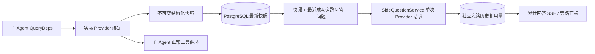

# ARTEX `/btw`

普通聊天、任务 MainAgent 和当前任务自己的 Worker 支持独立旁路提问。主输入框输入 `/btw 问题` 即可提交，空 `/btw` 或“旁路提问”按钮打开历史。桌面使用可调整宽度的侧栏，移动端使用 Drawer。

旁路回答根据提交时的 Agent 上下文快照生成，支持流式显示、追问、停止和清空。关闭面板、刷新页面或断开 SSE 都不会取消模型请求。停止只影响当前旁路；清空会取消旁路并删除旁路历史，同时保留主上下文快照。

## 实现边界

沿用 Go、norma v0.3.7、Next.js、现有 Markdown / ResizablePanel / Drawer / AlertDialog 组件；没有修改 norma 源码或为旁路添加依赖。Planner、继承自其他任务的 Worker、工具型子任务升级不在本次范围内。



- `capture.go` 只在 `Options.Deps.CallModel / CallModelSync` 标记主循环请求。Provider 装饰器位于具体模型内部、路由池外层选择之后，因此记录实际选中的模型；压缩和摘要请求不覆盖快照。
- 请求开始、完整模型回复、运行终态发布快照。正在生成的半段回复不发布；工具调用通过 norma 的 `MessagesForAPI` 保持配对，工具结果在下一次主模型请求或运行终态进入快照。流式中止保留上一个有效边界。
- 快照通过 JSON 深拷贝保留结构化消息、系统提示、工具定义及生成参数。模型推理不持有快照锁或数据库事务。
- `SideQuestionService` 调用具体 Provider；必要时先生成旁路摘要，最终回答仅在首次上下文超限且尚未输出文本/工具调用时允许缩减后重试一次。不创建 agent session，不接入工具执行器、主 transcript、活动流或任务图，也不经过任务模型切换链。回答保留工具定义是为兼容既有结构化工具上下文；摘要请求不提供工具。新返回的工具调用没有执行路径。
- 每个父会话一个运行请求，单个服务进程最多四个，单次超时 120 秒。旁路使用服务生命周期下的独立取消上下文。
- 旁路请求保留模型配置引用和非敏感身份摘要；请求时从现有配置取得凭据。配置被删除，或模型、协议、地址等身份字段变化，要求先运行主 Agent 更新快照。测试不会改变产品默认模型。

## 持久化和恢复

`db/schema.sql` 自动创建 `side_question_sessions` 和 `side_question_requests`。前者保存父资源、最新快照、运行编号、版本和清理版本；后者保存问题、累计回答、状态、模型、快照时间、用量、事件序号和分页序号。

父会话键使用 conversation ID，或 task ID + exploration ID + intent ID。Worker 不使用可复用的执行槽位命名。

快照按父会话合并写入，每 250 ms 刷新一次，数据库比较 `(run_id, version)` 防止旧版本覆盖。旁路提交前再次保存选定快照。成功保存后释放内存中的大快照；失败时保留待写版本。回答累计内容在流式事件到来时最多每 250 ms 写入一次，终态立即保存并在数据库错误时有限重试。

服务启动将遗留 `running` 请求标记为 `interrupted`，保留已落库的部分回答和用量，不自动重放请求。最近成功保存的上下文可直接用于下一次提问。旧会话没有快照时要求先运行主 Agent，不从 UI 活动记录重建上下文。

清空操作递增清理版本并删除请求；条件更新阻止迟到的回调重新写回。物理父资源删除依靠外键级联，Worker 逻辑删除在同一事务中删除旁路数据，并拒绝后续迟到快照。任务归档先阻止新请求、等待主流程停止、取消并等待旁路落库；归档格式为 v3，同时兼容不含旁路表的 v1/v2。

历史完整保存，按序号游标每页最多返回 20 条。模型请求最多回放最近 20 组成功问答原文，同时按 token 预算限制回放量；较旧问答维护独立滚动摘要。主上下文超预算时仅摘要旁路副本的旧部分，保留近期结构化工具调用与结果。摘要、准备进度与用量一起纳入旁路的并发、取消和 120 秒超时限制。详见下节。

## 上下文预算与开源参考

2026-09-11 修复。原实现将请求 JSON 的字符数直接视为 token，并继承主任务的 32K 输出预留，因此 HTML、JS 和工具结果较多时会提前拒绝正常旁路问题。

### 开源实现核对

- [Grok CLI 旁路上下文](https://github.com/superagent-ai/grok-cli/blob/fb97af83f06dca873281d60168430f06c8de6324/src/agent/agent.ts#L739)：从最近的用户、助手文本中摘取片段，字符预算约 2000，每条至多截取 400 字符。未在此路径维护连续旁路问答历史。
- [Grok CLI 独立请求](https://github.com/superagent-ai/grok-cli/blob/fb97af83f06dca873281d60168430f06c8de6324/src/utils/side-question.ts)：独立取消信号；模型支持时输出上限为 2048 tokens；不提供工具。
- [Grok CLI 主会话压缩](https://github.com/superagent-ai/grok-cli/blob/fb97af83f06dca873281d60168430f06c8de6324/src/agent/compaction.ts)：估算 token、保留近期内容、把新内容更新进旧摘要，并处理跨回合截断。
- [OpenCode 会话压缩](https://github.com/anomalyco/opencode/blob/b3f1a96c6dd7adeb28b36dd11add1998fc84d67b/packages/core/src/session/compaction.ts)：完整请求估算、输出/缓冲预留、近期内容加滚动摘要、无工具摘要请求；该实现默认近期预算 8000、摘要输出上限 4096 tokens。
- [OpenCode 溢出恢复](https://github.com/anomalyco/opencode/blob/b3f1a96c6dd7adeb28b36dd11add1998fc84d67b/packages/core/src/session/runner/llm.ts)：尚未开始助手输出时才尝试溢出恢复，恢复后的调用不再进入同一溢出恢复路径。

ARTEX 借鉴独立输出预算、近期内容与滚动摘要、有限恢复的做法。保持 norma 的结构化消息与工具配对，不照搬 Grok 的文本摘录；不把 OpenCode 的主会话压缩事件写入 ARTEX 主 transcript。

### 请求预算与执行

- 消息沿用 norma 的按内容块 UTF-8 字节估算及 4/3 余量；额外计入系统提示、工具 schema 和消息封装开销。估算不是模型精确 token 计数。
- 旁路输出默认最多 8192 tokens，也不超过主配置已设的输出上限。可用服务环境变量 `ARTEX_BTW_MAX_OUTPUT_TOKENS` 设置 256–32768 的上限；不会修改产品默认模型或主任务参数。
- 输入预算为上下文窗口减去输出上限和安全余量；未知窗口使用平台默认 200K。安全余量为窗口的 5%，最小 128、最大 8192 tokens。
- 成功问答按递增序号每批最多加载 20 组。最多保留 20 组原文，其 token 预算最多为输入预算的 1/4，且不超过 16K。
- 超额问答更新到滚动摘要。摘要带历史来源与上下文时间；历史助手回答不等同于新的工具证据，冲突时优先依据最新主快照。
- 主上下文仍过长时，仅摘要副本中的旧消息，近期最多保留 8K tokens；截取点不会拆开工具调用与结果。过大的单组会整体进入摘要。
- 摘要输入按实际剩余窗口进行 UTF-8 安全分块，输出上限 2048 tokens；空摘要、截断、工具调用或超出摘要预算均不写缓存。单次旁路最多 12 次摘要调用，并受同一 120 秒超时限制；达到上限会明确失败，不无限循环。
- 若模型首次返回上下文超限且尚未输出文本或工具调用，进一步缩减后最多重试一次；若估算大小没有下降，立即停止恢复。其他模型错误和部分流式输出不触发该恢复。
- 所有已取得用量，包括摘要、失败尝试和取消时的用量，累加到同一旁路请求。Provider 不返回用量时仍只能记录零，不能把估算伪装成实际用量。

### 持久化与界面

`side_question_sessions.memory` 保存旧问答摘要、覆盖的 ordinal，以及按快照身份缓存的主上下文摘要。`side_question_requests.context_info` 保存准备阶段、实际回放组数、摘要使用情况和预算估算。

摘要只在原请求仍运行且清理版本匹配时保存；清空同时清除缓存，迟到写入不会恢复已清理数据。新快照不复用旧快照摘要。摘要字段随 v3 任务归档保存；恢复旧 v3 缺失字段时补空对象，v1/v2 继续兼容。

POST 先接纳并返回请求，准备与压缩在后台执行，不持有准入锁或数据库事务。SSE/历史显示准备、整理问答、压缩副本、回答阶段；压缩失败作为该旁路请求的失败终态保存。前端保留错误并恢复本次失败问题的草稿，不用悬浮通知遮挡输入框；历史轮询不再清掉提交错误。

## HTTP 契约

以下路径作为 `{parent}`，沿用现有认证及资源校验：

- `/api/conversations/{id}`
- `/api/tasks/{id}/chat`
- `/api/tasks/{id}/intents/{iid}`

| 请求 | 返回及行为 |
| --- | --- |
| `GET {parent}/side-questions?before={ordinal}` | `items` 按新到旧排列、独立 `current` 运行状态、`snapshot` 元信息、`next_cursor`；游标为 0 表示最新页 / 无下一页 |
| `POST {parent}/side-questions` | JSON `{ "question": "…", "client_request_id": "UUID" }`；新请求返回 202 及请求对象；相同 ID 和问题返回既有对象 200 |
| `DELETE {parent}/side-questions` | 取消并清空当前父会话的旁路问答 |
| `GET /api/side-questions/{requestID}/events` | `snapshot` SSE 事件，`id` 为递增序号，`data` 为完整累计请求对象；清空时发送 `cleared` |
| `POST /api/side-questions/{requestID}/cancel` | 显式取消；终态可从历史或 SSE 读取 |

问题上限 4000 字符。无快照、模型配置变化、同一父会话忙或幂等 ID 冲突返回 409；全局并发上限返回 429。每次 SSE 连接都先发送累计状态，不依赖客户端之前收到的文本片段。前端按请求 ID + 序号合并，并在切换父会话、清空时废弃旧回调。

## 验证记录

日期 2026-09-10（预算改动 2026-09-11 复验）。使用独立测试库与数据目录；真实模型凭据只注入独立测试环境，没有写入代码，也没有修改产品默认模型。实际模型对话、返回对象与审查原文保存在 [`validation-2026-09-10.json`](validation-2026-09-10.json)（不含 API 凭据）。

**工程检查（均通过）**：结构化消息与工具参数深拷贝；摘要/压缩请求不覆盖快照、半段回复排除；实际模型池成员身份；工具配对、20 组回放、预算裁剪与超限错误；主旁路并行与双向取消隔离；无工具执行（流式/非流式、失败时仍记用量）；真实 ChatAgent + 本地工具与主 transcript/活动隔离；持久化、分页、幂等、重启保留部分回答；清空与迟到写入竞争、父资源删除、版本比较；MainAgent/Worker 归档与 v1/v2/v3 兼容；三种父接口的认证与归属校验；忙碌主会话可旁路、独立 SSE 重连与取消；每父会话 1 / 全局 4 并发；提交前快照落库与重启续问；缓存配置变更后拒绝继续；归档前 drain 落库；消费者提前取消时用量只记一次；恢复的 Worker 运行上下文继续发布新快照。相关包 `-race` 通过；前端 `tsc --noEmit`、生产构建与新增模块 `biome check` 通过。

**预算改动复验（2026-09-11）**：19/20/21/50 组回放、跨 20 组旧结论保留、摘要缓存重启复用、超长中文回答与代码上下文、分块请求预算、工具配对、快照不变、新快照缓存失效、摘要失败/取消/截断/超长/工具返回、清空竞争、调用上限、仅一次溢出恢复及部分流不重试，均通过；独立 PostgreSQL 的分页/重启/归档/预算元数据恢复与 20 个父会话共享四个并发名额通过；内置浏览器在 1280×720 与 390×844 验证整理阶段、摘要范围提示、失败后草稿恢复、无悬浮错误通知、无横向溢出、控制台无错误。只读回放本机 Worker 快照（如 293085 字符）不再被本地字符计数误判拒绝。

**真实模型对话**：主会话运行期间询问资产/目标/标记 → 返回预期资产、首页读取与总结（16.97s）；询问工具依据 → 正确引用 WebFetch 200 与跳转链（7.24s）；要求 Bash 创建文件 → 拒绝执行且文件未创建（7.74s）；完成后的旁路不改变主上下文（主 transcript SHA-256 与活动记录一致，旁路工具执行 0 次）；停止并重启 Go 服务后续问 → 保留先前 3 条旁路历史，直接从持久化快照回答，未重跑主 Agent。流式端点不返回 usage，因此流式记录的 0 表示端点未提供用量，不能解释为未计费；非流式用量（如 input 11734 / output 138 / cache_read 11520）正确保存。

**第三方审查**：审查模型返回 `verdict: accept`、`concerns: []`，认为回答与资产、标记、页面读取证据一致，旁路工具拒绝符合约束。

**已知非绿项（如实记录，未修改既有断言）**：全量 Go 回归中 `server` 包有两个既有用例在临时目录清理阶段失败（`TestInheritedActivityDetailAndRelationDeletion`、`TestTaskMetadataPatchReturnsRenameAndPin`，均报 `TempDir RemoveAll … directory not empty`）；从未修改基线导出源码后在相同隔离环境重跑仍可复现，判为基线问题而非本次改动。Next.js 构建存在既有的多 lockfile / workspace root 推断警告，构建完成且页面全部生成。

复现命令（只用独立可丢弃数据库，不要指向生产库）：

```sh
go test -race ./agent ./db ./server ./sidequestion ./llmrec ./llmpool \
  -run 'Test(Side|Checkpoint|Snapshot|BuildRequest|Service|MainSide|CaptureRun|TaskArchive|CompleteForwards|StopIntent|CancelIntent)' -count=1
cd web && npx tsc --noEmit
npx biome check src/lib/side-questions.ts src/hooks/use-side-questions.ts src/components/side-question-workspace.tsx
npm run build
```

## 参考实现

独立请求参考 [Grok CLI side-question.ts（固定提交）](https://github.com/superagent-ai/grok-cli/blob/fb97af83f06dca873281d60168430f06c8de6324/src/utils/side-question.ts)，运行隔离参考 [OpenCode（固定提交）](https://github.com/anomalyco/opencode/tree/b3f1a96c6dd7adeb28b36dd11add1998fc84d67b)。ARTEX 的上下文使用 norma 的结构化消息，未采用从前端日志拼接文本的方式。
